# tube_psu_kicad

Migration of the **tube_power_5_1** board ("Tube power supply", V5.1) from Proteus 8.12
to KiCad 10. The KiCad schematic is redrawn from the Proteus PDF, and the PCB is rebuilt
from the Proteus gerbers, so that every pad, track, via and pour carries a net from the new
schematic. The goal is a KiCad design that is **electrically identical** to the Proteus
original.

The Proteus project file is binary and cannot be read, so the IPC-D-356A netlist in the
CADCAM export is the reference: 193 nets, 315 parts, 1165 pad/via/hole records, each with
net, refdes, pin and coordinates. Every check in this repo compares against that file.

The method follows `tools/p2k/CONVERSION_PLAYBOOK.md`. The tools are the shared
[proteus2kicad](https://github.com/johonkanen/proteus2kicad) repository, a git submodule in
`tools/p2k` (clone with `git clone --recurse-submodules`, or run
`git submodule update --init`); everything specific to this board is in `p2k_config.py`.

- `PLAN.md`: the plan, inventory of the source files, risks and model usage.
- `STATUS.md`: what is done, the last verification output, findings about the original
  design, and what comes next.
- `next_prompt.md`: the prompt for the next work session, replaced at the end of every
  phase.

## Board

3D renders and copper layers of the 5.2 board `kicad_next/tube_psu_5_2.kicad_pcb` (6 layers, in work) and of the
5.1 board `kicad/tube_psu.kicad_pcb`, made by GitHub Actions on every board change
([kicad-board-plots](https://github.com/johonkanen/kicad-board-plots), `.github/workflows/board-plots.yml`;
the images live on the `renders` branch).

<!-- board-plots:start -->
<!-- Generated by kicad-board-plots; edits between these markers are overwritten. -->

### tube_psu_5_2

3D renders and copper layers of `kicad_next/tube_psu_5_2.kicad_pcb`, the layers in stack order without silkscreen. Plotted by [kicad-board-plots](https://github.com/johonkanen/kicad-board-plots) on each board change; the images live on the `renders` branch.

<table>
<tr>
<td align="center">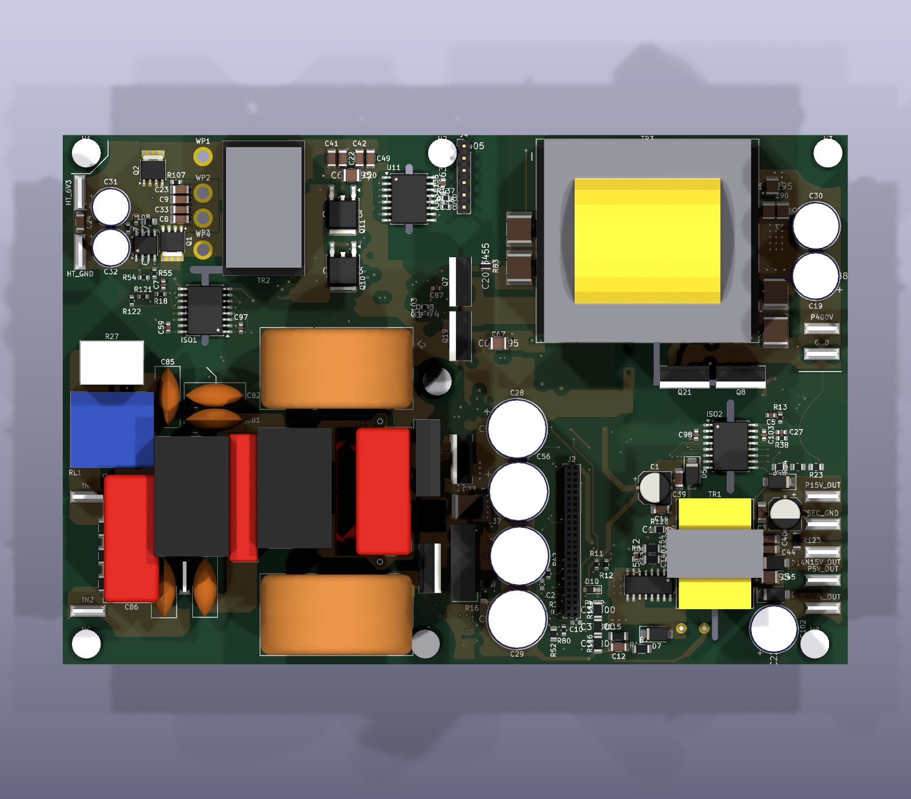<br><b>3D, top</b></td>
<td align="center">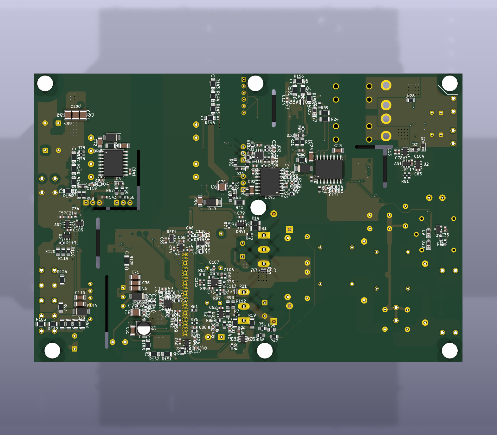<br><b>3D, bottom (seen from below)</b></td>
</tr>
<tr>
<td align="center">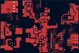<br><b>F.Cu: signal, Net-(RL1-COM), HEATER_HI_SOURCE, DHB_HI_SOURCE, GND, Q14_DRAIN and 28 more pours (top)</b></td>
<td align="center">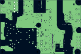<br><b>In1.Cu: IN2, ISO_GND, HT_GND, GND, RES_IN planes</b></td>
</tr>
<tr>
<td align="center">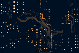<br><b>In2.Cu: signal</b></td>
<td align="center">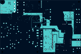<br><b>In3.Cu: signal + plane, 5V, 6V3, 5V_ISOL, 15V_ISO_SEC, 15V and 1 more pours</b></td>
</tr>
<tr>
<td align="center">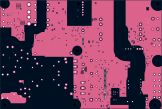<br><b>In4.Cu: IN2, ISO_GND, GND, HT_GND planes</b></td>
<td align="center">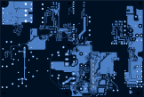<br><b>B.Cu: signal, 420V, PFC CURRENT 2+, ISO_GND, GND, 6V3 and 5 more pours (bottom, seen from the top)</b></td>
</tr>
</table>

### tube_psu

3D renders and copper layers of `kicad/tube_psu.kicad_pcb`, the layers in stack order without silkscreen. Plotted by [kicad-board-plots](https://github.com/johonkanen/kicad-board-plots) on each board change; the images live on the `renders` branch.

<table>
<tr>
<td align="center">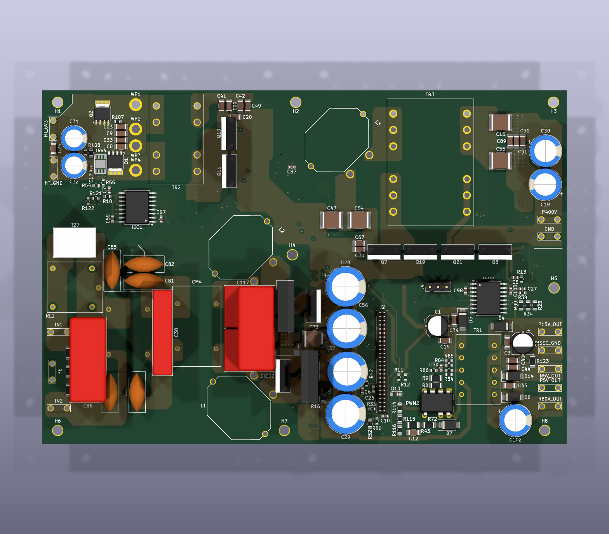<br><b>3D, top</b></td>
<td align="center">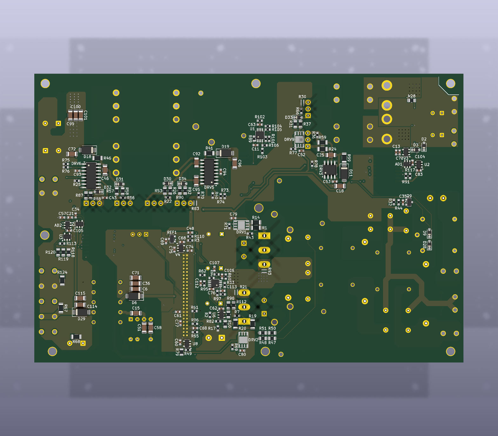<br><b>3D, bottom (seen from below)</b></td>
</tr>
<tr>
<td align="center">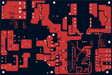<br><b>F.Cu: signal, Net-(RL1-COM), HEATER_HI_SOURCE, GND, Q14_DRAIN, AC1 and 28 more pours (top)</b></td>
<td align="center">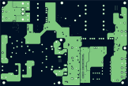<br><b>In1.Cu: signal, Q14_DRAIN, HT_GND, IN2, GND, Net-(L2-2) and 5 more pours</b></td>
</tr>
<tr>
<td align="center">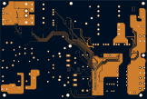<br><b>In2.Cu: signal, GND, IN2, L2_PRI2, Q14_DRAIN, DHB_HI_SOURCE_SEC and 3 more pours</b></td>
<td align="center">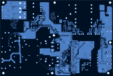<br><b>B.Cu: signal, 420V, PFC CURRENT 2+, GND, ISO_GND, 15V and 6 more pours (bottom, seen from the top)</b></td>
</tr>
</table>

<!-- board-plots:end -->

## Layout

```
source/      Proteus exports (read-only): schematic PDF + page renders + text, the .pdsprj,
             cadcam/ = Gerber X2 export with drill gerbers and IPC-D-356A netlist (used),
             cadcam_rs274x/ = earlier RS-274X export with Excellon drill (cross-check only)
reference/   tables generated from the IPC netlist: pads (CSV/JSON), pin→net per part,
             pins per net
lib/         tube_psu.kicad_sym, part_map.csv, footprint_map.csv, tube_psu.pretty/ (all generated)
kicad/       KiCad project: root sheet + 11 sub-sheets (one per PDF page), tube_psu.kicad_pcb
             (generated by tools/make_pcb.sh)
p2k_config.py  board configuration of the proteus2kicad tools
tools/       check_all.sh, erc.sh, make_part_map.py, gen_symbols.py, sheets/ (one script per
             sheet), gen_footprints.py, make_pcb.sh, measure_gaps.py; p2k/ = proteus2kicad submodule
reports/     generated reports
```

## Phases

| Phase | Content | State |
|---|---|---|
| 0 | Tooling: KiCad AppImage wrappers, IPC-D-356A parser, reference tables, X2 export check | done |
| 1 | Schematic: part map, symbols, netlist comparison, skeleton; 11 sheets redrawn | done |
| 2 | Footprints, fitted to the IPC pads | done |
| 3 | PCB: board, tracks/vias from gerbers, nets, zones, DRC | done |
| 4 | Independent verification: gerber round trip, IPC-D-356 diff | – |

## Checks

`tools/check_all.sh` runs every check and prints `ALL CHECKS PASSED` or the failing steps.

| Script | Checks |
|---|---|
| `tools/p2k/bin/p2k ipc356 --check` | IPC parser counts and fix-ups; reference tables up to date |
| `tools/p2k/bin/p2k check_sources` | Gerber X2 flashes (vias, pads, free pads, holes) and drills vs IPC; outline |
| `tools/make_part_map.py --check` | `lib/part_map.csv` up to date with the .pdsprj, PDF and IPC |
| `tools/gen_symbols.py --check` | `lib/tube_psu.kicad_sym` up to date |
| `tools/p2k/bin/p2k check_symbols` | symbol pin set = IPC pin set for every refdes |
| `tools/erc.sh` | KiCad ERC, 0 errors |
| `tools/p2k/bin/p2k compare_netlists` | schematic netlist vs IPC by pad sets (`--sheet N`, `--allow-missing` while drawing) |
| `tools/gen_footprints.py --check` | footprint map and `lib/tube_psu.pretty` up to date |
| `tools/p2k/bin/kipy -m p2k.check_footprints --pcbnew` | every footprint fits its IPC pads within 0.05 mm |
| `tools/make_pcb.sh --check` | the board rebuilt from scratch equals `kicad/tube_psu.kicad_pcb` byte for byte |
| `tools/p2k/bin/kipy -m p2k.check_board` | board pads, holes, free pads, vias vs IPC (position, size, net) |
| `tools/p2k/bin/kipy -m p2k.assign_nets --check` | copper connectivity after zone fill: 0 shorts / orphans / opens |
| `tools/p2k/bin/p2k drc` | KiCad DRC with schematic parity: 0 shorts / unconnected / parity, accepted types only |

`tools/p2k/bin/p2k ipc356` regenerates `reference/` after a change of `p2k_config.py`.

## KiCad environment

KiCad 10.0.7 AppImage at `~/kicad/kicad-10.0.7-x86_64.AppImage`. `tools/p2k/bin/kipy` (KiCad's
Python with `pcbnew`) and `tools/p2k/bin/kicad-cli` mount it on demand (`tools/p2k/bin/kicad_env.sh`).
Never run the AppImage with `--version`: it starts the GUI and hangs.
