# Trial 5.2 board from the 5.1 layout – DRC and rework estimate

Generated by `tools/next/trial_report.py` from the board that `tools/p2k/bin/kipy tools/next/reuse_51_board.py` builds (`kicad_next/trial_from_51/tube_psu_5_2_trial.kicad_pcb`, its own project with copies of the 5.2 `.kicad_pro` / `.kicad_dru`). The real 5.2 board `kicad_next/tube_psu_5_2.kicad_pcb` (empty shell) is not touched. DRC: KiCad 10.0.7, `--severity-all`, zones refilled with the 5.2 rules first. kicad-cli's creepage test on the whole board needs more than 3 GB, so the DRC runs in passes (refill; every check except creepage; creepage with only the F.Cu zones; creepage with only the B.Cu zones – the creepage rules are outer-layer only) and `drc.json` merges them: refill peak RSS 2161 MB, main peak RSS 2154 MB, creepage F.Cu peak RSS 2469 MB, creepage B.Cu peak RSS 2574 MB.

## What the script did

**Layer mapping** (6-layer JLC06161H-3313 stack of `make_board.py`; only 4 layers carry copper for now):

| 5.1 layer | trial layer | note |
|---|---|---|
| F.Cu | F.Cu (L1) | outer, 1 oz |
| In1.Cu (GND planes, 131 mm of track) | In1.GND (L2) | 0.0994 mm below F.Cu |
| – | In2.Signal_HV (L3) | **empty** |
| – | In3.Power (L4) | **empty** |
| In2.Cu (2.0 m of routing + pours) | In4.GND (L5) | 0.0994 mm above B.Cu |
| B.Cu | B.Cu (L6) | outer, 1 oz |

Why: in JLC's 4-layer stack the 5.1 In1 / In2 sit one thin prepreg under F.Cu / over B.Cu – the same place as L2 / L5 of the 6-layer stack – so each 5.1 inner layer keeps its outer-layer neighbour and reference distance, the copper stays symmetric about the centre (warp), and the two free layers L3 / L4 are the adjacent pair in the middle (0.11 mm 2116 prepreg between them) for the later signal / power-pour rework. Note: the stack's L1–L2 and L5–L6 prepregs are 0.0994 mm, so 5.1 copper of two domains overlapping across F.Cu/In1 or In4/B.Cu is not reinforced solid insulation (README D6) – KiCad does not check that.

**Footprints** (5.2 netlist by refdes): unchanged 243, library copy with identical pads (new 3D model / can height, tracks kept) 30, **changed 31**, removed 11, added 62 (placed off-board below the outline, grouped by sheet), mounting holes 8, board-only free pads WP1–WP4 4 (kept, re-netted).

- changed (new 5.2 footprint at the 5.1 position / rotation / side; L1 / L2 at 0°, `reuse_51_board.NEW_ORIENTATION`): C100, C101, C15, C20, C45, C58, C67, C70, C89, C90, C91, C99, DRV1, DRV2, DRV3, DRV4, DRV5, DRV6, ISO1, ISO2, J4, L1, L2, PWM2, Q10, Q11, R114, R115, R116, TR1, TR3
- removed: C4, C50, DRV9, L3, R25, R40, R64, R81, R84, R85, R86
- added: C118, C119, C120, C121, C122, C123, C124, C125, C126, C127, C128, C129, C130, C131, C132, C133, C134, C135, C136, C137, C138, C139, C140, D35, R125, R126, R127, R128, R129, R130, R131, R132, R133, R134, R135, R136, R137, R138, R139, R140, R141, R142, R143, R144, R145, R146, R147, R148, R149, R150, R151, R152, R153, R154, R155, R156, R157, R158, U10, U11, U12, U9

| ref | 5.1 footprint | 5.2 footprint | pos (mm) | rot | side | 5.1 courtyard | 5.2 courtyard |
|---|---|---|---|---|---|---|---|
| C100 | C_1206_3216Metric_Pad1.33x1.80mm_HandSolder | C_1210_3225Metric | 75.4, -75.425 | -90.0 | B | 2.39 × 5.05 | 3.29 × 4.69 |
| C101 | C_1206_3216Metric_Pad1.33x1.80mm_HandSolder | C_1210_3225Metric | 73.5, -75.425 | -90.0 | B | 2.39 × 5.05 | 3.29 × 4.69 |
| C15 | C_1206_3216Metric_Pad1.33x1.80mm_HandSolder | C_1210_3225Metric | 52.525, -0.1 | 0.0 | B | 5.05 × 2.39 | 4.69 × 3.29 |
| C20 | C_1206_3216Metric | C_1210_3225Metric | -12.0, -82.9 | 180.0 | F | 4.69 × 2.39 | 4.69 × 3.29 |
| C45 | C_1206_3216Metric_Pad1.33x1.80mm_HandSolder | C_1210_3225Metric | 73.389, 0.552 | 0.0 | F | 5.05 × 2.39 | 4.69 × 3.29 |
| C58 | C_1206_3216Metric_Pad1.33x1.80mm_HandSolder | CP_Elec_5x5.4 | 46.9, 5.425 | 90.0 | B | 2.39 × 5.05 | 5.89 × 7.99 |
| C67 | C_1206_3216Metric_Pad1.33x1.80mm_HandSolder | C_1210_3225Metric | 26.774, -43.7 | 0.0 | F | 5.05 × 2.39 | 4.69 × 3.29 |
| C70 | C_1206_3216Metric_Pad1.33x1.80mm_HandSolder | C_1210_3225Metric | 26.774, -41.8 | 0.0 | F | 5.05 × 2.39 | 4.69 × 3.29 |
| C89 | C_1206_3216Metric_Pad1.33x1.80mm_HandSolder | C_1210_3225Metric | 73.5, -75.425 | -90.0 | F | 2.39 × 5.05 | 3.29 × 4.69 |
| C90 | C_1206_3216Metric_Pad1.33x1.80mm_HandSolder | C_1210_3225Metric | 75.4, -75.425 | -90.0 | F | 2.39 × 5.05 | 3.29 × 4.69 |
| C91 | C_1206_3216Metric_Pad1.33x1.80mm_HandSolder | C_1210_3225Metric | 77.4, -75.425 | -90.0 | F | 2.39 × 5.05 | 3.29 × 4.69 |
| C99 | C_1206_3216Metric_Pad1.33x1.80mm_HandSolder | C_1210_3225Metric | 77.4, -75.425 | -90.0 | B | 2.39 × 5.05 | 3.29 × 4.69 |
| DRV1 | DFN-8-1EP_P0.95mm_IXDD60xD2 | SOT-23-6 | 12.465, -33.612 | -90.0 | B | 6.29 × 3.89 | 3.49 × 4.19 |
| DRV2 | DFN-8-1EP_P0.95mm_IXDD60xD2 | SOT-23-6 | 11.731, 10.076 | 180.0 | B | 3.89 × 6.29 | 4.19 × 3.49 |
| DRV3 | SOIC-8_3.9x4.9mm_P1.27mm_Proteus | SOIC-16W_7.5x10.3mm_P1.27mm | -21.077, -54.649 | 90.0 | B | 5.49 × 7.49 | 10.89 × 11.95 |
| DRV4 | DFN-8-1EP_P0.95mm_IXDD60xD2 | SOIC-8_3.9x4.9mm_P1.27mm | -53.775, -68.35 | 0.0 | F | 3.89 × 6.29 | 7.49 × 5.49 |
| DRV5 | SOIC-16_3.9x9.9mm_P1.27mm_Proteus | SOIC-16W_7.5x10.3mm_P1.27mm | 24.7, -53.895 | 0.0 | B | 7.49 × 10.49 | 11.95 × 10.89 |
| DRV6 | SOIC-16_3.9x9.9mm_P1.27mm_Proteus_KiCadPads | SOIC-16W_7.5x10.3mm_P1.27mm | 69.507, -52.407 | 180.0 | B | 7.49 × 10.49 | 11.95 × 10.89 |
| ISO1 | SOIC-16W_7.5x10.3mm_P1.27mm_Proteus | SOIC-16W_7.5x10.3mm_P1.27mm_Slot8.0 | -42.359, -54.845 | 180.0 | F | 11.95 × 10.89 | 11.95 × 15.09 |
| ISO2 | SOIC-16W_7.5x10.3mm_P1.27mm_Proteus | SOIC-16W_7.5x10.3mm_P1.27mm_Slot11.1 | 66.757, -26.6 | 0.0 | F | 11.95 × 10.89 | 11.95 × 20.09 |
| J4 | PinHeader_1x03_P2.54mm_Vertical | PinHeader_1x06_P2.54mm_Vertical | 48.66, -30.1 | 90.0 | F | 8.71 × 3.63 | 16.33 × 3.63 |
| L1 | L_RM8_Proteus | L_Toroid_D31.5mm_W16.7mm_Vertical_RM8_45deg | -7.026, 3.772 | 45.0 | F | 22.391 × 21.873 | 33.59 × 21.966 |
| L2 | L_RM8_Proteus | L_Toroid_D31.5mm_W16.7mm_Vertical_RM8_315deg | -6.458, -38.724 | -45.0 | F | 21.873 × 22.391 | 33.59 × 21.967 |
| PWM2 | DIP-8-N6_W7.62mm | PG-DSO-12_3.9x9.9mm_P1.27mm | 54.5, 2.2 | -90.0 | F | 10.79 × 9.89 | 10.49 × 7.49 |
| Q10 | TO-220-3_Vertical | TO-252-2 | -12.872, -75.321 | 90.0 | F | 4.99 × 10.59 | 7.09 × 11.19 |
| Q11 | TO-220-3_Vertical | TO-252-2 | -12.771, -63.583 | 90.0 | F | 4.99 × 10.59 | 7.09 × 11.19 |
| R114 | R_0805_2012Metric_Pad1.20x1.40mm_HandSolder | R_1206_3216Metric | 39.2, 7.4 | 90.0 | F | 1.99 × 3.79 | 2.35 × 4.65 |
| R115 | R_0805_2012Metric_Pad1.20x1.40mm_HandSolder | R_1206_3216Metric | 39.2, 10.9 | 90.0 | F | 1.99 × 3.79 | 2.35 × 4.65 |
| R116 | R_0805_2012Metric_Pad1.20x1.40mm_HandSolder | R_1206_3216Metric | 39.2, 14.4 | 90.0 | F | 1.99 × 3.79 | 2.35 × 4.65 |
| TR1 | Transformer_EF20_2x5_P3.81mm | Transformer_EEL19_V_4+6_FlyLeads | 63.516, -4.278 | 0.0 | F | 14.56 × 22.434 | 16.89 × 30.09 |
| TR3 | Transformer_ETD34_4x3pads | Transformer_EC42x15_2Slot_2x8_P5mm | 48.63, -68.76 | 0.0 | F | 27.59 × 40.09 | 47.09 × 43.09 |

**Nets**: 26 5.1 copper nets renamed through the pads of kept footprints (-5V_SEC → -15V_SEC, /01 AUX supply/AUX_FB → Net-(TR1-A5), /04 MCU connector/ADA0 → GND, /04 MCU connector/ADA1 → GND, /04 MCU connector/ADA2 → GND, /04 MCU connector/ADA4 → PFC_I1_MEAS, /04 MCU connector/ADB0 → /04 MCU connector/5V_MEAS, /04 MCU connector/AUX_MEAS → Net-(U10A-+), /04 MCU connector/CUK_CAP_MEAS_RAW → DHB_I_MEAS, /04 MCU connector/F16 → DAB_DIS, /04 MCU connector/HEATER_CAP_AD_MEAS → GND, Net-(D29-PadA) → Net-(TR1-S5), Net-(D4-PadA) → Net-(TR1-S15), Net-(D5-PadA) → Net-(TR1-A15), Net-(D7-PadA) → /01 AUX supply/FLY_C, Net-(DRV1-OUTA) → Net-(DRV1-OUTL), Net-(DRV2-OUTA) → Net-(DRV2-OUTL), Net-(DRV3-OUT+) → /06 Heaters/HEATER_HI_DRV, Net-(DRV3-OUT-) → /06 Heaters/HEATER_HI_DRV, Net-(DRV3-VDD2) → Net-(DRV3-VDDA), Net-(DRV9-OUTA) → /06 Heaters/HEATER_LOW_DRV, Net-(L1-1) → /05 PFC/PFC_DRAIN_2, Net-(L2-2) → /05 PFC/PFC_DRAIN_1, Net-(PWM2-E) → Net-(PWM2-CS), Net-(R2-Pad2) → Net-(C131-Pad2), Net-(R49-Pad1) → Net-(C127-Pad1)); nets with no 5.2 counterpart (copper deleted): /07 DHB/TRANS_PRI, Net-(C50-Pad2), Net-(DRV5-NC6), Net-(DRV6-NC6), Net-(PWM2-Vsense), unconnected-(DRV5-NC12-Pad12), unconnected-(DRV5-NC13-Pad13), unconnected-(DRV5-NC7-Pad7), unconnected-(DRV6-NC12-Pad12), unconnected-(DRV6-NC13-Pad13), unconnected-(DRV6-NC7-Pad7), unconnected-(ISO2-VO_C-Pad13), unconnected-(L1-NC-Pad1), unconnected-(L1-NC-Pad2), unconnected-(L2-NC-Pad1), unconnected-(L2-NC-Pad2), unconnected-(L3-NC-Pad1), unconnected-(L3-NC-Pad2). Split nets (pads of one 5.1 net now on several 5.2 nets; tracks follow the majority, the minority pads lose their touching segments): /04 MCU connector/AUX_MEAS: {'GND': 1, 'Net-(U10A-+)': 3}; Net-(DRV1-OUTA): {'Net-(DRV1-OUTH)': 1, 'Net-(DRV1-OUTL)': 1}; Net-(DRV2-OUTA): {'Net-(DRV2-OUTH)': 1, 'Net-(DRV2-OUTL)': 1}; Net-(DRV3-VDD2): {'Net-(D11-K)': 1, 'Net-(DRV3-VDDA)': 1}. Pads of kept footprints whose net differs from the mapped 5.1 net: 11.

**Copper deleted**: 606 items (segment: net changed 19, segment: net gone 32, segment: removed/changed fp 453, segment: under changed fp 66, via: removed/changed fp 24, via: under changed fp 12); by part: (net gone: /07 DHB/TRANS_PRI) 16, (net gone: Net-(C50-Pad2)) 7, (net gone: Net-(DRV5-NC6)) 5, (net gone: Net-(DRV6-NC6)) 1, (net gone: Net-(PWM2-Vsense)) 3, C100 8, C101 8, C15 3, C4 5, C45 11, C50 1, C58 4, C67 8, C70 8, C89 8, C90 8, C91 8, C99 8, D10 2, DRV1 30, DRV2 29, DRV3 31, DRV4 27, DRV5 36, DRV6 43. Zones deleted (net gone): /07 DHB/TRANS_PRI; re-netted: Net-(L2-2) → /05 PFC/PFC_DRAIN_1, Net-(D4-PadA) → Net-(TR1-S15), Net-(L1-1) → /05 PFC/PFC_DRAIN_2, -5V_SEC → -15V_SEC, Net-(D5-PadA) → Net-(TR1-A15), Net-(L2-2) → /05 PFC/PFC_DRAIN_1, Net-(L1-1) → /05 PFC/PFC_DRAIN_2.

## DRC result by type

| violation type | trial 5.2 | severity | 5.1 board (own rules) |
|---|---|---|---|
| clearance | 350 | error 350 | 0 |
| silk_overlap | 199 | warning 199 | 50 |
| silk_over_copper | 194 | warning 194 | 51 |
| courtyards_overlap | 171 | error 171 | 146 |
| creepage | 163 | error 163 | 0 |
| hole_clearance | 138 | error 138 | 0 |
| lib_footprint_issues | 96 | warning 96 | 96 |
| track_dangling | 73 | warning 73 | 0 |
| shorting_items | 30 | error 30 | 0 |
| solder_mask_bridge | 30 | error 30 | 0 |
| via_dangling | 24 | warning 24 | 0 |
| pth_inside_courtyard | 14 | error 14 | 4 |
| nonmirrored_text_on_back_layer | 10 | warning 10 | 0 |
| silk_edge_clearance | 6 | warning 6 | 0 |
| items_not_allowed | 2 | error 2 | 0 |
| copper_edge_clearance | 1 | error 1 | 0 |
| isolated_copper | 1 | warning 1 | 0 |
| text_thickness | 1 | warning 1 | 0 |
| text_height | 1 | warning 1 | 0 |
| **unconnected items** | 286 |  | 0 |

The 5.1 column is the same DRC on `kicad/tube_psu.kicad_pcb` with its own project rules (`drc_51.json`): the Proteus migration already had courtyard / silk overlaps, so only the difference is caused by 5.2.

## Isolation (domain-to-domain custom rules)

**418 clearance / creepage violations between two isolation domains on the board** (of 651 clearance / hole-clearance / creepage violations; 222 are inside one domain – HV functional 1.2 mm on the outer layers, net-class clearances – and 11 are between the added parts in the off-board grid, ignored here).

| domain pair | count | by type / layer (first item) |
|---|---|---|
| PRI-UART | 259 | hole_clearance F.Cu 104, creepage F.Cu 61, clearance F.Cu 58, clearance In4.GND 25, creepage B.Cu 10, clearance B.Cu 1 |
| PRI-SEC | 100 | clearance THT pad/hole 30, creepage F.Cu 30, clearance In4.GND 11, hole_clearance F.Cu 8, creepage THT pad/hole 7, creepage B.Cu 6, clearance In1.GND 4, clearance F.Cu 4 |
| HEATER-PRI | 37 | creepage F.Cu 12, hole_clearance F.Cu 8, clearance In4.GND 7, creepage B.Cu 5, clearance F.Cu 4, clearance In1.GND 1 |
| PE-PRI | 22 | creepage F.Cu 6, creepage B.Cu 6, clearance F.Cu 4, clearance THT pad/hole 4, clearance B.Cu 1, creepage THT pad/hole 1 |

All clearance / hole-clearance / creepage violations on the board by rule (sheets of the parts involved):

| rule | type | count | top sheets |
|---|---|---|---|
| HV functional, outer layers | clearance | 123 | 07 DHB 53, 04 MCU connector 21, 06 Heaters 14 |
| PRI-HEATER/UART inner layers | hole_clearance | 112 | 04 MCU connector 104, 03 Isolated measurements 84, board-only items 4 |
| PRI-HEATER/UART reinforced creepage | creepage | 88 | 04 MCU connector 71, 03 Isolated measurements 57, 06 Heaters 14 |
| PRI-HEATER/UART inner layers | clearance | 69 | 04 MCU connector 57, 03 Isolated measurements 42, 06 Heaters 10 |
| PRI-SEC inner layers | clearance | 49 | 07 DHB 28, 01 AUX supply 15, 03 Isolated measurements 7 |
| PRI-SEC reinforced creepage | creepage | 43 | 01 AUX supply 22, 07 DHB 19, 03 Isolated measurements 15 |
| net class clearance (PRIMARY_LV) | clearance | 35 | 06 Heaters 11, 08 Current measurement 7, 04 MCU connector 4 |
| PRI-HEATER/UART reinforced clearance | clearance | 27 | 04 MCU connector 27, 03 Isolated measurements 23 |
| PE-PRI basic | creepage | 13 | 05 PFC 13, 08 Current measurement 1 |
| net class clearance (HV_PRIMARY) | clearance | 12 | 06 Heaters 3, 07 DHB 3, 02 DHB gate drive 3 |
| Mounting hole - primary | hole_clearance | 12 | board-only items 12, 09 AC measurement 5 |
| Mounting hole - primary | creepage | 12 | board-only items 12, 09 AC measurement 6, 05 PFC 2 |
| PE-PRI basic, inner layers | clearance | 8 | 05 PFC 8 |
| PRI-SEC inner layers | hole_clearance | 8 | 04 MCU connector 8, 07 DHB 8 |
| Mounting hole - secondary | creepage | 7 | board-only items 7, 03 Isolated measurements 3, 01 AUX supply 1 |
| Mounting hole - secondary | hole_clearance | 5 | board-only items 5, 03 Isolated measurements 5 |
| Mounting hole - primary | clearance | 5 | board-only items 5, 09 AC measurement 1 |
| net class clearance (SECONDARY_LV) | clearance | 4 | 02 DHB gate drive 2, 07 DHB 1, 03 Isolated measurements 1 |
| net class clearance (HEATER) | clearance | 2 | 03 Isolated measurements 2, 06 Heaters 1 |
| net class clearance (SIGNAL) | clearance | 1 | 02 DHB gate drive 1 |
| PE-PRI basic | clearance | 1 | 05 PFC 1 |
| Hole clearance violation | hole_clearance | 1 | 03 Isolated measurements 1 |
| net class clearance (HV_SECONDARY) | clearance | 1 | 02 DHB gate drive 1 |

**Hot spots** (violations chained within 3 mm; refs = parts owning or nearest to the items):

| n | centre x, y (mm) | extent (mm) | item kinds | domain pairs | layers | parts | sheets |
|---|---|---|---|---|---|---|---|
| 218 | 59, -29 | 10 × 5 | PTH 218, Via 148, Pad 38, Track 22, Zone 10 | PRI-UART 218 | F.Cu 197, In4.GND 17, B.Cu 4 | J4, C98, ISO2, D5, C1, C39 | 04 MCU connector, 03 Isolated measurements |
| 38 | 46, -28 | 4 × 5 | PTH 38, Via 22, Track 15, Pad 1 | PRI-UART 38 | F.Cu 23, In4.GND 8, B.Cu 7 | J4, C69, C75, C1, REF1 | 04 MCU connector, 01 AUX supply |
| 38 | 51, -42 | 6 × 3 | PTH 38, Track 5, Pad 3 | PRI-SEC 38 | THT pad/hole 30, In4.GND 4, B.Cu 3, F.Cu 1 | Q19, Q21, R58, R57, R22 | 07 DHB |
| 28 | -37, -63 | 4 × 6 | PTH 18, Via 18, Track 9, Pad 7, Zone 4 | HEATER-PRI 28 | F.Cu 20, In4.GND 7, In1.GND 1 | ISO1, TR2, WP4 | 03 Isolated measurements, 06 Heaters |
| 17 | 65, -21 | 3 × 5 | Pad 11, Zone 8, Via 3, PTH 1 | PRI-SEC 17 | F.Cu 16, B.Cu 1 | ISO2, D4, D5, TR1 | 01 AUX supply, 03 Isolated measurements |
| 14 | 67, 11 | 2 × 1 | PTH 13, Track 9 | PRI-SEC 14 | THT pad/hole 5, In4.GND 4, In1.GND 4, F.Cu 1 | TR1, C102 | 01 AUX supply |
| 14 | 60, -37 | 7 × 1 | PTH 14, Via 12, Pad 2 | PRI-SEC 14 | F.Cu 14 | Q21, J4, ISO2, Q8 | 07 DHB, 04 MCU connector |
| 6 | -44, -39 | 1 × 0 | PTH 5, Via 5, Pad 1, Track 1 | PE-PRI 6 | F.Cu 5, B.Cu 1 | R32, C82 | 05 PFC |
| 6 | -52, -31 | 0 × 0 | PTH 6, Track 1 | PE-PRI 6 | THT pad/hole 5, B.Cu 1 | RL1, C85 | 05 PFC |
| 3 | 67, -29 | 3 × 1 | Track 2, Via 1, Zone 1 | PRI-SEC 3 | In4.GND 2, B.Cu 1 | ISO2, C98 | 03 Isolated measurements |
| 3 | 25, -58 | 3 × 0 | PTH 3, Zone 3 | PRI-UART 3 | F.Cu 3 | J4, H2 | 04 MCU connector,  |
| 3 | -51, -49 | 1 × 1 | Zone 3, Pad 2, Via 1 | HEATER-PRI 3 | F.Cu 3 | Q9, C59, R91 | 05 PFC, 03 Isolated measurements |
| 2 | -41, -5 | 0 × 0 | PTH 2, Track 2 | PE-PRI 2 | B.Cu 2 | C65, CM1 | 05 PFC |
| 2 | 64, -7 | 0 × 0 | PTH 2 | PRI-SEC 2 | THT pad/hole 2 | TR1 | 01 AUX supply |
| 2 | 74, 0 | 2 × 0 | Zone 2, Track 1, Pad 1 | PRI-SEC 2 | F.Cu 2 | SEC_GND, TR1, D7 | 01 AUX supply |
| 2 | 75, -21 | 1 × 1 | Zone 2, Pad 1 | PRI-SEC 2 | F.Cu 2 | P15V_OUT, D5, ISO2 | 01 AUX supply, 03 Isolated measurements |
| 2 | -44, -47 | 2 × 0 | Track 2 | HEATER-PRI 2 | B.Cu 2 | ISO1, R117 | 03 Isolated measurements, 06 Heaters |
| 2 | -31, -68 | 2 × 0 | Zone 2, Pad 1 | HEATER-PRI 2 | B.Cu 2 | R99, TR2 | 06 Heaters |
| 1 | 66, -33 | 0 × 0 | Track 1 | PRI-SEC 1 | In4.GND 1 | V2, C98 | 03 Isolated measurements |
| 1 | 60, -22 | 0 × 0 | Track 1, Via 1 | PRI-SEC 1 | F.Cu 1 | ISO2, C1 | 03 Isolated measurements, 01 AUX supply |
| 1 | 29, -64 | 0 × 0 | PTH 1, Zone 1 | PRI-SEC 1 | F.Cu 1 | Q21, H2 | 07 DHB,  |
| 1 | 74, -16 | 0 × 0 | Zone 1 | PRI-SEC 1 | F.Cu 1 | D5, SEC_GND | 01 AUX supply |
| 1 | -26, -77 | 0 × 0 | Zone 1 | HEATER-PRI 1 | F.Cu 1 | Q10, TR2 | 06 Heaters |
| 1 | -36, -33 | 0 × 0 | PTH 1, Zone 1 | PE-PRI 1 | F.Cu 1 | C81, CM4 | 05 PFC |
| 1 | -41, -25 | 0 × 0 | PTH 1, Track 1 | PE-PRI 1 | B.Cu 1 | CM1 | 05 PFC |

By sheet of the parts involved (a violation counts once per sheet of each of its two items): 04 MCU connector 307, 03 Isolated measurements 231, 07 DHB 93, 01 AUX supply 77, 05 PFC 45, 06 Heaters 31,  11, 02 DHB gate drive 1, 08 Current measurement 1.

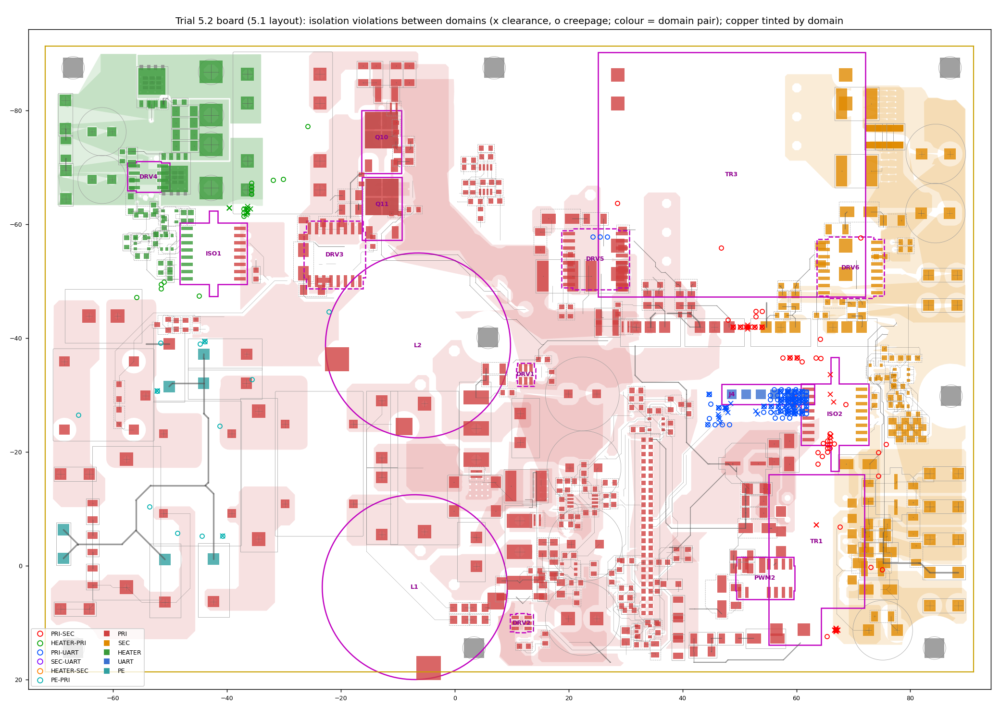

## Unrouted connections

286 unconnected items (ratsnest lines). By sheet (of the first item's part):

| sheet | unrouted |
|---|---|
| 04 MCU connector | 69 |
| 01 AUX supply | 55 |
| 06 Heaters | 50 |
| 02 DHB gate drive | 33 |
| 03 Isolated measurements | 32 |
| 07 DHB | 22 |
| 09 AC measurement | 15 |
| 08 Current measurement | 7 |
| 10 PFC current measurement | 2 |
| ? | 1 |

Nets with most unrouted connections: GND 50, +3V3 12, 15V 12, 5V 10, DC+ 8, ISO_UART_GND 6, ISO_GND 6, +1V65_BIAS 5, 6V3 4, /07 DHB/DHB_CAP 4, /01 AUX supply/FLY_C 4, /07 DHB/TRANS_SEC 4, DHB_HI_SOURCE_SEC 4, DAB_DIS 4, HEATER_CURRENT 4.

## Footprint collisions of the changed parts (courtyard overlaps)

Courtyard overlaps: 171 pairs on the trial board, 146 on the 5.1 board, **32 new**.

Courtyard intersections computed from the footprint courtyards (mm² of overlap, same side = a real body collision); 'new in DRC' = KiCad courtyards_overlap pairs not present on the 5.1 board; 'pad shorts' = copper of the new footprint touching another part's pad (KiCad shorting_items); 'other side' = parts on the opposite side under the courtyard (only a problem where THT leads / solder joints land on them).

| ref | 5.2 footprint (side) | same-side overlap (mm²) | new in DRC | pad shorts | other side under it |
|---|---|---|---|---|---|
| TR1 | Transformer_EEL19_V_4+6_FlyLeads (F) | PWM2 33.2, D7 8.5, D14 3.8, D8 3.7, C45 2.6, C3 2.2, C14 1.4, C40 0.1, C44 0.1 | C102, C14, C3, C40, C44, C45, D7, PWM2 | D6 | D29, D6, C114, C115 |
| TR3 | Transformer_EC42x15_2Slot_2x8_P5mm (F) | C16 32.1, C55 32.1, C54 31.5, C89 1.0 | C16, C54, C55, C89 | C16, C54, C92, C95, DRV5 | DRV6, DRV5, D18, C46, C92, C95, R46, D30, D31, D34, R41, R90, R92, R26, R53, R57, R58, C101 |
| L1 | L_Toroid_D31.5mm_W16.7mm_Vertical_RM8_45deg (F) | SICD2 4.8, C117 1.3, H7 0.4 | H7 | – | R47, R50 |
| L2 | L_Toroid_D31.5mm_W16.7mm_Vertical_RM8_315deg (F) | C117 1.5 | – | – | DRV3, C18, D11, C53 |
| DRV1 | SOT-23-6 (B) | – | – | – | – |
| DRV2 | SOT-23-6 (B) | – | – | – | – |
| DRV3 | SOIC-16W_7.5x10.3mm_P1.27mm (B) | D11 11.0, C25 7.0, C53 4.3, C18 3.3, R99 2.8 | C18, C25, C53, D11, R99 | C18, C25, C53, D11, R99 | L2, Q11 |
| DRV4 | SOIC-8_3.9x4.9mm_P1.27mm (F) | Q1 9.3, C17 3.7, R63 1.6 | C17, R63 | C17, Q1, R63 | – |
| DRV5 | SOIC-16W_7.5x10.3mm_P1.27mm (B) | C92 9.0, C95 8.8, C94 4.3 | C95, D19 | C94, TR3 | TR3, C54, C47 |
| DRV6 | SOIC-16W_7.5x10.3mm_P1.27mm (B) | C46 9.1, C93 3.1, D32 0.8 | C46, C93 | C46, C93 | TR3 |
| ISO1 | SOIC-16W_7.5x10.3mm_P1.27mm_Slot8.0 (F) | – | – | – | C13, C78, V3 |
| ISO2 | SOIC-16W_7.5x10.3mm_P1.27mm_Slot11.1 (F) | J4 8.1, D4 0.6 | D4, J4 | J4 | – |
| Q10 | TO-252-2 (F) | – | – | – | R37, R66, D33, R30, R36 |
| Q11 | TO-252-2 (F) | – | – | – | C52, R78, DRV3, R36, R59, R24 |
| PWM2 | PG-DSO-12_3.9x9.9mm_P1.27mm (F) | TR1 33.2, R8 7.6, R9 2.6 | R9, TR1 | R8, R9 | C15, C51, C58 |
| J4 | PinHeader_1x06_P2.54mm_Vertical (F) | ISO2 8.1, C98 3.1 | C98, ISO2 | C98, ISO2 | – |

### Does the new part fit near its 5.1 place?

The 5.2 courtyard is slid over a ±25 mm window (1 mm steps, 0° / 90° about the 5.1 origin) and the same-side courtyard overlap with every part that stays is summed (mounting holes count on both sides; the parts of the power stage that move with the part are excluded, listed per row). The 5.1 footprint of a removed part (L3) no longer blocks anything.

| ref | moves with it (excluded) | overlap at 5.1 place (mm²) | best overlap (mm²) | best shift dx, dy (mm) | rot | still blocked by (mm²) |
|---|---|---|---|---|---|---|
| TR3 | C16, C54, C55, C47, C89, C90, C91, C99, C100, C101 | 0 | 0 | +0, +0 | 0 | free |
| TR1 | PWM2, D7, C45, C3, C14, D14, D8, D6, D29, C102, C40, C44 | 0 | 0 | +0, +0 | 0 | free |
| L1 | – | 6.5 | 1.2 | -7, +0 | 0 | C66 1 |
| L2 | – | 1.5 | 0 | +0, -1 | 0 | free |
| ISO2 | J4, C98 | 0.6 | 0 | -4, -3 | 90 | free |
| J4 | ISO2, C98 | 0 | 0 | +0, +0 | 0 | free |

**TR3 EC42 vs ETD34 + L3:** 5.1 courtyards ETD34 1099 mm² + L3 391 mm² (union bounding box 53.0 × 40.0 mm at x 9.5…62.5, y -88.9…-48.9); EC42 courtyard 2020 mm² (47.0 × 43.0 mm). At the 5.1 origin 825 mm² of the EC42 courtyard lie outside the freed ETD34 + L3 area.

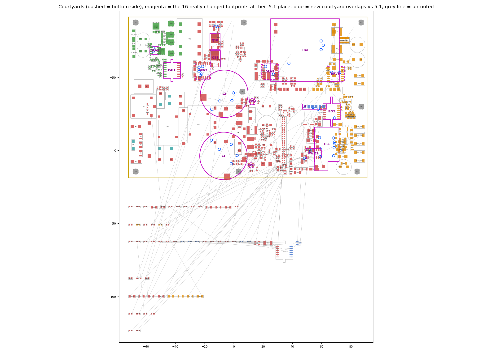

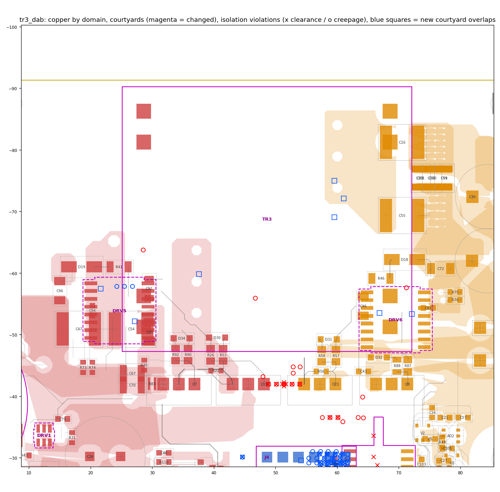

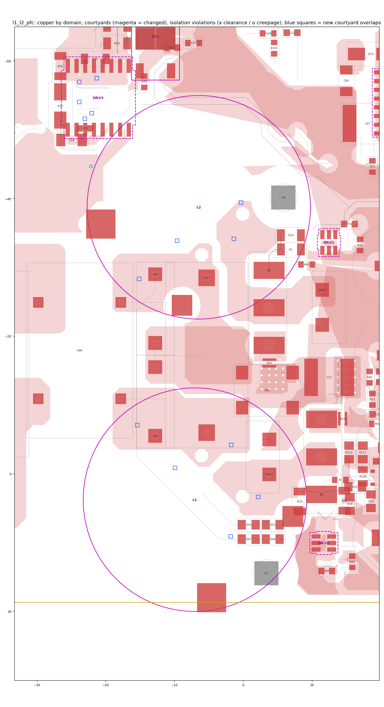

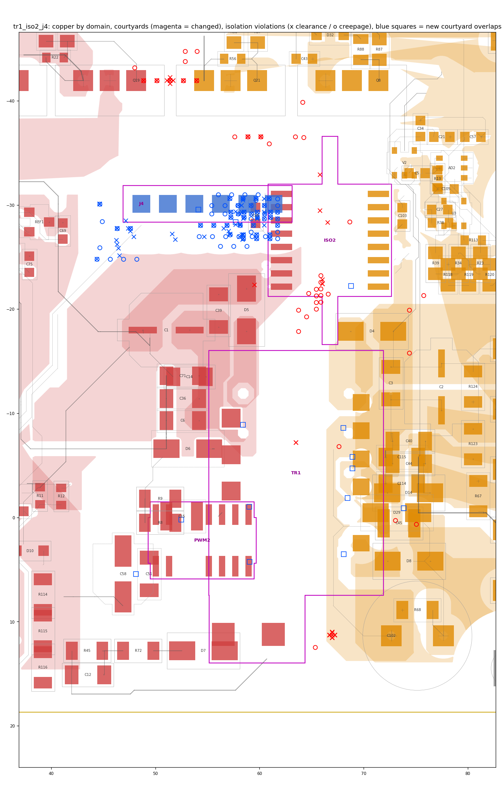

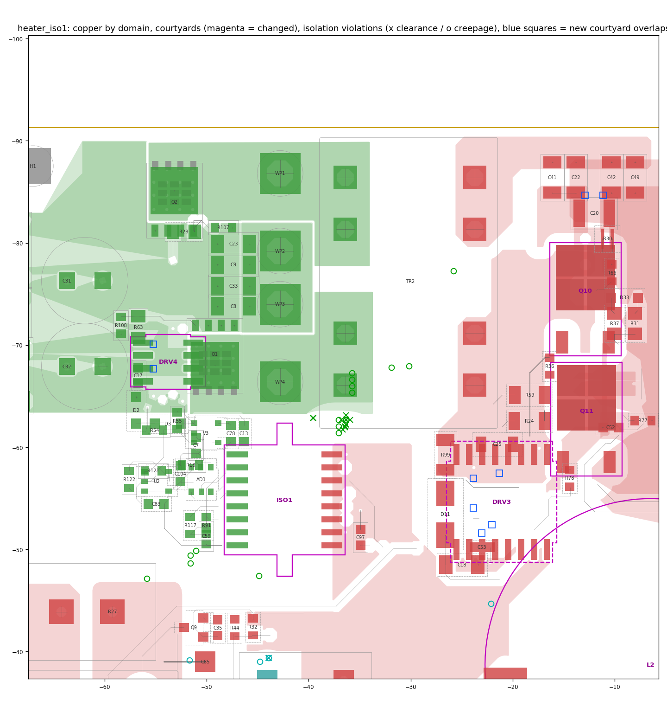

## Zone fill: how far the pours are pulled back by the 5.2 rules

Filled copper of the kept 5.1 zones: 21306 mm² in 5.1, 19543 mm² refilled with the 5.2 rules (-8 %). The zone filler applies the domain clearances (4.0 / 11.1 / 8.0 mm…) itself, so pours cause few DRC markers – the cost shows up as lost copper instead. Largest losses:

| zone net | layer | 5.1 mm² | 5.2 mm² | change |
|---|---|---|---|---|
| GND | In1.GND | 541.9 | 304.1 | -44 % |
| GND | In4.GND | 444.3 | 293.9 | -34 % |
| DC+ | F.Cu | 1458.4 | 1310.8 | -10 % |
| GND | B.Cu | 465.1 | 329.9 | -29 % |
| ISO_GND | In1.GND | 1481.9 | 1364.8 | -8 % |
| ISO_GND | In4.GND | 1276.4 | 1164.8 | -9 % |
| ISO_GND | B.Cu | 933.3 | 851.0 | -9 % |
| GND | In4.GND | 352.5 | 278.6 | -21 % |
| ISO_GND | B.Cu | 301.1 | 240.5 | -20 % |
| GND | B.Cu | 312.6 | 258.5 | -17 % |
| GND | In1.GND | 2119.1 | 2075.8 | -2 % |
| DHB_HI_SOURCE_SEC | In4.GND | 240.5 | 201.3 | -16 % |
| /06 Heaters/HEATER_HI_SOURCE | F.Cu | 242.7 | 204.6 | -16 % |
| 420V | F.Cu | 499.8 | 464.7 | -7 % |
| /06 Heaters/Q14_DRAIN | In1.GND | 152.3 | 121.5 | -20 % |

## Copper of two domains overlapping on different layers (solid insulation)

README D6: the 0.0994 / 0.1088 mm prepregs are not reinforced solid insulation, so copper of two domains must not overlap on any pair of layers. KiCad does not check this; overlap of the refilled zone copper (polygons decimated to ≤ 400 points, tracks not counted):

| layers | domain pair | overlap mm² |
|---|---|---|

## Rework estimate

Written after reviewing the numbers of the first trial (commit d3f1063, L1 / L2 still the flat-lying toroid
footprint at the RM8 place); the tables above are regenerated, this text is not. Since 2026-11-19 L1 / L2 are the
upright toroids on the RM8 holes (item 6 is superseded) and TR3 / the split caps / DRV5 / DRV6 have a first
placement (item 1): see **After placement step 1** at the end.

**Overall.** 273 of the 315 5.1 parts stay where they are with their tracks (243 unchanged footprints + 30 library
copies with identical pads); 31 footprints changed (the 16 listed parts plus 15 passives that only grew a size:
1206 → 1210 630 V caps, 0805 → 1206 start-up resistors, C58 → SMD electrolytic – all fit in place, no new
collisions); 11 parts removed, 58 added (off-board grid). 644 of the 3672 5.1 copper items (17.5 %) were deleted
because they ended on a changed / removed part or a re-netted pad; the 5.1 pours refill to −9 % copper. The 5.1
layout already has one primary / secondary barrier line (red / orange in `isolation.png`) and per-domain GND
planes on In1 / In4 that are stacked domain-on-domain (no zone copper of two domains overlaps across layers), so
most of the board survives; the rework is concentrated in five spots along the barriers.

**Can stay as built (only local nudges):**
- PFC power stage and mains input (sheet 05) apart from L1 / L2: 22 PE-PRI basic markers (3.2 mm creepage at the
  Y caps / RL1 / CM1 / C85 pads) – pad-spacing fixes or a short slot.
- Measurement and MCU-connector centre (sheets 08 / 09 / 10, J2 and its filters): a few net-class / HV-functional
  clearances, mounting-hole spacings at H2 / H5 / H6 (3.2 / 4.2 mm creepage from the earthed screws).
- Heater power stage (Q13 / Q14, TR2 primary) and the secondary DAB rectifier / output side (C19 / C30 / C28 / C29 /
  C37 / C56, outputs on the right edge): no isolation markers apart from the barrier spots below.
- Q10 / Q11 (TO-220 → DPAK at the same place): no collision, only their 30 segments to reconnect.
- DRV1 / DRV2 (DFN → SOT-23-6): fit in place, ~30 segments each to re-route.
- 126 'HV functional 1.2 mm' (07 DHB 53) and ~55 net-class clearances inside one domain: track nudges, mostly in
  the gate-drive areas.

**Needs re-placement and re-routing:**
1. **DAB transformer TR3 (EC42) – top right.** The EC42 courtyard (47 × 43 mm, 2020 mm²) is 3 mm taller than the
   whole ETD34 + L3 space (53 × 40 mm); at the 5.1 origin 825 mm² lie outside it. On the top side it fits at the
   5.1 origin only if the split caps C16 / C55 (secondary) and C54 (primary) move – which the plan wants anyway
   (C47 / C54 at the primary pins, C16 / C55 at the secondary pins). Its 16 THT pins land in the bottom-side gate
   drive cluster: DRV5 / DRV6 (now SOIC-16W), their bootstrap / decoupling parts and D18 / D30 / D31 / D34 / R26 /
   R41 / R46 / R53 / R57 / R58 / R90 / R92 sit under the courtyard (pad shorts with DRV5 / C92 / C95, mask
   bridges). → Re-place TR3 + split caps and move DRV5 / DRV6 with ~20 parts out from under it (they go next to
   their MOSFETs anyway), keep the 12 mm keep-out under the divider free, re-route both half-bridge loops
   (DHB_CAP, DHB_HI_SOURCE / TRANS_SEC, DHB_HI_SOURCE_SEC; ~90 segments deleted around TR3 / DRV5 / DRV6).
2. **TO-247 row on the heatsink (Q7 / Q19 primary next to Q21 / Q8 secondary, y ≈ −42).** 38 PRI-SEC markers at
   Q19 / Q21: the Q19 gate pin and the Q21 source pin are 6.5 mm apart (4.6 mm pad edge to pad edge) – enough for
   the 4.0 mm clearance, not for 11.1 mm creepage, and secondary tracks on In4 run 5–10 mm from the Q19 barrels
   (inner rule 11.1 mm). → A milled slot between Q19 and Q21 (long enough to give 11.1 mm around it) or ≥ 6.5 mm
   more spacing in the row, and no secondary copper on In1 / In4 within 11.1 mm of the primary barrels. The
   heatsink is primary / earthed, so the secondary devices need reinforced insulation to the plate. The
   remaining markers there are HV-functional 1.2 mm nudges of the gate tracks (R22 / R53 / R57 / R58).
3. **J4 / UART island – right centre.** J4 is now the isolated FTDI header (UART island behind U11, which is still
   off-board) but sits inside primary copper: 258 PRI-UART markers (8 mm creepage, 8 mm inner clearance and hole
   clearance to ~150 primary vias). It also overlaps the larger ISO2. → Move J4 + U11 to a board edge, U11's 8 mm
   slot on the island boundary, island copper (ISO_UART_GND / UART nets) separate, primary vias and pours pulled
   back 8 mm (all layers).
4. **ISO2 (Slot 11.1) / TR1 outputs – right centre.** 18 PRI-SEC markers at (65, −21): the primary 15 V rectifier
   D5 and the secondary 15V_ISO_SEC rectifier D4 sit side by side, the ISO2 slot cuts into D4's pad
   (copper-edge clearance) and J4. → Put ISO2 across the barrier line and split the TR1 output rectifiers to their
   domain sides.
5. **Flyback TR1 (EEL19) + PWM2 – bottom right.** EEL19 courtyard 16.9 × 30.1 vs EF20 14.6 × 22.4: collides with
   PWM2 (33 mm²; PWM2 is a new DSO-12) and 8 small parts (D7, D8, D14, C3, C14, C40, C44, C45); 55 segments deleted
   around TR1. The fit search finds TR1 free at its 5.1 origin once these ~12 loop parts move. 14 PRI-SEC markers
   at C102 (secondary −100 V bias cap) next to the primary fly-lead pins at y ≈ 11. → Re-place PWM2, clamp and
   rectifier parts around the EEL19, move C102 (or the fly-lead side) to keep 11.1 mm.
6. **(superseded 2026-11-19: upright toroids on the RM8 holes, see step 1)** **PFC chokes L1 / L2 (toroids Ø 32.6 mm courtyard vs RM8 22 × 22).** L1 crosses the board edge at its 5.1
   place and within ±25 mm never gets below 225 mm² overlap (CM4, C117, C66); L2 overlaps 191 mm² in place (C117,
   C64, Q5, CM4); H4 / H7 mounting holes fall inside the courtyards; the toroid lead pads short R19 / R51 on the
   bottom. → Re-place the PFC input block (L1, L2, C117, CM4, C64 / C66, Q5 / Q6 surroundings) or mount the
   toroids vertically / use the `_TieSlots` variant elsewhere; this is the largest mechanical change on the
   primary side.
7. **Heater barrier ISO1 / TR2 – top left.** 36 HEATER-PRI markers (28 at (−37, −63)): heater-side tracks / vias /
   WP4 within 8 mm of primary vias and pours at ISO1 and TR2. ISO1's slot footprint fits in place. → Local re-route
   and pour pull-back along an 8 mm barrier between TR2 / ISO1; DRV3 (now SOIC-16W, collides with C18 / C25 / C53 /
   D11 / R99) and DRV4 (SOIC-8, collides with Q1 / C17 / R63) need their bootstrap / decoupling parts re-placed.
8. **Added parts (58)**: U9 (bias buffer), U10 (AUX op-amp), U11 (UART isolator), U12, R125–R154, C118–C140, D35 –
   most of the 287 unrouted connections; the C47 / C54 / C16 / C55 balancing resistors R143–R150 go with TR3.

**For reinforced isolation (beyond moving parts):**
- Slots: ISO1 / ISO2 / U11 and TR1 already carry theirs in the footprint; add one between Q19 and Q21 on the TO
  row (or regroup the row), consider one at the Y caps / RL1 (PE-PRI basic) – no other slot is needed if the
  barrier is drawn along the five spots above.
- Pulled-back pours: the zone filler already applies the 4.0 / 8.0 / 11.1 mm domain clearances on every layer
  (the PRI GND pours lose up to 44 % at the barriers); creepage is not applied by the filler, so the outer-layer
  pour edges at J4, ISO1 / TR2 and TR1 / C102 must be drawn back by hand (≥ 11.1 / 8.0 mm along the surface).
- Re-routed tracks: no track crosses a barrier (nets never change domain); the work is moving primary vias / tracks
  out of the 8 mm (UART, heater) and 11.1 mm (secondary) inner-layer bands – In1 / In4 have no creepage credit –
  mainly around J4 / ISO2, the TO row and TR1.
- Layer-to-layer: the L1–L2 / L5–L6 prepregs (0.0994 mm) are not reinforced solid insulation. The refilled
  pours never overlap across layers between domains; tracks were not checked – do this in the 6-layer rework
  (barrier keep-out on all six layers, README D6).

**Scope.** Roughly 60–65 % of the board area (left and centre: PFC except the chokes, measurements, MCU connector,
heater power stage, secondary output edge) can be kept as routed. About a third needs re-placement and re-routing:
the top-right DAB transformer / gate-drive block, the right-centre barrier strip (TO row, ISO2, J4 + U11, TR1 /
PWM2), the L1 / L2 choke area and the ISO1 / TR2 spot – about 60–80 parts moved plus the 58 added, and on the order
of 700–900 track segments re-drawn (the 644 deleted plus the barrier spots). The 5.1 layout is a usable starting point,
not a drop-in: the L1 / L2 toroids and the TR3 / gate-driver stack-up are the decisions to make first, because
they set where the rest of the barrier can run. Then In2 / In3 (empty here) take the re-routed signals and the
power pours.

## After placement step 1

User decisions of 2026-11-19, applied reproducibly: **A** (L1 / L2) in the footprint and in step 0 (`reuse_51_board.py`, `NEW_ORIENTATION`), **B** (TR3, split caps, gate-drive clusters) by `tools/p2k/bin/kipy tools/next/trial_placement.py` (moves as data in `PLACE` / `GROUPS`) on the step-0 board → `tube_psu_5_2_trial_p1.kicad_pcb`, DRC `drc_p1.json` (same split passes: refill peak RSS 2177 MB, main peak RSS 2196 MB, creepage F.Cu peak RSS 2455 MB, creepage B.Cu peak RSS 2567 MB), `placement_p1.json`.

**A. L1 / L2 – upright toroids on the RM8 holes.** Footprints `tube_psu_next:L_Toroid_D31.5mm_W16.7mm_Vertical_RM8_45deg` (L1) / `…_315deg` (L2) (`gen_next_footprints.py` `TOROID_V`): pads 1 / 2 = the 5.1 RM8 winding holes pri1 / pri2, origin = the 5.1 RM8 origin, placed at 0° on the RM8 position, so the step-0 board keeps the 5.1 tracks on both leads (kept pads: L1 pri1→1, L1 pri2→2, L2 pri1→1, L2 pri2→2, C20 1→1, C20 2→2). Body 31.5 × 16.7 mm standing on edge, ring plane along x (photo), centre (−12, ±8) mm from the pad midpoint (outer side of the pad pair, +x end at the heatsink / H7), courtyard body + 1 mm.

| ref | origin (mm) | courtyard | pads x (net) | same-side overlap (mm²) | other side under it |
|---|---|---|---|---|---|
| L1 | -7.026, 3.772 | x -31.8 … 1.7, y -4.2 … 17.7 | -0.1 (/05 PFC/PFC_DRAIN_2), -6.06 (AC2) | SICD2 4.8, C117 1.3, H7 0.4 | R47, R50 |
| L2 | -6.458, -38.724 | x -31.8 … 1.7, y -52.1 … -30.3 | -6.03 (AC1), -0.07 (/05 PFC/PFC_DRAIN_1) | C117 1.5 | DRV3, C18, D11, C53 |

**B. Moves** (absolute place of single parts; rigid shift of the bottom-side gate-drive groups – their own tracks / vias move with them):

| part / group | side | step 0 (x, y / rot) | step 1 |
|---|---|---|---|
| C16 | F | 70.558, -81.228 / 180° | 76.1, -58.6 / -90° |
| C47 | F | 18.1, -50.9 / 0° | 22.5, -86.5 / -90° |
| C54 | F | 26.6, -50.9 / 0° | 22.5, -78.5 / -90° |
| C55 | F | 70.551, -69.36 / 0° | 76.1, -50.6 / -90° |
| C89 | F | 73.5, -75.425 / -90° | 75.4, -80.6 / -90° |
| TR3 | F | 48.63, -68.76 / 0° | 49.5, -69.3 / 0° |
| DRV5 primary gate drive: DRV5, C92, C94, C95, C96, D19, R41 | B | – | shift -4.5, +0 mm (23 copper items moved along) |
| DRV6 secondary gate drive: DRV6, C46, R46, D18, C93, C72, R75, R76 | B | – | shift -8.5, -4.6 mm (40 copper items moved along) |

Copper deleted by step 1: 58 items (segment: touches old pad of moved part 26, segment: within 1 mm of a new pad of a moved part 16, via: touches old pad of moved part 5, via: within 1 mm of a new pad of a moved part 11); by part: C16 9, C47 9, C54 4, C55 10, C89 7, C93 4, C95 3, DRV5 1, DRV6 2, R75 3, R76 2, TR3 4.

### DRC delta

| type | first trial (d3f1063, flat L1 / L2) | step 0 (upright L1 / L2) | step 1 (+ TR3 / caps / DRV moves) | step 1 − first |
|---|---|---|---|---|
| clearance | 354 | 350 | 337 | -17 |
| silk_overlap | 199 | 199 | 199 | +0 |
| silk_over_copper | 198 | 194 | 191 | -7 |
| courtyards_overlap | 179 | 171 | 165 | -14 |
| creepage | 161 | 163 | 164 | +3 |
| hole_clearance | 138 | 138 | 138 | +0 |
| lib_footprint_issues | 96 | 96 | 96 | +0 |
| track_dangling | 77 | 73 | 78 | +1 |
| solder_mask_bridge | 32 | 30 | 22 | -10 |
| shorting_items | 32 | 30 | 23 | -9 |
| via_dangling | 24 | 24 | 25 | +1 |
| pth_inside_courtyard | 23 | 14 | 6 | -17 |
| nonmirrored_text_on_back_layer | 10 | 10 | 10 | +0 |
| silk_edge_clearance | 7 | 6 | 6 | -1 |
| isolated_copper | 1 | 1 | 7 | +6 |
| copper_edge_clearance | 2 | 1 | 1 | -1 |
| items_not_allowed | 2 | 2 | 0 | -2 |
| npth_inside_courtyard | 2 | 0 | 0 | -2 |
| text_height | 1 | 1 | 1 | +0 |
| text_thickness | 1 | 1 | 1 | +0 |
| **isolation, between two domains (on the board)** | 417 | 418 | 419 | +2 |
|   HEATER-PRI | 36 | 37 | 37 | +1 |
|   PE-PRI | 22 | 22 | 22 | +0 |
|   PRI-SEC | 101 | 100 | 101 | +0 |
|   PRI-UART | 258 | 259 | 259 | +1 |
| **unconnected items** | 287 | 286 | 303 | +16 |

Courtyard-overlap pairs: first trial 179, step 1 165; resolved (14): C16/TR3, C54/TR3, C55/TR3, C64/L2, C66/L1, C89/C90, C89/TR3, CM4/L1, CM4/L2, D32/DRV6, DB1/L1, H4/L2, L1/Q6, L2/Q5; new (0): –.

### What remains around TR3 and L1 / L2

| area | box (mm) | step 0 | step 1 |
|---|---|---|---|
| TR3 + split caps + DRV5 / DRV6 | x 11 … 82, y -94 … -44 | clearance 37, silk_over_copper 31, courtyards_overlap 29, silk_overlap 28, track_dangling 15, shorting_items 12, solder_mask_bridge 12, lib_footprint_issues 10, creepage 9, pth_inside_courtyard 8, items_not_allowed 2, via_dangling 2; unconnected 42 | silk_over_copper 28, courtyards_overlap 23, clearance 22, silk_overlap 22, track_dangling 17, lib_footprint_issues 10, creepage 10, isolated_copper 6, shorting_items 5, solder_mask_bridge 4, via_dangling 3; unconnected 59 |
| L1 | x -35 … 5, y -7 … 21 | courtyards_overlap 4, silk_overlap 4, silk_over_copper 4, hole_clearance 3, lib_footprint_issues 3, creepage 2; unconnected 0 | courtyards_overlap 4, silk_overlap 4, silk_over_copper 4, hole_clearance 3, lib_footprint_issues 3, creepage 2; unconnected 0 |
| L2 | x -35 … 5, y -55 … -27 | clearance 15, silk_over_copper 10, silk_overlap 7, courtyards_overlap 6, track_dangling 5, shorting_items 4, solder_mask_bridge 4, hole_clearance 2, lib_footprint_issues 2, creepage 2; unconnected 10 | clearance 15, silk_over_copper 10, silk_overlap 7, courtyards_overlap 6, track_dangling 5, shorting_items 4, solder_mask_bridge 4, hole_clearance 2, lib_footprint_issues 2, creepage 2; unconnected 10 |

| part | side | same-side courtyard overlap (mm²) | bottom-side parts under its THT pins |
|---|---|---|---|
| TR3 | F | – | none |
| C16 | F | – | – (SMD) |
| C47 | F | – | – (SMD) |
| C54 | F | – | – (SMD) |
| C55 | F | – | – (SMD) |
| C89 | F | – | – (SMD) |
| DRV5 primary gate drive | B | inside the group (5.1 SOIC-16 → 5.2 SOIC-16W): C92/DRV5, C94/DRV5, C95/DRV5, C96/D19; with others: – | – |
| DRV6 secondary gate drive | B | inside the group (5.1 SOIC-16 → 5.2 SOIC-16W): C46/DRV6, C72/D18, C93/DRV6, R75/R76; with others: – | – |

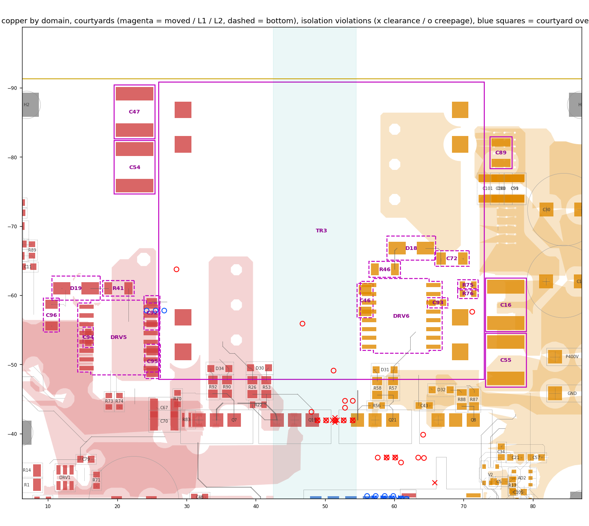

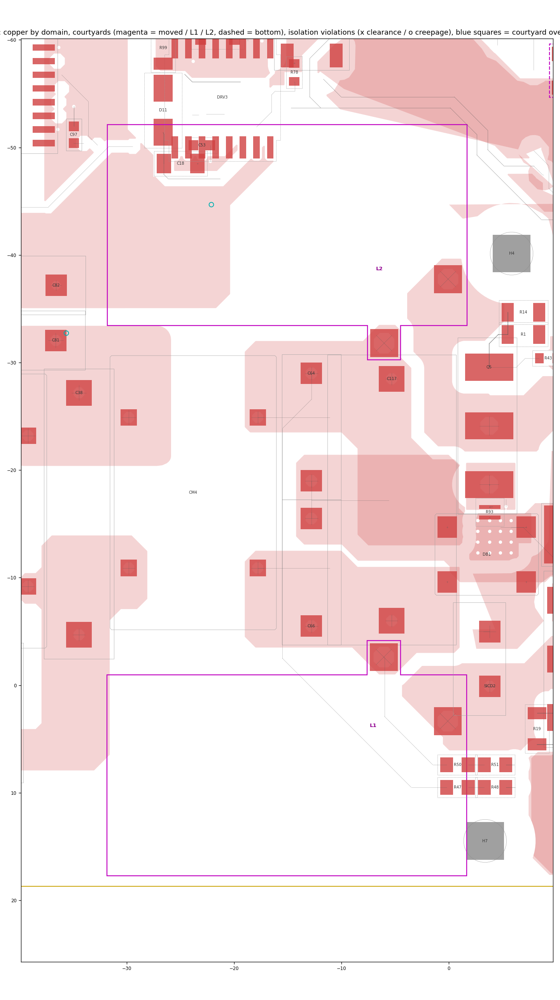

### Notes on step 1

Written after reviewing the step-1 numbers (2026-11-19); the tables above are regenerated, this text is not.

**L1 / L2 orientation (photo).** In the photo of the built 5.1 board the board's long axis runs top–bottom, mains
input at the top (= KiCad left edge, IN1 / IN2 / PE), the heatsink plate lower left (= KiCad TO row at y ≈ −42).
Mapping: photo down = KiCad +x, photo left = KiCad +y (bottom edge). The two taped toroids stand on edge with their
ring planes along the photo's vertical, i.e. **along KiCad x** (the board's long axis); the left one (= L1, at the
KiCad bottom edge y = 18.75) and the right one (= L2) flank the two common-mode chokes (CM1 / CM4, KiCad y −8 … −34),
their lower (+x) ends stop just short of the heatsink / H7 standoff, right where the RM8 pri1 / pri2 holes are –
the leads come down from the lower +x side of each ring. Hence: body centre 12 mm towards −x and 8 mm outwards (L1
+y, L2 −y) from the pad pair; this is also the only place near the RM8s where an upright 31.5 × 16.7 body is free
(the fit scan over the offsets gives ≤ 5 mm² overlap only here; at the pad midpoint it would hit Q5 / Q6, C117,
CM4, H4 / H7). L1's courtyard ends 1.0 mm inside the bottom edge – the photo shows the toroid flush with the edge;
its top only appears to overhang by perspective, so no overhang is drawn. The body position is a photo estimate
(±3 mm): measure it on the built board. Step 0 already resolves all L1 / L2 collisions of the first trial except
small courtyard touches (SICD2 4.8, C117 1.3 / 1.5, H7 0.4 mm²), keeps the 5.1 tracks on all four leads, and the
L1 / L2 area has no new DRC items (the remaining ones there are the 5.1 PE-PRI / clearance items of the PFC block).

**TR3 / split caps / gate drive (B).** TR3 at (49.5, −69.3), 0°, winding axis along x (plan phase 5.6): pin rows
x 29.5 (primary) / 69.5 (secondary), courtyard 0.55 mm inside the top edge; its 12 mm barrier band x 42.5 … 54.5
continues the primary / secondary line of the TO row (Q19 gate pad x 48.2 | Q21 source pad x 54.7), so one straight
barrier runs from the top edge through TR3 down to the heatsink. Why not further right / at the 5.1 origin: the
secondary split caps then have no F.Cu room next to pins 9 / 10 (C19 / the output terminals take x ≥ 79), and the
EC42 numbering puts the secondary cap pins 9 / 10 at the TO-row end, so C16 / C55 belong at x ≈ 76, y −59 … −47
(TRANS_SEC pads 6 mm from the pins, ISO_GND end towards Q8, 420V end towards C19). C47 / C54 sit in the old L3
area next to primary pins 1 / 2 (DHB_CAP pads facing each other 2.6 mm apart); their DC+ / DHB_CURRENT ends need
a run to the TO row (C67 / C70 stay there as the HF decoupling of the primary half-bridge). C89 moved above C90.
DRV5 + 6 parts moved 4.5 mm left (out of the primary pin row, still left of Q7); DRV6 + 7 parts moved under the
TR3 body between the band and the secondary row (the only free bottom-side room on the secondary side). No
bottom-side part is under a TR3 pin; TR3, the split caps and C89 have no courtyard overlap left; the TR3-area
shorts / mask bridges dropped from 12 / 12 to 5 / 4 (the rest are the DRV5 / DRV6 groups' own 5.1-SOIC-16 →
SOIC-16W overlaps: C92 / C94 / C95 at DRV5, C46 / C93 at DRV6 – their bootstrap / decoupling parts must be
re-placed around the wider package) and the TR3-area clearances from 38 to 23.

**What remains around TR3:** (1) the TO-row barrier (rework item 2): the Q19 gate track and the Q21 / Q8 copper
are within 11.1 mm across x ≈ 51 (creepage marker Q19 gate ↔ DRV6 pad 9 now that DRV6 sits right of the band) –
needs the Q19 / Q21 slot or more spacing in the row, unchanged by this step; (2) a 5.1 DHB_HI_SOURCE_SEC F.Cu
track and the primary DHB_HI_SOURCE F.Cu pour near the band, a primary +3V3 via inside the 420V pour at x ≈ 71
(5.1 leftovers to delete when routing); (3) 59 unconnected items in the TR3 box (both half-bridge loops, the
split caps, the moved gate-drive groups' outside connections – 58 copper items were deleted by the moves,
63 moved along with the groups); (4) the gate-drive groups are now further from the TO row (DRV6 ≈ 10 mm above
Q21 / Q8, under the transformer – check the EC42 stray field at the driver, or move DRV6 + its parts into the
row once the TO row is regrouped); (5) the 5.1 F.Cu pours around the old C16 / C55 / TR3 area still follow the
old shapes and must be redrawn for the new pins.

## After placement step 2

Applied by `tools/p2k/bin/kipy tools/next/trial_placement_p2.py` (moves as data: `PLACE`, `AUTO` = two-pad parts placed by centre / axis with the orientation that puts each pad next to its pin, `GROUPS`, `SLOTS`, the UART pour keep-out) on the step-1 board → `tube_psu_5_2_trial_p2.kicad_pcb`, DRC `drc_p2.json` (same split passes: refill peak RSS 2159 MB, main peak RSS 2136 MB, creepage F.Cu peak RSS 2320 MB, creepage B.Cu peak RSS 2558 MB), `placement_p2.json` (moves, slot, keep-out and every deleted track / via with net, layer and end points, so the routing can redo it). Nothing is routed.

**Moves**

| part / group | side | step 1 (x, y / rot) | step 2 |
|---|---|---|---|
| C102 | F | 72.657, 11.347 / 0° | 74.5, 11.35 / 0° |
| C134 | F | -40.125, 62.425 / 0° | -7.3, -81.0 / 90° |
| C135 | F | -35.075, 62.425 / 0° | 7.0, -81.2 / 90° |
| C136 | F | -30.025, 62.425 / 0° | 9.0, -70.3 / 180° |
| C137 | F | -24.975, 62.425 / 0° | 10.9, -73.0 / 90° |
| C14 | F | 53.275, -13.5 / 0° | 52.4, -13.5 / 0° |
| C17 | F | -56.7, -67.0 / 90° | -56.7, -73.8 / 90° |
| C18 | B | -24.974, -48.5 / 0° | -24.5, -61.9 / 180° |
| C2 | F | 77.475, -12.534 / -90° | 78.07, -12.53 / -90° |
| C25 | B | -21.525, -60.3 / 0° | -14.3, -59.6 / 90° |
| C3 | F | 72.618, -12.893 / -90° | 73.25, -12.89 / -90° |
| C46 | B | 55.767, -59.217 / 90° | 57.0, -63.75 / 180° |
| C47 | F | 22.5, -86.5 / -90° | 23.05, -86.5 / -90° |
| C51 | B | 49.4, 5.425 / 90° | 53.7, 6.8 / 90° |
| C53 | B | -23.0, -50.2 / 0° | -19.8, -47.6 / 180° |
| C54 | F | 22.5, -78.5 / -90° | 23.05, -78.5 / -90° |
| C58 | B | 46.9, 5.425 / 90° | 49.4, 6.0 / 90° |
| C92 | B | 25.0, -57.474 / -90° | 25.3, -60.9 / 0° |
| C93 | B | 66.27, -58.912 / 0° | 65.6, -50.6 / 180° |
| C94 | B | 15.8, -53.9 / -90° | 13.0, -52.6 / 90° |
| C95 | B | 25.1, -50.425 / -90° | 24.0, -47.2 / 0° |
| D11 | B | -26.6, -53.45 / -90° | -11.5, -55.0 / 180° |
| D4 | F | 70.795, -17.864 / 180° | 76.8, -19.2 / 180° |
| D5 | F | 58.748, -19.914 / -90° | 58.75, -20.91 / -90° |
| D6 | B | 53.111, -6.6 / 0° | 51.6, -6.25 / 0° |
| D7 | F | 54.611, 12.8 / 0° | 51.4, 12.4 / 0° |
| DRV4 | F | -53.775, -68.35 / 0° | -54.75, -68.35 / 90° |
| J4 | F | 48.66, -30.1 / 90° | 11.4, -89.0 / 0° |
| PWM2 | F | 54.5, 2.2 / -90° | 49.8, 2.2 / -90° |
| R136 | F | 5.325, 62.425 / 0° | 7.6, -76.4 / 0° |
| R137 | F | 10.375, 62.425 / 0° | 7.6, -78.2 / 0° |
| R46 | B | 58.635, -63.738 / 180° | 62.0, -63.74 / 180° |
| R63 | F | -56.7, -71.766 / -90° | -54.0, -73.3 / 180° |
| R72 | F | 48.35, 12.8 / 0° | 48.3, 15.5 / 0° |
| R78 | B | -14.4, -56.964 / -90° | -14.4, -51.0 / -90° |
| R8 | F | 50.45, 0.5 / 180° | 50.45, -5.4 / 180° |
| R9 | F | 50.45, -1.8 / 180° | 50.45, -3.1 / 180° |
| R99 | B | -26.6, -59.25 / -90° | -10.7, -58.3 / 180° |
| U11 | F | 34.515, 69.195 / 0° | 0.0, -78.0 / 0° |
| U12 | F | 44.465, 63.395 / 0° | 7.95, -73.0 / 0° |
| TR1 -15 V caps right of TR1: C40, C44 | – | – | shift +0.4, +0 mm (25 copper items moved along) |
| TR1 secondary rectifiers right of TR1: D14, C45, D8 | – | – | shift +1.4, +0 mm (23 copper items moved along) |
| U1 current-measurement amplifier (bottom) + C87: U1, R101, R102, R103, R104, R105, R106, R29, C63, C11, R89, C87 | – | – | shift +0, +8 mm (67 copper items moved along) |

**Slot** Q19 / Q21 / ISO2 barrier slot (L): Edge.Cuts polygon (50.81, -62.00), (52.02, -62.00), (52.02, -40.40), (68.60, -40.40), (68.60, -39.20), (50.81, -39.20) (1.2 mm wide; legs x 50.81 … 52.02 / y -62.00 … -39.20, x 50.81 … 68.60 / y -40.40 … -39.20).
**Keep-out** UART island pour keep-out (8 mm): rule area x -4.4 … 20.2, y -91.3 … -61.8, all copper, no copper pour.
**Keep-out** barrier pour keep-out: Q21 / Q8 to ISO2 under the heatsink plate: rule area x 52.5 … 71.0, y -39.2 … -33.0, all copper, no copper pour.
**Keep-out** barrier pour keep-out: around the TR1 slot end at the fly leads: rule area x 57.5 … 77.0, y 4.0 … 18.4, all copper, no copper pour.
**Keep-out** barrier pour keep-out: bridge between the L-slot and the ISO2 slot: rule area x 60.5 … 73.0, y -33.0 … -26.0, all copper, no copper pour.
**Keep-out** barrier pour keep-out: gap between the ISO2 and TR1 slots: rule area x 56.5 … 73.5, y -23.0 … -9.5, all copper, no copper pour.
**Pads without unused inner-layer rings:** Q19, Q21 (KiCad 'remove unconnected layers, keep start / end').

**Copper deleted by step 2:** 175 items (segment: inside an inner-layer barrier band 8, segment: other domain within 11.1 mm of a TR1 fly lead 3, segment: other domain within 11.1 mm of a barrier barrel (inner layer) 4, segment: primary copper within 8.0 mm of the UART island 6, segment: touches old pad of moved part 106, segment: under copper moved with a group 12, segment: within 1 mm of a new pad of a moved part 21, via: inside an inner-layer barrier band 1, via: other domain within 11.1 mm of a barrier barrel (inner layer) 1, via: touches old pad of moved part 1, via: within 1 mm of a new pad of a moved part 12); by part: C102 24, C11 1, C14 5, C18 8, C2 13, C25 2, C3 13, C53 2, C92 1, D11 8, D14 1, D4 10, D5 11, D6 8, D7 1, DRV4 10, ISO2 9, Q19 4, Q21 1, R103 2, R46 1, R63 4, R72 5, R78 6, R8 2, R9 2, TR1.11 3, U1 12, U11 6. Nets of the deleted copper (to re-route): ISO_GND 35, GND 20, 15V_ISO_SEC 19, 15V 13, 5V 11, -100V BIAS 7, /06 Heaters/HEATER_SYNC_GATE_1 6, EPWM5A 6, +3V3 6, 6V3 5, Net-(TR1-S15) 4, Net-(TR1-A15) 4, DHB_HI_SOURCE_SEC 4, ISO_SEC_DHB_LO 4, DC+ 3, EPWM6A 3, 5V_ISOL 3, Net-(TR1-A5) 2, Net-(C12-Pad2) 2, Net-(C11-Pad1) 2, CUK_CLK 2, HEATER_CURRENT 2, $HT_CS 2, DHB_HI_SOURCE 1, Net-(D7-K) 1.

### DRC delta step 1 → step 2

| type | step 1 | step 2 | delta |
|---|---|---|---|
| clearance | 337 | 183 | -154 |
| silk_over_copper | 191 | 199 | +8 |
| silk_overlap | 199 | 199 | +0 |
| courtyards_overlap | 165 | 133 | -32 |
| creepage | 164 | 49 | -115 |
| hole_clearance | 138 | 32 | -106 |
| track_dangling | 78 | 110 | +32 |
| lib_footprint_issues | 96 | 96 | +0 |
| via_dangling | 25 | 18 | -7 |
| shorting_items | 23 | 0 | -23 |
| solder_mask_bridge | 22 | 0 | -22 |
| silk_edge_clearance | 6 | 17 | +11 |
| nonmirrored_text_on_back_layer | 10 | 10 | +0 |
| isolated_copper | 7 | 4 | -3 |
| pth_inside_courtyard | 6 | 3 | -3 |
| lib_footprint_mismatch | 0 | 2 | +2 |
| copper_edge_clearance | 1 | 0 | -1 |
| text_height | 1 | 1 | +0 |
| text_thickness | 1 | 1 | +0 |
| **isolation, between two domains (on the board)** | 419 | 60 | -359 |
|   HEATER-PRI | 37 | 36 | -1 |
|   PE-PRI | 22 | 22 | +0 |
|   PRI-SEC | 101 | 2 | -99 |
|   PRI-UART | 259 | 0 | -259 |
| **unconnected items** | 303 | 346 | +43 |

Courtyard-overlap pairs: step 1 165, step 2 133; resolved (32): C102/TR1, C14/TR1, C17/DRV4, C18/C53, C18/DRV3, C25/DRV3, C25/R24, C3/TR1, C40/TR1, C44/TR1, C45/TR1, C46/DRV6, C51/C58, C53/DRV3, C6/D6, C92/DRV5, C93/DRV6, C94/DRV5, C95/DRV5, C98/J4, D11/DRV3, D14/TR1, D4/ISO2, D7/TR1, D8/TR1, DRV3/R99, DRV4/Q1, DRV4/R63, ISO2/J4, PWM2/R8, PWM2/R9, PWM2/TR1; new (0): –.

### Per area (step 1 → step 2)

| area | box (mm) | isolation violations by domain pair | courtyard pairs | shorts | clearance (all) | creepage (all) | unconnected |
|---|---|---|---|---|---|---|---|
| UART island J4 / U11 / U12 (top edge) | x -15 … 35, y -100 … -62 | PRI-SEC 1 → 0 | 9 → 7 | 2 → 0 | 1 → 0 | 2 → 1 | 21 → 47 |
| TO row Q19 / Q21 slot | x 25 … 78, y -47 … -13 | PRI-SEC 78 → 0, PRI-UART 256 → 0 | 34 → 29 | 2 → 0 | 160 → 40 | 103 → 0 | 37 → 40 |
| ISO2, D4 / D5, TR1, PWM2, C102 | x 42 … 85, y -40 … 20 | PRI-SEC 58 → 2, PRI-UART 256 → 0 | 35 → 18 | 5 → 0 | 136 → 26 | 102 → 5 | 52 → 60 |
| DRV5 / DRV6 gate drive (bottom) | x 8 … 71, y -69 … -42 | PRI-SEC 8 → 0, PRI-UART 3 → 0 | 21 → 16 | 3 → 0 | 32 → 29 | 10 → 0 | 46 → 55 |
| DRV3 / DRV4 (heater) | x -61 … -4, y -79 … -43 | HEATER-PRI 37 → 36, PE-PRI 1 → 1 | 29 → 19 | 8 → 0 | 45 → 38 | 18 → 17 | 57 → 75 |

Zooms: copper by domain (red primary, orange secondary, green heater, blue UART), courtyards (magenta = moved by step 2, dashed = bottom side), cross-domain isolation violations (x clearance / o creepage, coloured by pair), blue squares = courtyard overlaps new vs step 1, black = new slot, cyan dashed = pour keep-outs, grey + = end points of deleted copper, light band = TR3 barrier band.

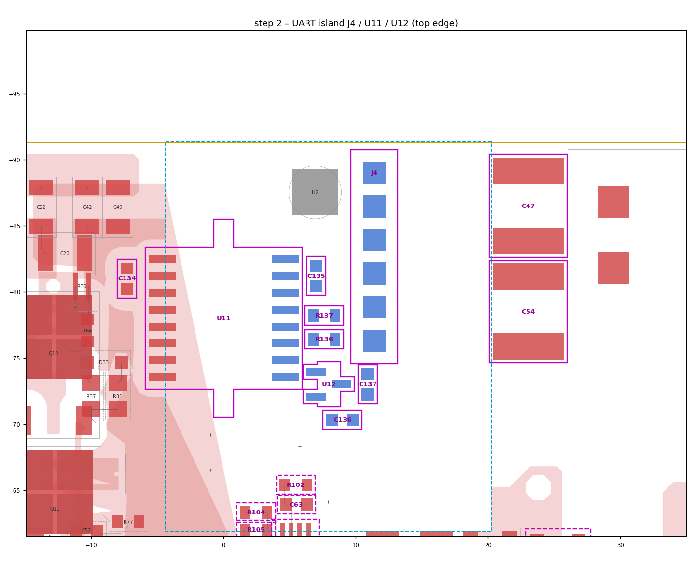

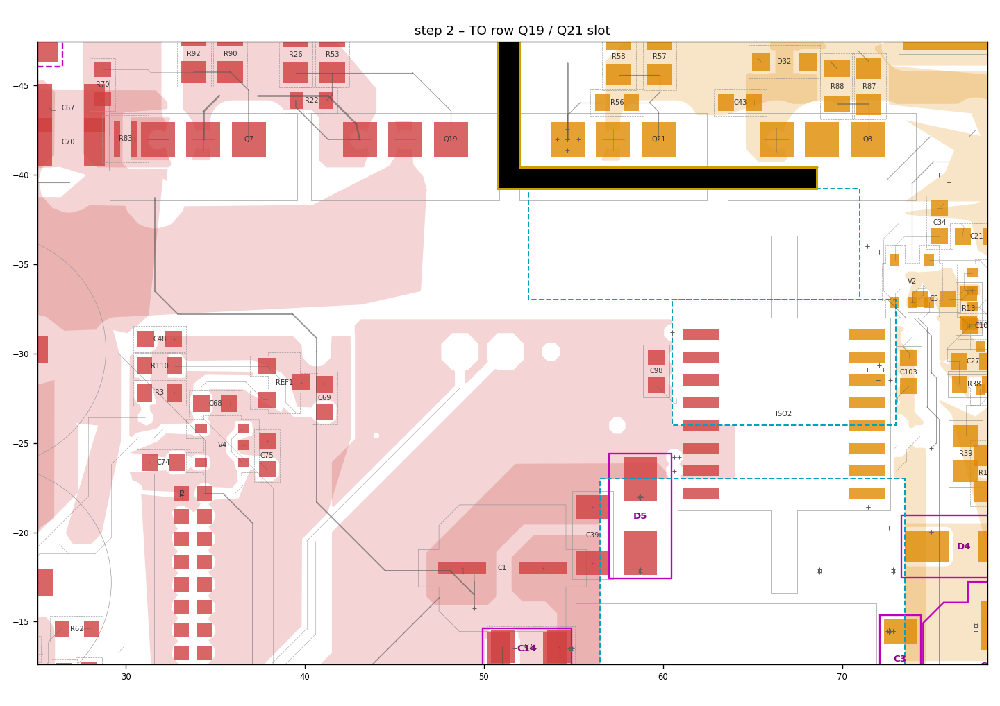

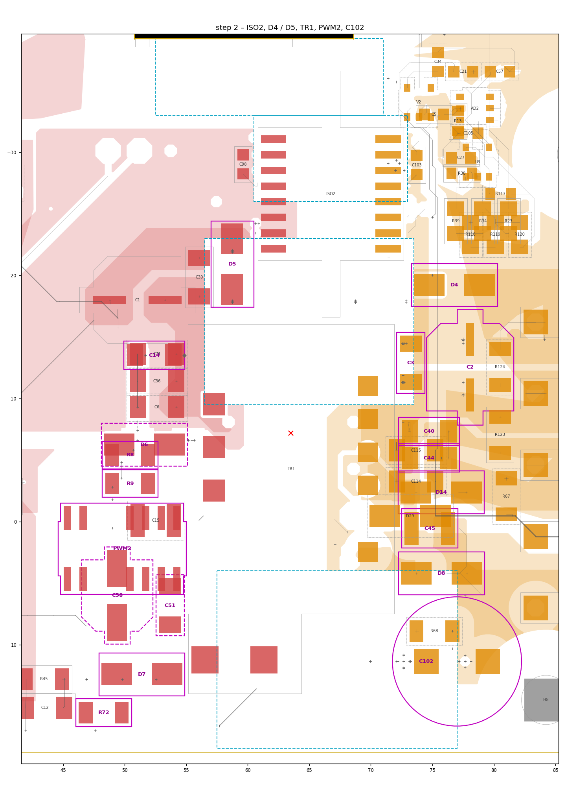

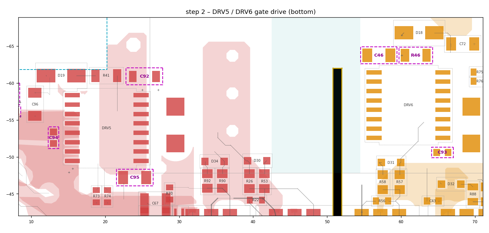

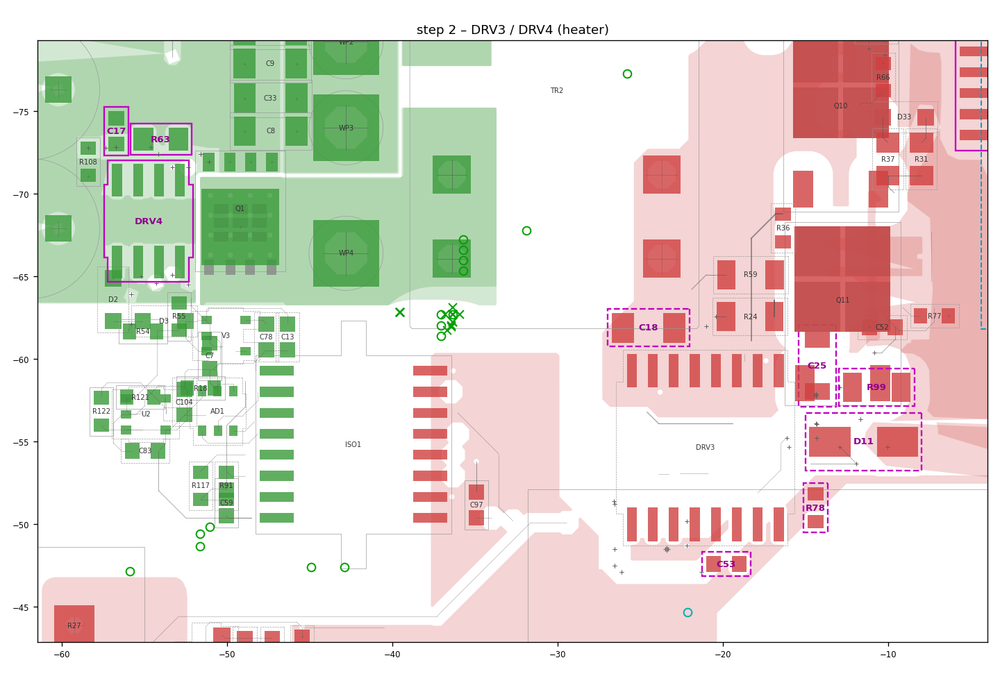

### Notes on step 2

Written after reviewing the step-2 numbers (2026-11-19); the tables above are regenerated, this text is not.

**1. UART island – top edge, x −6 … 14, next to H2.** Candidates checked: (a) the old J4 place (x 49 … 61, y −30)
is not at an edge – it lies inside the heatsink L next to the control card on J2, the 5.1 cable ran over the board;
(b) the bottom edge next to J2's end (x 25 … 40), closest to the UART signals (TX / RX = J2 pins 26 / 24 at
x 34.4, y −7 / −8): C29 (DC+ electrolytic) and the DC+ start-up chain R114 … R116 are 16 mm apart, so after 8 mm
on each side nothing is left, and the AC-measurement amplifier U8 group sits there; (c) the bottom edge left of L1:
mains input filter; (d) the right edge: secondary outputs (8.4 mm SEC-UART, and U11's primary side cannot reach
primary copper there); (e) the top-left edge: heater island parts. The old L3 area left of TR3 was freed by step 1;
it is outside the heatsink L (in the photo the board's right edge, open), so the cable reaches the edge, and the
only neighbours are primary: Q10 / C22 / C42 / C49 on the left – faced by U11's primary pins 1–8, with the U11
8 mm slot between – and C47 / C54 on the right (C47 / C54 0.55 mm closer to the TR3 pins, J4 8.1 mm from them).
J4 stands at the top edge (pin 1 ISO_UART_GND at y −89, 2.4 mm from the edge) right of H2, U12 / C135–C137 /
R136 / R137 between U11 and J4 below H2's screw head (Ø 5.5 mm). The bottom-side U1 current-measurement amplifier
(12 parts + C87 on top) moved 8 mm down with its own copper (12 In4 segments of EPWM5A / EPWM6A / +3V3 /
HEATER_CURRENT / DHB_CURRENT it landed on were deleted). Primary copper within 8 mm of an island pad: 6
segments deleted; pour keep-out over the island + 8 mm on all six layers (no solid-insulation overlap either).
Cost: TX / RX run about 80 mm from J2 to U11's primary pins (In2 / In3 routing). PRI-UART 259 → 0.

**2. Q19 / Q21 – L-slot.** The heatsink footprint (`gen_next_footprints.py` `heatsink()`) is only an outline
helper (plate 120 × 3 mm on the tab side, keep-off lines, no pads / holes): the 5.1 board has no bracket holes,
the plate is held by the TO screws, and its hole pattern is the TO-row pitch (Q7 / Q19 / Q21 / Q8 at x 36.9 /
48.2 / 59.8 / 71.4), so the TO parts stay. The tabs face +y; the plate face is at y −38.8. A 1.2 mm milled slot
fits without touching the plate: vertical leg at x 51.4 (between Q19 pin 1 and Q21 pin 3, pad edges 1.8 mm away,
inside the TR3 barrier band x 42.5 … 54.5) from y −62 (under TR3, where the band forbids copper anyway) down to
the pins, then a horizontal leg in front of the plate face under the Q21 / Q8 pins (0.55 mm from their pads) to
x 68.6, past the top of the ISO2 slot (2.85 mm bridge). Outer-layer creepage Q19 ↔ Q21 now goes round the slot
(≥ 16 mm), and the ISO2 primary pins 1 / 2 (+3V3 / EPWM2A, 9.6 mm from the Q21 gate before) see Q21 / Q8 only
round the slot end. Five inner-layer secondary / primary items within 11.1 mm of the Q19 / Q21 barrels were
deleted, the Q19 / Q21 pads lost their unused inner rings. **Remaining (24 of the 26 PRI-SEC items): KiCad
checks the plated barrels themselves on the inner layers** (Q19 pin 1 ↔ Q21 pin 1 10.5 mm, pin 1 ↔ pin 3 5.4 mm
hole edge to hole edge) and the DRU gives no slot credit there. The slot does cut the laminate between the
barrels (the through-laminate path goes round the slot ends like the surface path), so this needs a decision:
(a) a DRU exception for barrels separated by a through-board slot (as for TR1's barrier pads, but with the slot
argued as the barrier), or (b) 5.7 mm more pitch between Q19 and Q21 – a new plate hole pattern, which the fixed
plate does not allow. **User decision 2026-11-19: (a).** `tube_psu_5_2.kicad_dru` rule "PRI-SEC inner layers,
Q19/Q21 across the barrier slot": inner-layer clearance / hole clearance 4.0 mm (reinforced air clearance across
the slot) for Q19 ↔ Q21 pairs only; the laminate path round the slot ends has the same plan geometry as the
outer surface path that the 11.1 mm creepage rule checks (with the larger outer pads), and that check passes.
DRC re-run with the rule: Q19 ↔ Q21 24 → 0 (PRI-SEC 26 → 2, the TR1 pin 2 / 9 barrels). The re-run's
creepage pass also reported 2 old 5.1 B.Cu tracks at mounting holes (H4 ↔ 15V 2.2 mm of 3.2, H5 ↔
CUK_CAP_MEAS- 3.45 mm of 4.2) that the first run had not listed – unrelated to the rule, fixed when routing.

**3. ISO2 / D4 / D5.** ISO2 stays: its slot already sits on the barrier line between TR1's slot and the TO row,
and the L-slot now closes its top end. D4 (secondary 15V_ISO_SEC rectifier) moved out of the ISO2 slot to the
right of ISO2 (x 76.8, y −19.2, cathode next to C2 / P15V_OUT), C2 / C3 0.6 mm right; D5 (primary 15 V) stays
left of the barrier, 1 mm up for 11.1 mm to TR1 pin 10 through the 2.5 mm gap between the ISO2 and TR1 slots.
The 5.1 F.Cu pours that bridged that gap (TR1-A15, TR1-S15, 15V, 15V_ISO_SEC) and the B.Cu GND / ISO_GND pours at
the slot bridge are held off by pour keep-outs; 9 In4 items of the 5.1 ISO2 routing inside an 11.1 mm inner band
on the ISO2 slot line were deleted. Area: PRI-SEC 58 → 2 (the 2 are TR1 pin 2 GND ↔ pin 9 ISO_GND barrels
on the inner layers, already on step 1: the TR1 footprint keeps pin 2's inner ring where a GND pour connects –
keep In1 / In4 GND off pin 2 when routing).

**4. TR1 / PWM2 / flyback.** TR1 stays at its 5.1 origin and is free (no courtyard overlap, no part under its
pins: D6 moved 1.5 mm left off pin 2). PWM2 4.7 mm left (its courtyard ends at TR1's), drain pins 5–8 at the
left end (x 45.4 … 46.6) facing away from the TR1 slot and the FB / VERR pins; CS resistors R8 / R9 above it,
VCC caps C58 / C51 (bottom) right of the drain end, clamp D7 / R72 left of the FLY_C fly lead. Drain copper room
as placed: F.Cu x 41 … 46 between R114–R116 and the drain pins plus a strip along y 8 … 10.5 to D7 / TR1 pin 12,
about 0.8 cm² per outer layer, i.e. **≈ 1.5 cm² F + B – short of the 2–3 cm² of NEXT_REVISION_PLAN phase 5 (8)**:
gain it by moving the start-up chain R114–R116 1–2 mm left or C58 off the drain end on B.Cu when routing. The
secondary parts right of TR1 moved 0.4 / 1.4 mm right, C102 1.85 mm right (pad 1 13.2 mm from the DC+ fly
lead, barrel to barrel ≥ 11.1 mm); 3 secondary segments within 11.1 mm of the fly leads deleted and the pours
at the TR1 slot end held off.

**5. Gate drivers.** All bootstrap / decoupling parts sit outside the SOIC bodies next to their pins (orientation
picked per part so that each pad faces its pin): DRV5 C94 left of pins 3 / 4, C95 below pins 14 / 16, C92 above
pins 9 / 11; DRV6 C46 / R46 above pins 14 / 16 (C46 just right of the TR3 band), C93 below pin 8 (VCCI); DRV3
C25 / R99 / D11 / R78 right of the package (pins 16 / 14 / 1), C18 above pins 9 / 11, C53 below pins 3 / 4;
DRV4 turned 90° between C32 and Q1 (pins 5–8 on top: OUTA towards the Q1 gate, VDD), R63 / C17 above it. The
DRV-area shorts 23 → 0, mask bridges 22 → 0, courtyard pairs with the drivers resolved (no new pair on the board).

**Remaining after step 2** (beyond the routing itself, unconnected 303 → 346, dangling 78 → 110): the Q19 / Q21
barrels (24) are resolved by decision (a) above; TR1 pin 2 / 9 inner barrels (2); HEATER-PRI 36 at ISO1 / TR2 and PE-PRI 22 at the PFC
Y caps / RL1 (not in this step); PWM2 drain area (above); C2 / R123 courtyard touch 0.76 mm² (5.1 pair, was
0.55); 17 silk-to-edge warnings at the new slot / U11 / J4 (reference texts to move); `lib_footprint_mismatch`
Q19 / Q21 (board pads without unused inner rings – put it in a footprint copy if kept).

