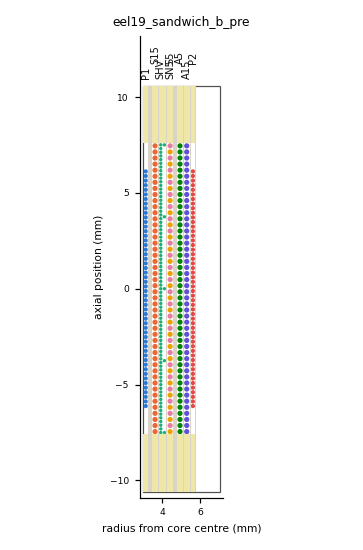

# TR1 on an EEL19 core – 10–15 W design (new transformer)

Board tube_power_5_1, sheet 1: PWM2 (IW1818, primary-side regulated QR flyback, integrated
800 V BJT) with TR1. The user has decided on a **new transformer on an EEL19 (long-leg E19)
core with a vertical 5+5 bobbin**, primary on fly leads, enamel wire with margin tape (no
triple-insulated wire), 10–15 W capability. This document takes the calibrated model and the
OpenMagnetics (MKF, PyOpenMagnetics 1.7.41) infrastructure from [FLYBACK_DESIGN.md](FLYBACK_DESIGN.md)
and reuses them unchanged for the EF20. The EF20 results stay reproducible: the netlists and the
MKF matrices of the EF20 options are bit-identical after this session's changes. Tables:
[eel19_results.md](eel19_results.md). Status 2026-11-17. Design study only: **the schematic and
board are not changed.**

Net names are the KiCad names: 15V, 5V, 15V_ISO_SEC, 5V_ISOL, −5V_SEC, −80 V (−100V BIAS). The
scripts keep the Proteus labels `20V` / `20V_ISO_SEC` internally.

## Summary

- **Turns: every winding is doubled from the EF20 recommendation:** P 104 (2 × 52, split) /
  A15 16 / A5 6 ‖ S15 16 / S5 6 / SN5 6 / SHV 84. Because of this the turns ratios, the 5.58 V
  aux knee and Vor = 96.7 V are the same as before. **The Vsense divider (R64/R81/R84/R85)
  stays as it is**, and D8 sees the same stress (V_R = 0.81·DC+ + 80 V).
- **Lp = 600 µH** (AL 55.5 nH). **Rsense 1.0 Ω (R8 = R9 = 2.0 Ω, was 2.49 Ω).** With
  VIPK(HIGH) = 1.00 V the peak current is 1.00 A, OCP is 1.15 A, and the maximum power from the
  magnetising inductance is ½·Lp·I²·72 kHz = 21.6 W.
  - Flux density: Bpk 0.247 T at 1.00 A, 0.284 T at OCP, 0.21 T at 15 W (PC40 Bsat ≈ 0.39 T at 100 °C).
  - Timing at 15 W: Tr/Tp = 0.40, and DCM uses 7.8 of the 13.9 µs period even at 325 V.
- **Gap: spacer, 0.40 mm under all three legs (recommended), or grind the centre leg to about
  0.85–0.9 mm.** Either way the gap is set by measurement: **Lp = 600 µH ± 5 %**, or 50 µH on a
  30-turn test coil (section 4).
  - The spacer splits the gap three ways. This roughly halves the fringing-field losses that MKF
    predicts in the inner primary layer: 1.17 W instead of 2.12 W winding loss at 15 W.
- **Recommended winding: `eel19_sandwich_b_pre3`** (enamel, 3 mm margins, two 4-layer barriers):
  **P1 52 ‖ S15 16 | SHV 84 | S5+SN5 6+6 ‖ A5 6 | A15 16 | P2 52**.
  - Preloads: **2.2 kΩ on 15V, 1 kΩ on 5V and 3.3 kΩ on 15V_ISO_SEC**.
  - The P1–P2 crossover goes onto the free pin 5, so no sleeved lead has to leave the bobbin.
  - The two primary ends are fly leads in thick-wall PTFE sleeving to 2 extra PCB holes.
  - MAS document: [mas/tr1_eel19_recommended.json](mas/tr1_eel19_recommended.json).
- **Cross regulation over the 15 standard load cases at 400 V: about equal to the EF20
  recommendation on 15V and 5V, better on the other rails.**

  | rail | EEL19 recommended | EF20 margin_sandwich_8_pre |
  |---|---|---|
  | 15V | 14.59–15.97 V | 14.40–15.78 V |
  | 5V | 4.83–5.22 V | 4.85–5.22 V |
  | 15V_ISO_SEC | 14.91–16.75 V | 14.75–17.07 V |
  | 5V_ISOL | 4.89–5.32 V | 4.88–5.36 V |
  | −5V | 4.95–5.29 V | 4.97–5.53 V |
  | −80 V | 80.5–83.7 V | 78.5–82.8 V |

  At light and idle load every rail is as good or better: 15V 14.77 / 14.59 V against 14.40 / 14.64 V.
- **Full load** (new cases): 15 W out (Pin 17.1 W) at 400 V and at 325 V.
  - The PWM regulates at u = 0.71, Ipk 0.84 A, 72 kHz.
  - All rails stay within 14.45–14.89 V (15 V rails) / 4.80–4.99 V (5 V rails) / −80 V 81.6–82.2 V.
  - Collector peak 603 V (75 % of 800 V); D8 V_R 395 V.
- **IW1818 limit:** the product summary rates the IW1818 at **10 W** (open frame, 50 °C,
  universal input) and Renesas lists 10–12 W. The transformer and the sense resistor give 15 W,
  but 15 W continuous is above the IC's thermal rating. Treat **12 W continuous** as the design
  value and confirm 15 W by measuring the IC's GND-pin temperature (ψJB 25 °C/W, TSD 150 °C). For
  15 W continuous with margin, the iW1819 (18 W) is the option, but it is a different package
  (SO-10) and therefore a board change.
- **Board fit:** the part does **not** drop into the EF20 location as is.
  - It fits with TR1 moved **+0.93 mm in x, to (64.45, −4.28)**. The primary row then stays at
    x 58.45 and the isolated row moves to 70.45.
  - About 9 isolated-side small parts move 1.5–2 mm right, C3 gets a new spot, and C102 moves
    down about 1.4 mm.
  - Fly-lead holes at (57.4, 9.6) and (62.2, 9.6).
  - The F.Cu ISO_GND pour must be pulled back to x ≥ 69.8 for y 2…14. That is also needed for an
    existing 5.08 mm DC+ to ISO_GND spot (section 8).
- **D8 still needs ≥ 600 V** (ES1J/US1J; US1M for margin against turn-on ringing). D4/D5 see
  77 V and D6/D14/D29 28 V: ES1B/ES1D are fine there, and a true 50 V ES1A is not, for D4/D5.

## 1. Assumptions and sources

| item | value | source / status |
|---|---|---|
| core | EEL19: A 19.0, B 13.65 (half height), C 4.85 (depth), D 11.4 (half window height), E 14.0 (window width), F 4.85 (centre leg) mm; Ae 23.4 mm², le 62.1 mm, Ve 1450 mm³, 7.2 g | Chinese ferrite catalogue table (globalsources K1067465674.pdf, row "EEL19"); MKF computes Ae 23.4 mm² / le 59.9 mm from these dims. **Confirm with calipers** |
| core material | PC40 (TDK, MKF database; ≈ N87) | user (AliExpress EEL19 PC40) |
| bobbin | vertical 5+5, MyCoilTech MCT-EL1903(V5+5P) class: body 22.5 × 15.8 × 29.2 mm, pitch 4.0 mm, row distance 12.0 mm | vendor page; **confirm with calipers** (pitch might be 3.75/3.81/5.0 on other vendors) |
| winding window (model) | 21.2 mm axial × 3.975 mm radial (MKF simple bobbin: 0.8 mm flanges, 0.6 mm column wall) | assumption – measure the real bobbin |
| margins / tape | 3 mm margin tape both sides (15.2 mm winding width); polyester 25 µm + adhesive = 0.055 mm per layer; 4 layers per barrier, 1 layer between windings | user / as EF20 |
| IW1818 | 800 V BJT (VCES), IC 4 A, 72 kHz max PWM, Vcc 25 V abs / 20 V operating, product summary: 10 W (universal input, open frame, 50 °C) | Renesas iW1818 product summary Rev 1.1 (2022) |
| ISENSE / VSENSE thresholds | VIPK(HIGH) 1.00 V, VOCP 1.15 V (1.11–1.19), VIPK(LOW) 0.23 V, VSENSE 1.536 V, OVP 1.838 V; light-load modes PFM → DPWM 25 kHz → DPFM → DDPWM 2.1 kHz | iW1819 datasheet Rev 1.5 (same family; the iW1818 full datasheet is not public) |
| DC+ | 400 V nominal, 325 V before the PFC runs | as before |
| gate drivers | DRV5 / DRV6 are **Si8275BB** (UVLO grade B, 8 V): 15V feeds DRV5 VDDA (+ bootstraps), 15V_ISO_SEC feeds DRV6 VDDB; need ≥ 10 V worst case, abs max 30 V (Si827x datasheet, to verify) | user 2026-11-17 (replaces the "Si8274 UVLO grade" open question) |
| model | calibrated ngspice model of FLYBACK_DESIGN.md 2.1 unchanged (fixed 9.5 mA on 15V, AUX_MEAS, multi-mode control, ES1D rectifiers, RCD snubber R72 100R / R45 1M ‖ C12 470p) | – |

**Cross-check with ACME Ferrite's EE/EEL catalogue (2026-11-17,
https://www.acme-ferrite.com.tw/img/MnCorePDF/eel.pdf, p. 146–147).** A width, B half height,
C depth, D centre-leg width, E window width, F half window height (mm):

| core | A | B | C | D | E | F | Le mm | Ae mm² | Ve mm³ | AL P4 nH (ungapped) |
|---|---|---|---|---|---|---|---|---|---|---|
| EEL19 | 20.00 | 13.70 | 5.00 | 4.55 | 14.30 min | 11.15 | 61.0 | 25.0 | 1553 | 800 |
| EEL19A | 20.00 | 13.95 | 5.00 | 4.55 | 14.70 | 11.40 | 63.3 | 24.6 | 1557 | 800 |
| (this design) | 19.0 | 13.65 | 4.85 | 4.85 | 14.0 | 11.4 | 62.1 | 23.4 | 1450 | – |
| seller table (user, 2026-11-17) | 19 ±0.3 | 13.55 ±0.25 | 4.85 ±0.15 | 4.85 ±0.15 | 14 ±0.3 | 11.3 ±0.3 | – | (23.5) | – | – |

The seller's table (the core actually bought) matches the dims used here within 0.1 mm, so the design stands as computed. ACME's EEL19/EEL19A differ slightly. Differences to the dims used here are small and on the safe side: Ae +5…7 % (Bpk ≈ 0.20 T
instead of 0.21 T at 15 W), window width (E−D)/2 = 4.9–5.1 mm instead of 4.6 mm (more room for
the 2.76 mm build). The half window height (11.15–11.40 mm) sets the bobbin, i.e. the 15.2 mm
winding width – confirm on the actual bobbin. The results are not rerun; the gap is set by
measurement anyway (section 4).

## 2. Electrical design (`eel19_calc.py`)

**Why every turn count is doubled.** The EEL19 has a smaller Ae than the EF20 (23.4 vs 32 mm²)
but a much longer window (21.2 vs 12.6 mm). The higher power needs more Lp·I². Keeping Bpk at
OCP below 0.3 T then needs Np ≥ 95 turns. Np = 104 = 2 × 52 keeps:

- every turns ratio of the EF20 recommendation, so the same cross-regulation physics;
- A5 at 6 T giving the same 5.58 V knee, so **the Vsense divider stays unchanged**;
- Vor = 96.7 V;
- the same collector and rectifier stresses.

With A5 = 5 T instead, Np would be 87 (Bpk too high), and the 15 V windings would be 13 or
14 T (14.3 or 15.4 V).

| quantity | value |
|---|---|
| V/turn at the knee | 0.930 V (A5 6 T → 5.58 V; Vsense 1.536 V with the existing 0.2753 divider) |
| Vor | 96.7 V |
| Lp / AL | 600 µH / 55.5 nH |
| Rsense | 1.0 Ω (R8 = R9 = 2.0 Ω 1206, 1 %); Ipk max 1.00 A, OCP 1.15 A, Ipk min 0.23 A |
| Pmax (½ Lp Imax² fmax) | 21.6 W from the magnetising inductance |
| Bpk at Ipk max / OCP | 0.247 T / 0.284 T (hand calc Lp·I/(Np·Ae)); PC40 Bsat ≈ 0.39 T at 100 °C |
| VSENSE during the on-time | −6.35 V at 400 V into the divider (unchanged from today – same ratio) |

Power budget and timing (hand calculation; ES1x drop 0.9 V, 3 % copper, 4 % leakage; simulated
values in brackets):

| case | Pout W | from Lp W | Ipk A | ton µs (400 / 325 V) | Tr µs | Tr/Tp | period used (of 13.9 µs) | Bpk T |
|---|---|---|---|---|---|---|---|---|
| nom | 5.6 | 6.4 (Pin 6.7) | 0.55 (0.51) | 0.82 / 1.01 | 3.4 | 0.24 | 4.8–5.0 | 0.135 |
| full10 (table 1.1 maxima at once) | 10.9 | 12.6 (12.5) | 0.76 (0.72) | 1.14 / 1.41 | 4.7 | 0.34 | 6.5–6.7 | 0.19 |
| full15 | 14.9 | 17.2 (17.1) | 0.89 (0.84) | 1.34 / 1.65 | 5.5 | 0.40 | 7.5–7.8 | 0.22 |

- **DCM / QR**: at 15 W and 325 V there are still 6 µs left in each 72 kHz period, so the BJT
  turns on in a valley and never enters CCM.
- **CC limit:** the IW1818 regulates the output current from Ipk and Tr/Tp, and the threshold
  is not published. Tr/Tp ≤ 0.4 at 15 W keeps clear of the usual ~0.5 region. The model has no
  CC mode, so verify it on the bench: the 15 W load must not drop the rails.
- **Stress at DC+ 400 / 420 V (on-time plateau):**

  | | 400 V | 420 V |
  |---|---|---|
  | collector | 497 V + spike (simulated peak 603 V at full15) | 517 V + spike |
  | D8 | 404 V | 420 V |
  | D4 / D5 | 77 V | 81 V |
  | D6 / D14 / D29 | 29 V | 30 V |

- **Rail allocation for 15 W (case full15):** the extra capacity is spread over the gate-drive
  and logic rails.
  - 15V: 0.3 A.
  - 15V_ISO_SEC: 0.3 A (off-board +15V OUT).
  - 5V: 0.3 A.
  - 5V_ISOL: 0.3 A.
  - −5V_SEC: 0.2 A.
  - −80 V: 13.4 mA on top of the 6.6 mA bleeder.
  - Together with the preloads, bleeders and fixed loads this is 14.9 W. Any rail can take more
    as long as the total stays ≤ 15 W. ES1x is rated 1 A average and the windings carry
    ≤ 0.8 A rms in this case.

## 3. Winding options and results

Options (options.py, all with core "EEL19", Lp 600 µH, Rsense 1.0 Ω, 3 mm margins, enamel;
`_pre` = preloads 3.3 kΩ on 15V and 1 kΩ on 5V like the EF20 recommendation; `_pre3` adds
3.3 kΩ on 15V_ISO_SEC, and `eel19_sandwich_b_pre3` also lowers the 15V preload to 2.2 kΩ):

| option | build | notes |
|---|---|---|
| eel19_sandwich_pre | P1 52 ‖ S15 16 \| S5+SN5 \| SHV 84 ‖ A5 6 \| A15 16 \| P2 52 | EF20 recommendation × 2 turns |
| eel19_sandwich_pre3 | same + 3.3 kΩ on 15V_ISO_SEC | |
| eel19_sandwich_b_pre | P1 ‖ S15 \| SHV \| **S5+SN5** ‖ A5 \| A15 \| P2 | isolated 5 V pair directly across the barrier from the feedback winding |
| **eel19_sandwich_b_pre3** | same + 15V 2.2 kΩ, 5V 1 kΩ, 15V_ISO_SEC 3.3 kΩ | **recommended** |
| eel19_simple_pre | P 104 (2 layers) \| A15 \| A5 ‖ S15 \| S5+SN5 \| SHV, one barrier | simplest build, no split primary |
| eel19_spacer_pre | eel19_sandwich_pre with a spacer gap | gap-type check |

Leakage between the effective windings, referred to the 104 T primary (in brackets ÷ 4 for
the EF20's 52 T) from MKF:

| option | P–A5 | P–S15 | P–S5 | P–SHV | A5–S15 | A5–S5 | A5–SHV |
|---|---|---|---|---|---|---|---|
| EF20 margin_sandwich_8_pre (52 T) | 9.4 | 9.3 | 10.4 | 9.5 | 19.0 | 15.4 | 9.4 |
| eel19_sandwich | 20.2 (5.0) | 20.2 (5.0) | 21.3 (5.3) | 21.0 (5.3) | 32.7 (8.2) | 25.2 (6.3) | 16.6 (4.1) |
| eel19_sandwich_b | 20.1 (5.0) | 20.2 (5.0) | 21.5 (5.4) | 20.9 (5.2) | 32.7 (8.2) | **13.8 (3.4)** | 25.5 (6.4) |
| eel19_simple | 20.6 (5.2) | 34.6 (8.6) | 45.6 (11.4) | 54.2 (13.5) | 12.0 (3.0) | 23.1 (5.8) | 31.5 (7.9) |

The longer window halves the leakage per turn². The primary leakage with every other winding
shorted is 8.9 µH (1.5 % of Lp; EF20 2.9 µH).

Rails over the 15 standard load cases at 400 V (same set as results.md), nominal (min–max), V:

| option | 15V (limit 18.7) | 5V | 15V_ISO_SEC | 5V_ISOL | −5V_SEC | −80 V | Vcol max |
|---|---|---|---|---|---|---|---|
| EF20 margin_sandwich_8_pre | 14.65 (14.40–15.78) | 4.96 (4.85–5.22) | 14.75 (14.75–17.07) | 4.96 (4.88–5.36) | 4.97 (4.97–5.53) | 81.3 (78.5–82.8) | 556 |
| eel19_sandwich_pre | 14.81 (14.56–16.31) | 5.04 (4.80–5.27) | 15.03 (14.92–17.24) | 5.06 (4.97–5.40) | 5.07 (5.02–5.37) | 82.5 (79.9–83.6) | 571 |
| eel19_sandwich_pre3 | 14.83 (14.59–16.35) | 5.05 (4.81–5.27) | 15.05 (14.91–16.44) | 5.07 (4.97–5.34) | 5.08 (5.02–5.31) | 82.6 (80.0–83.6) | 572 |
| eel19_sandwich_b_pre | 14.66 (14.57–16.14) | 4.99 (4.81–5.21) | 14.94 (14.92–17.45) | 5.00 (4.88–5.32) | 5.00 (4.95–5.29) | 82.1 (80.3–83.7) | 571 |
| **eel19_sandwich_b_pre3** | **14.68 (14.59–15.97)** | **5.00 (4.83–5.22)** | **14.94 (14.91–16.75)** | **5.01 (4.89–5.32)** | **5.01 (4.95–5.29)** | **82.2 (80.5–83.7)** | 571 |
| eel19_simple_pre | 16.12 (15.58–**19.76**) | 5.31 (5.18–5.93) | 15.07 (14.77–16.38) | 5.01 (4.88–5.49) | 5.01 (4.93–5.45) | 81.0 (79.7–82.2) | 596 |
| eel19_spacer_pre | 14.81 (14.58–16.31) | 5.04 (4.80–5.27) | 15.04 (14.92–17.24) | 5.07 (4.97–5.40) | 5.07 (5.02–5.37) | 82.5 (80.0–83.6) | 571 |

Light / idle load (the user's criterion), recommended vs EF20 recommendation:

| case | 15V | 5V | 15V_ISO_SEC | 5V_ISOL | −5V | −80 V |
|---|---|---|---|---|---|---|
| light, EF20 | 14.40 | 4.92 | 17.07 | 5.36 | 5.53 | 78.5 |
| light, EEL19 b_pre3 | 14.77 | 5.08 | **15.12** | 5.20 | **5.17** | 80.8 |
| idle, EF20 | 14.64 | 4.85 | 15.59 | 5.09 | 5.25 | 80.2 |
| idle, EEL19 b_pre3 | 14.59 | 4.83 | 15.07 | 5.04 | 5.17 | 80.5 |
| min_15V, EF20 | 15.78 | 5.06 | 14.99 | 5.04 | 5.06 | 82.8 |
| min_15V, EEL19 b_pre3 | 15.97 | 5.09 | 15.15 | 5.09 | 5.09 | 83.4 |

Full load (b_pre3):

| case | 15V | 5V | 15V_ISO_SEC | 5V_ISOL | −5V | −80 V | Pin W | Ipk A | u | Vcol pk |
|---|---|---|---|---|---|---|---|---|---|---|
| full10 | 14.64 | 4.97 | 14.89 | 4.93 | 4.98 | 82.2 | 12.5 | 0.715 | 0.51 | 587 |
| full15 | 14.55 | 4.92 | 14.81 | 4.83 | 4.99 | 82.1 | 17.1 | 0.844 | 0.71 | 603 |
| full15_325 | 14.45 | 4.88 | 14.71 | 4.80 | 4.95 | 81.6 | 17.0 | 0.855 | 0.73 | 527 |

Observations:

- **The split-primary sandwich carries over.** `eel19_simple` (no split) puts A15 between P
  and A5 again. Its 15V rail peak-charges to 19.8 V in min_15V, above the 18.7 V AUX_MEAS
  limit, and 5V runs 5.3 V nominal. It is not usable without TIW-like coupling.
- **Order b** (S5+SN5 next to the barrier, facing A5) halves the A5–S5 leakage (25 → 14 µH).
  This lowers the light-load excursions of 5V_ISOL / −5V and of 15V_ISO_SEC.
- **Preloads:** the bleeder-only excursions (min_15V, min_S15) are a few tenths of a volt
  higher than on the EF20. This is because Ipk min is 0.23 A (was 0.185 A, since the 1.0 Ω sense
  resistor raises VIPK(LOW)/Rs) and Lp is larger, so each light-load pulse carries 2× the
  energy. Lowering the 15V preload to 2.2 kΩ and adding 3.3 kΩ on 15V_ISO_SEC brings 15V to
  ≤ 15.97 V and 15V_ISO_SEC to ≤ 16.75 V.
  - Si8275BB: the 8 V UVLO and 30 V abs max are met with margin. The minimum, 14.45 V at
    full15_325, is well above 10 V.
- **Gap type does not change the cross regulation** (spacer vs ground centre leg within 0.02 V),
  only the losses (section 5).
- The −80 V rail sits about 1 V higher than on the EF20 (82 V nominal, 80.5–83.7 V); the same
  scaled-capacitor bias of about +1 V applies (FLYBACK_DESIGN.md 3).

## 4. Gap and how to set it

Target **Lp = 600 µH ± 5 %** (P1 + P2 in series, all other windings open, 10 kHz, 0.3–1 V),
AL = 55.5 nH.

| method | gap | basis |
|---|---|---|
| **spacer under all three legs (recommended)** | **≈ 0.37–0.46 mm** (MKF reluctance models Zhang 0.39 / Partridge 0.37 / Mühlethaler 0.46; ideal without fringing 0.35) | `eel19_calc.py` |
| ground centre leg | ≈ 0.84–0.87 mm total (Zhang / Partridge; Mühlethaler 1.27; ideal 0.53) – e.g. 0.43 mm from each half | `eel19_calc.py` |

- MKF's field-energy inductance (used for the leakage matrices) needs a larger gap for 600 µH:
  0.83 mm spacer and 1.84 mm centre gap. On the EF20 it agreed with the reluctance models
  within 10 %; on the tall EEL19 window it does not (it attributes more energy to the window
  field). This only shifts the gap length that gives 600 µH. The simulations use Lp = 600 µH
  exactly, so the electrical results do not depend on it. **Set the gap by measurement.**
- **Procedure:**
  1. Wind a temporary **30-turn test coil** on a spare bobbin. The target is **50 µH**
     (30² × 55.5 nH), which measures more precisely than the 104 T primary early on.
  2. With the spacer, start at 0.40 mm (e.g. 4 × 0.1 mm polyester / Kapton or 2 × 0.2 mm,
     covering all three legs, halves clamped as in the final build).
  3. L goes roughly with 1 / spacer: if the reading is high, add about
     0.4 mm × (L/50 µH − 1); if low, remove the same.
  4. When grinding the centre leg, remove in 0.1 mm steps and re-measure. Grinding is permanent;
     the spacer is reversible.
  5. Finally measure Lp on the finished transformer: 570–630 µH. Then fix the core with tape or
     a clip and varnish.
- **Why the spacer:** it puts three ~0.4 mm gaps in place of one ~0.85 mm centre gap. That is
  less fringing field at the innermost layer (P1), which sits right at the centre-leg gap, so
  MKF's winding loss at 15 W falls from 2.12 W to 1.17 W (section 5). The outer-leg gaps radiate a
  little more stray field. At 15 W next to an ISO-side layout that is acceptable.

## 5. Losses and temperature

MKF winding losses (Dowell / Ferreira with MKF's gap-fringing field, 60 °C) from the simulated
currents. Core losses use PC40 Steinmetz / iGSE with the hand-calculated flux, because MKF's
core-loss path reports a Bpk of only 0.075–0.13 T for the custom shape.

| case | winding W, spacer gap (ground centre leg) | of which primary | core W (iGSE, 25–100 °C) | total |
|---|---|---|---|---|
| nom (5.6 W out) | 0.40 (0.71) | 0.15 (0.28) | 0.02–0.04 | ≈ 0.44 W |
| full15 | 1.17 (2.12) | 0.44 (0.83) | 0.07–0.14 | ≈ 1.3 W |

- These winding losses are an upper bound. They are dominated by proximity losses from the
  gap fringing field, which scale with MKF's (larger than real) gap. The DC part is small: at
  full15 P1 carries 0.17 A rms × 0.78 Ω, i.e. 23 mW.
- The EF20 recommendation had 0.14 W at nom.
- **Temperature rise** (surface ≈ 19.6 cm², ΔT ≈ (P[mW]/A[cm²])^0.833): about 13 °C at nominal
  load and **≤ 33 °C at 15 W** with the spacer gap (≈ 52 °C with the MKF ground-gap loss).
  Measure it on the sample.

## 6. Recommended build – `eel19_sandwich_b_pre3` with spacer gap



**Window fill:**
- The radial build is 2.76 mm of 3.975 mm (69 %) with all tape counted.
- The low-turn windings fill 93 % of the 15.2 mm width in one layer.
- P1 and P2 fill 82 % close-wound.

Every section has 3 mm margin tape on both flanges (built up to the section height), so the
winding width is 15.2 mm. All windings are wound in the same rotational direction, and the
start of each winding is its dot.

| # | winding | turns | wire | layer(s) | start → finish | notes |
|---|---|---|---|---|---|---|
| 1 | **P1** (primary half 1) | 52 | 1 × AWG32 heavy (0.24 mm) | 1, close-wound, centred | **fly lead FL_DC (DC+)** at the pin end → top flange; return lead (sleeved, over 1 tape layer) down the margin to **pin 5** | quiet (DC+) end inside, next to the core |
| – | **barrier** | | 4 layers 25 µm polyester (3M 1350F-1 class) | | | reinforced (≥ 3 layers); full width over the margins |
| 2 | S15 → 15V_ISO_SEC (D4) | 16 | 3 × AWG30 heavy in parallel | 1, spread over the width | pin 9 → pin 10 | strands side by side |
| – | tape | | 1 layer | | | |
| 3 | SHV → −80 V (D8) | 84 | 1 × AWG34 heavy | 2 (model: 79 + 5; 42 + 42 spread is equivalent) | pin 6 → pin 9 | |
| – | tape | | 1 layer | | | |
| 4 | S5 + SN5 → 5V_ISOL (D29), −5V_SEC (D14) | 6 + 6 | 4 × AWG30 each, multifilar (strands alternate S5 / SN5) | 1, spread | S5: pin 9 → 7; SN5: pin 8 → 9 | wind both as one 8-strand bundle |
| – | **barrier** | | 4 layers | | | reinforced |
| 5 | A5 → 5V + AUX_FB (D6) | 6 | 8 × AWG30 in parallel | 1, spread | pin 2 → pin 3 | the feedback winding faces S5/SN5 across the barrier |
| – | tape | | 1 layer | | | |
| 6 | A15 → 15V (D5) | 16 | 3 × AWG30 in parallel | 1, spread | pin 2 → pin 1 | |
| – | tape | | 1 layer | | | |
| 7 | **P2** (primary half 2) | 52 | 1 × AWG32 heavy | 1, close-wound, centred | from **pin 5** (sleeved lead up the margin) → wound top to bottom → **fly lead FL_C (collector)** at the pin end | P1 + P2 in series aiding |
| – | outer wrap | | 2–3 layers tape | | | |

**Pins (5+5 vertical bobbin, same numbering and row orientation as the EF20 footprint):**

| pin | row | connection |
|---|---|---|
| 1 | primary | A15 finish → D5 anode (15V) |
| 2 | primary | GND (A5 and A15 start) |
| 3 | primary | A5 finish → AUX_FB / D6 anode |
| 4 | primary | not connected (mount-only pad, or clip the pin) – spacing between the aux pins and the crossover |
| 5 | primary | **P1–P2 crossover post** – mount-only pad, **no net**, ≥ 2.5 mm to other copper (it carries up to ≈ DC+ + Vor/2 with the switching swing) |
| 6 | isolated | SHV dot → D8 cathode (−80 V) |
| 7 | isolated | S5 finish → D29 anode (5V_ISOL) |
| 8 | isolated | SN5 dot → D14 cathode (−5V_SEC) |
| 9 | isolated | ISO_GND (S15 / S5 start, SN5 / SHV finish) |
| 10 | isolated | S15 finish → D4 anode (15V_ISO_SEC) |
| FL_DC | primary, fly lead | P1 start → DC+ (new PCB hole, 1.2 mm drill) |
| FL_C | primary, fly lead | P2 finish → IW1818 collector / D7 (new PCB hole) |

- **Fly leads:**
  - Both leave the bobbin at the base on the **primary side, at the pin-5 end**.
  - Each is the AWG32 magnet wire doubled and twisted, or spliced inside the margin zone to a
    0.4–0.5 mm tinned lead, in **thick-wall PTFE / FEP sleeving (wall ≥ 0.3–0.4 mm, reinforced
    rating)**.
  - The sleeving starts ≥ 3 mm inside the winding margin and runs to the PCB, with a free length
    of about 10–15 mm.
  - The collector lead is the high-dV/dt node: keep it short and away from the isolated row.
- **Split primary with fly leads:**
  - Because the primary ends use fly leads, pin 5 is free and serves as the crossover post. The
    P1–P2 crossover therefore never leaves the bobbin and needs no third sleeved fly lead.
  - Its two leads lie in the primary-side margin zone and run under / over the barrier tape.
    Sleeve them where they pass the isolated sections' margins.
- **Isolation:**
  - 3 + 3 mm margins give 6 mm creepage around each barrier edge (MKF coordination for
    reinforced insulation, PD2, OVC II, 264 V: 3.2–4.4 mm creepage).
  - 4 tape layers per barrier.
  - The P1 → secondary barrier and the secondary → A5 barrier both see the full
    primary-to-isolated working voltage.
  - Vertical bobbin, primary row on one side and isolated row on the other: row-to-row pad gap
    10.2 mm on the PCB.

### 6a. Bobbin actually bought: EEL19 vertical 4+6 (user, 2026-11-17)

Seller data: 4-pin row pitch 3.5 mm, 6-pin row pitch 2.7 mm, row spacing ("array pitch")
12.5 mm. It replaces the 5+5 / 4.0 mm / 12 mm assumption above; the winding build is unchanged.
The pin count is exactly enough (the 5+5 pin 4 spacer is dropped, the 6-pin row has a spare):

| pin | row | connection |
|---|---|---|
| P1 | primary (4 × 3.5 mm) | A15 finish → D5 anode (15V) |
| P2 | primary | GND (A5 and A15 start) |
| P3 | primary | A5 finish → AUX_FB / D6 anode |
| P4 | primary (end pin, at the fly-lead end) | **P1–P2 crossover post: no PCB pad, no net.** Terminate the crossover on the pin, then clip the pin flush with the bobbin base (it swings to ≈ DC+ + Vor/2; a pad at 3.5 mm pitch would leave only ≈ 1.7 mm copper gap to the AUX_FB pad) |
| S1 | isolated (6 × 2.7 mm) | SHV dot → D8 cathode (−80 V) |
| S2 | isolated | spare – clip, no pad (spacing between −80 V and the 5 V pins) |
| S3 | isolated | S5 finish → D29 anode (5V_ISOL) |
| S4 | isolated | SN5 dot → D14 cathode (−5V_SEC) |
| S5 | isolated | ISO_GND (S15 / S5 start, SN5 / SHV finish) |
| S6 | isolated | S15 finish → D4 anode (15V_ISO_SEC) |
| FL_DC, FL_C | primary, fly leads | as above (P1 start → DC+, P2 finish → collector) |

- Footprint: 4 pads at 3.5 mm pitch (only P1–P3 get pads) and 6 at 2.7 mm (S2 without pad),
  rows 12.5 mm apart, plus the two fly-lead holes; confirm pin diameter (drill ≈ pin + 0.3 mm)
  and the base outline with calipers. 2.7 mm pitch needs ≤ 1.7 mm pads (≥ 1.0 mm gap; the
  largest isolated pin-to-pin voltage is ≈ 100 V, S1 −80 V next to the spare).
- Rows 12.5 mm apart (was 12.0) add 0.5 mm row-to-row creepage on the PCB (≈ 10.7 mm); the rows
  are shorter (10.5 / 13.5 mm instead of 16 mm), so the board fit (section 8) needs at most
  0.5 mm more in x and less in y – recheck when the footprint is drawn.

## 7. Schematic / BOM changes (for the next board revision; nothing edited here)

| ref | today | new | why |
|---|---|---|---|
| TR1 | EF20 10-pin, V2 52/8/3‖7/3/3/42 | **EEL19 vertical 4+6 (bought; 5+5 also works), PC40, 104(52+52)/16/6 ‖ 16/6/6/84, Lp 600 µH, spacer gap** | 15 W, better cross regulation |
| TR1 footprint | Transformer_EF20_2x5_P3.81mm (3.81 × 10.16 mm) | new EEL19 4+6: pitch 3.5 / 2.7 mm, rows 12.5 mm (section 6a), crossover and spare pins without pad, **+2 holes FL_DC / FL_C** (1.2 mm drill, 2.2 mm pad) | new bobbin, fly leads |
| R8, R9 | 2.49 Ω 1206 | **2.0 Ω 1206 1 %** (Rsense 1.0 Ω; 32 mW total at 15 W) | Ipk max 1.0 A, OCP 1.15 A |
| R64, R81, R84, R85 | 39k / 15k / 33k / 4.7k | **unchanged** | aux knee voltage unchanged (6 T at 0.93 V/T) |
| new | – | **2.2 kΩ preload on 15V** (102 mW → 1206 0.25 W), **1 kΩ on 5V** (25 mW) | light-load excursions |
| R124 | 12.1 kΩ (15V_ISO_SEC bleeder) | **2.61 kΩ** (= 12.1k ‖ 3.3k; 86 mW, 1206) or add 3.3 kΩ | min_S15 excursion |
| D8 | 1000 V diode fitted (user) | keep ≥ 600 V (US1M 1000 V), same SMA | V_R 395 V at 400 V, 420 V at 420 V |
| D4, D5 | ES1A family | ES1B/ES1D (≥ 100 V) – a true 50 V ES1A would be overstressed (77 V) | |
| C1, C2 (220 µF, 15 V rails), C6/C36/C71, C114/C115 | – | check ripple-current rating at 15 W (winding rms 0.6–0.8 A at full15) | not simulated with the real ESR |
| snubber D7 / R72 / R45 / C12 | S1M / 100R / 1M / 470p | unchanged in the model (Vcol 603 V at full15, R45 13 mW) – check on the bench | |
| PWM2 | IW1818 (10–12 W class) | keep for ≤ 12 W continuous; iW1819 (18 W, SO-10) if 15 W continuous is required | IC thermal rating |

## 8. Board fit (read-only check of kicad/tube_psu.kicad_pcb)

- **Today's TR1:** `tube_psu:Transformer_EF20_2x5_P3.81mm` at (63.516, −4.278), courtyard
  x 56.41…70.88, y −15.58…6.77.
  - Primary row (pins 1–5: D5-A, GND, AUX_FB, DC+, collector) at x 58.44.
  - Isolated row (pins 6–10: D8-K, D29-A, D14-K, ISO_GND, D4-A) at x 68.60. Both rows run along y.
  - The board has no 3D model or height data, so the EF20 height is not known from the board.
- **Orientation:** the EEL19 goes in with its rows parallel, body 15.8 mm in x and 22.5 mm in y.
  Rotated 90° it collides with about 24 parts and puts both rows across the barrier.
- **In place it does not fit.** At the current origin the courtyard overlaps 18 parts. The R
  column (R64/R81/R84/R85) and PWM2 on the left, and D8/D14/C45 on the right, leave 14.8 mm for
  a 16.8 mm courtyard. D4 to C102 leaves 22.2 mm for 23.5 mm.
- **Fits with TR1 at (64.45, −4.28)** (+0.93 mm in x):
  - The primary row stays at x 58.45 and the left side needs no moves (PWM2 overlaps by 0.05 mm).
  - The isolated row is at x 70.45, still inside the inner-layer GND / ISO_GND gap
    (x 59.7 / 69.2).
  - Parts to move:
    - D8, D14, C45, C40 and C44: +1.5…2 mm in x (room up to x ≈ 79).
    - B-side C114 / C115: +1.5 mm. Their ISO_GND pads would otherwise be 0.1–0.3 mm from new
      pin 8.
    - D29: optional, same net.
    - C3: new location.
    - C102: down about 1.4 mm (its courtyard then ends at y 18.0 against the 18.7 board edge).
  - New pin y positions: −12.28, −8.28, −4.28, −0.28, 3.72. The pad gap from the primary row to
    the isolated row grows from 8.6 to 10.2 mm.
- **Fly-lead holes** (below the body at the primary end):
  - **FL_C (57.4, 9.6)**: 1.3 mm from the existing collector track, 7.9 mm to isolated copper.
  - **FL_DC (62.2, 9.6)**: 8.1 mm to new pin 6. It is only 3.1 mm from the F.Cu ISO_GND pour,
    so **the pour edge must be pulled back to x ≥ 69.8 for y 2…14**. The existing DC+ track at
    x 60.7 is already only **5.08 mm** from that pour, which is a pre-existing creepage issue.
  - DC+ re-routes from its feed at (60.7, 13.57) with a short jog.
  - Pad-edge gap from FL_C to FL_DC: 2.6 mm. The existing DC+ and collector tracks are 1.96 mm
    apart, so this is no worse.
- **Re-routing:** every TR1 pad's tracks and pour spokes (pins 1–3, 6–10). The DC+ and
  collector tracks move from pins 4/5 to FL_DC / FL_C. Refill the zones, since they carry the
  clearance holes around the old pads.
- **Height:** the EEL19 vertical bobbin is about 29.2 mm. Nothing on the board limits it (J2
  mezzanine header is about 20 mm to the left; the nearest tall part is C102, a 10 mm radial
  cap). **Check the enclosure lid / MCU board clearance** over x 56…72.
- Analysis scripts used for this check (not committed):
  `/tmp/claude-1000/-home-jari-dev-tube-psu-kicad/efeb51ce-d43d-4cf8-bc58-6e92a9697ed4/scratchpad/boardfit/`.

## 9. What to measure on the first sample

1. Core and bobbin: dimensions with calipers. Specifically the window (21.2 × 3.98 mm assumed),
   the pin pitch and row distance (4.0 / 12.0 mm assumed), the pin cross-section, and the bobbin
   height and standoffs. Also check the fly-lead exit slot.
2. **Lp = 600 µH ± 5 %** (P1 + P2 in series, 10 kHz). Record the spacer thickness, and repeat
   after varnish and clamping.
3. Leakage: Lp with all other windings shorted, model 8.9 µH. Also P vs S15 shorted alone and
   P vs A5 shorted alone (model referred to 104 T: 20 µH each).
4. Turns-ratio check: drive P1 + P2 with 10 V / 50 kHz and read every winding open-circuit. The
   ratios must be 104 : 16 : 6 : 16 : 6 : 6 : 84, and the dots must be as in the table above.
5. Hipot: primary (incl. A5/A15) to the isolated windings, 3 kV AC 1 min (or 4.2 kV DC). Pin 5
   and the fly leads count as primary.
6. On the board:
   - Rails at idle, light, nominal and the full10 / full15 loads (electronic loads on 15V_ISO_SEC
     and 5V_ISOL, resistors on the others).
   - **Collector peak at full15 and DC+ 400–420 V** (model 603 V; the limit is 800 V).
   - D8 reverse voltage.
   - **IW1818 GND-pin (pin 3) temperature** at 12 W and 15 W: Tj ≈ T(pin 3) + 25 °C/W × Pdiss;
     stay well below the 150 °C TSD.
   - Transformer surface temperature at 15 W (estimate ≤ 33 °C rise).
   - 15V in min_15V: isolated outputs loaded, primary gate drivers idle (model 15.97 V; the
     AUX_MEAS limit is 18.7 V).
7. CC limit: increase the load past 15 W and record where the rails start to fall. Check that
   15 W is below the IW1818's CC threshold.

## 10. Open questions

1. Real EEL19 core / bobbin dimensions and pin pattern (section 9.1). The board-fit and window
   results assume the MyCoilTech / catalogue numbers.
2. ~~12 W vs 15 W continuous?~~ Answered (user 2026-11-17): 12 W continuous is enough; changing
   to the iW1819 is fine if it is stocked. It is: **iW1819-00** (0 mV cable compensation – right
   here, no cable; OTP recovery 100 °C; SO-10 batwing, 800 V BJT, 72 kHz, up to 18 W) is in stock
   at DigiKey (IW1819-00, about 4,800 pcs) and listed at Mouser; -01 / -11 (150 mV cable comp)
   are 18-week lead time – do not use. Next revision: PWM2 → iW1819-00, new SO-10 batwing
   footprint and pinout on sheet 1 (to do), keep Rsense 1.0 Ω / the EEL19 design.
Answered by the user (2026-11-17):

- Height: plenty of room above TR1 (bench photo) – the 29.2 mm body is fine.
- Board move (TR1 +0.93 mm, about 9 parts, ISO_GND pour pull-back): acceptable.
- Preloads (2.2k on 15V, 1k on 5V, R124 → 2.61k), about 0.2 W continuous: acceptable.
- D8 fitted today is a **1000 V** diode – OK for the 395–420 V reverse voltage (the D8 finding
  is closed; keep a ≥ 600 V part, US1M class, in the BOM).

## 11. How to rerun

```
cd /home/jari/dev/tube_psu_kicad
python3 simulation/flyback/eel19_calc.py                                   # hand calculations, gap (out/eel19_calc.json)
python3 simulation/flyback/run_flyback.py --om-only eel19_sandwich_b_pre3 eel19_recommended   # MKF matrices, MAS file
python3 simulation/flyback/run_flyback.py eel19_sandwich_b_pre3 --jobs 4   # 19 cases (16 standard + full10/full15/full15_325)
python3 simulation/flyback/losses.py eel19_spacer_pre                      # winding/core losses at nom
python3 simulation/flyback/losses.py eel19_spacer_pre --case full15        # ... at 15 W (out/losses/<opt>__full15.json)
python3 simulation/flyback/eel19_report.py                                 # eel19_results.md, geometry_eel19_*.png
```

- **Code changes this session (the EF20 options are unaffected):**
  - `om_model.py`: `use_core("EF20" | "EEL19")`. Custom EEL19 shape and MKF simple bobbin,
    turn length for a square column, `make_core(gap, kind)` with kind "spacer" (gap in all
    legs). The option keys are `core`, `gap_kind`, `lp`.
  - `flyback_sim.py`: per-case `rsense` and `knee_at`. The defaults are the EF20 board values;
    the EEL19 uses 0.4 At, the same 67 mA in the 6 T aux.
  - `run_flyback.py`:
    - EEL19 options take their own Rsense, u0 from the total primary inductance, and a PI gain
      scaled to the same loop gain.
    - `FULL_CASES` (full10, full15, full15_325) run for options with `full_cases`.
    - The MAS magnetising inductance of an EEL19 option is the whole primary.
  - `losses.py`: core-aware, plus `--case`.
- **Runtimes:**
  - 57 cases (3 options) took 814 s with 4 jobs, peak 0.72 GB ngspice.
  - 38 cases took 528 s; 19 cases took 290 s.
  - MKF matrix of one EEL19 sandwich: about 1.5 min.
