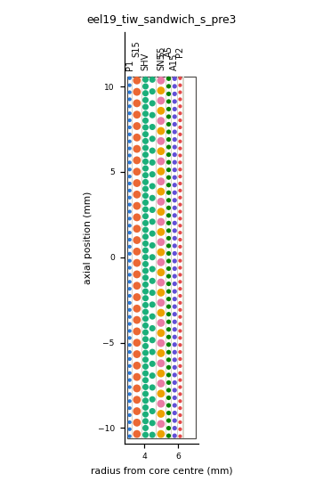

# TR1 on an EEL19 core – 10–15 W design (new transformer)

Board tube_power_5_1, sheet 1: PWM2 (IW1818, primary-side regulated QR flyback, integrated
800 V BJT) with TR1. The user has decided on a **new transformer on an EEL19 (long-leg E19)
core with a vertical 5+5 bobbin**, primary on fly leads, enamel wire with margin tape (no
triple-insulated wire), 10–15 W capability. This document takes the calibrated model and the
OpenMagnetics (MKF, PyOpenMagnetics 1.7.41) infrastructure from [FLYBACK_DESIGN.md](FLYBACK_DESIGN.md)
and reuses them unchanged for the EF20. The EF20 results stay reproducible: the netlists and the
MKF matrices of the EF20 options are bit-identical after this session's changes. Tables:
[eel19_results.md](eel19_results.md). Status 2026-11-17. Design study only: **the schematic and
board are not changed.**

Net names are the KiCad names: 15V, 5V, 15V_ISO_SEC, 5V_ISOL, −5V_SEC, −80 V (−100V BIAS). The
scripts keep the Proteus labels `20V` / `20V_ISO_SEC` internally.

## Summary

> **Update 2026-11-18: reinforced isolation is required** (552 Vrms / 778 Vpk, 11.1 mm creepage).
> The 3 + 3 mm margins of the enamel build below are too small. **The recommendation is now the
> TIW variant `eel19_tiw_sandwich_s_pre3` (section 12):**
> - TEX-E triple-insulated secondaries: S15 2 × 0.30, SHV 0.20, S5 / SN5 3 × 0.30;
> - enamel primary (AWG32, spread over the full width) and aux windings;
> - no margins, same turns, Lp, Rsense and preloads.
>
> Results:
> - Regulation as good as or better than the enamel build (15V 14.44–15.45 V, 5V 4.79–5.16 V).
> - Vcol 568 V at 15 W.
> - Winding loss 1.56 W at 15 W (MKF upper bound).
>
> Also needed:
> - a 1.2 × 26.5 mm creepage slot in the TR1 footprint (section 12.6);
> - 3 tape layers around the core (section 12.5).
>
> **Update 2026-11-18 (later): PWM2 is now the Infineon ICE5AR4780BZS** (section 13). With the
> 5.2 schematic values (VERR 88.7k / 49.9k from 5V, FB 4.7k + 10n ‖ 2.2n, RSel 750k = burst
> option 2, Rcs 0.8 Ω) the TIW build gives:
> - 5V 5.00 V in every case; 15V 14.18–15.31 V; 15V_ISO_SEC 14.55–17.44 V; 5V_ISOL / −5V 4.81–5.35 V;
>   −80 V 80.3–84.3 V;
> - VDS 556 V at 15 W (586 V at a 430 V bus);
> - 5V step ±28 mV; start-up at 15 W clears the OLP timer after 20 ms (30 ms min);
> - CoolMOS Tj ≈ 85 °C at 15 W.
>
> No schematic change is needed, and the preloads stay as they are (the 5V preload is now essential).
>
> **Update 2026-11-18 (evening): 100–450 V DC+ with the ICE5AR0680AG** (section 14). 20 W from
> 100 V to 450 V works on the EEL19, with no derating, using:
> - the same turns (Vor 97 V) and the same Lp 600 µH;
> - **thin strands**: TEX-E 0.20 for every isolated winding, AWG32 for every enamel winding;
> - **Rcs 0.685 Ω**.
>
> Results:
> - ΔT 48 K at 100 V / 20 W (MKF upper bound); Bpk 0.32 T at the worst-case current limit;
> - VDS 622 V at 450 V; rails as in section 13;
> - a full-load start at 100 V clears the OLP timer even at the minimum current limit.
>
> A higher Vor (120–150 V) is worse on this core. PWM2 becomes a PG-DSO-12 (SO-16-narrow land
> pattern, 4 drain pins). The VIN pin gets a line-OVP divider (≈ 483 V) or GND.
>
> The rest of this summary describes the enamel / margin-tape design, kept for reference.

- **Turns: every winding is doubled from the EF20 recommendation:** P 104 (2 × 52, split) /
  A15 16 / A5 6 ‖ S15 16 / S5 6 / SN5 6 / SHV 84. Because of this the turns ratios, the 5.58 V
  aux knee and Vor = 96.7 V are the same as before. **The Vsense divider (R64/R81/R84/R85)
  stays as it is**, and D8 sees the same stress (V_R = 0.81·DC+ + 80 V).
- **Lp = 600 µH** (AL 55.5 nH). **Rsense 1.0 Ω (R8 = R9 = 2.0 Ω, was 2.49 Ω).** With
  VIPK(HIGH) = 1.00 V the peak current is 1.00 A, OCP is 1.15 A, and the maximum power from the
  magnetising inductance is ½·Lp·I²·72 kHz = 21.6 W.
  - Flux density: Bpk 0.247 T at 1.00 A, 0.284 T at OCP, 0.21 T at 15 W (PC40 Bsat ≈ 0.39 T at 100 °C).
  - Timing at 15 W: Tr/Tp = 0.40, and DCM uses 7.8 of the 13.9 µs period even at 325 V.
- **Gap: spacer, 0.40 mm under all three legs (recommended), or grind the centre leg to about
  0.85–0.9 mm.** Either way the gap is set by measurement: **Lp = 600 µH ± 5 %**, or 50 µH on a
  30-turn test coil (section 4).
  - The spacer splits the gap three ways. This roughly halves the fringing-field losses that MKF
    predicts in the inner primary layer: 1.17 W instead of 2.12 W winding loss at 15 W.
- **Recommended winding: `eel19_sandwich_b_pre3`** (enamel, 3 mm margins, two 4-layer barriers):
  **P1 52 ‖ S15 16 | SHV 84 | S5+SN5 6+6 ‖ A5 6 | A15 16 | P2 52**.
  - Preloads: **2.2 kΩ on 15V, 1 kΩ on 5V and 3.3 kΩ on 15V_ISO_SEC**.
  - The P1–P2 crossover goes onto the free pin 5, so no sleeved lead has to leave the bobbin.
  - The two primary ends are fly leads in thick-wall PTFE sleeving to 2 extra PCB holes.
  - MAS document: [mas/tr1_eel19_recommended.json](mas/tr1_eel19_recommended.json).
- **Cross regulation over the 15 standard load cases at 400 V: about equal to the EF20
  recommendation on 15V and 5V, better on the other rails.**

  | rail | EEL19 recommended | EF20 margin_sandwich_8_pre |
  |---|---|---|
  | 15V | 14.59–15.97 V | 14.40–15.78 V |
  | 5V | 4.83–5.22 V | 4.85–5.22 V |
  | 15V_ISO_SEC | 14.91–16.75 V | 14.75–17.07 V |
  | 5V_ISOL | 4.89–5.32 V | 4.88–5.36 V |
  | −5V | 4.95–5.29 V | 4.97–5.53 V |
  | −80 V | 80.5–83.7 V | 78.5–82.8 V |

  At light and idle load every rail is as good or better: 15V 14.77 / 14.59 V against 14.40 / 14.64 V.
- **Full load** (new cases): 15 W out (Pin 17.1 W) at 400 V and at 325 V.
  - The PWM regulates at u = 0.71, Ipk 0.84 A, 72 kHz.
  - All rails stay within 14.45–14.89 V (15 V rails) / 4.80–4.99 V (5 V rails) / −80 V 81.6–82.2 V.
  - Collector peak 603 V (75 % of 800 V); D8 V_R 395 V.
- **IW1818 limit:** the product summary rates the IW1818 at **10 W** (open frame, 50 °C,
  universal input) and Renesas lists 10–12 W. The transformer and the sense resistor give 15 W,
  but 15 W continuous is above the IC's thermal rating. Treat **12 W continuous** as the design
  value and confirm 15 W by measuring the IC's GND-pin temperature (ψJB 25 °C/W, TSD 150 °C). For
  15 W continuous with margin, the iW1819 (18 W) is the option, but it is a different package
  (SO-10) and therefore a board change.
- **Board fit:** the part does **not** drop into the EF20 location as is.
  - It fits with TR1 moved **+0.93 mm in x, to (64.45, −4.28)**. The primary row then stays at
    x 58.45 and the isolated row moves to 70.45.
  - About 9 isolated-side small parts move 1.5–2 mm right, C3 gets a new spot, and C102 moves
    down about 1.4 mm.
  - Fly-lead holes at (57.4, 9.6) and (62.2, 9.6).
  - The F.Cu ISO_GND pour must be pulled back to x ≥ 69.8 for y 2…14. That is also needed for an
    existing 5.08 mm DC+ to ISO_GND spot (section 8).
- **D8 still needs ≥ 600 V** (ES1J/US1J; US1M for margin against turn-on ringing). D4/D5 see
  77 V and D6/D14/D29 28 V: ES1B/ES1D are fine there, and a true 50 V ES1A is not, for D4/D5.

## 1. Assumptions and sources

| item | value | source / status |
|---|---|---|
| core | EEL19: A 19.0, B 13.65 (half height), C 4.85 (depth), D 11.4 (half window height), E 14.0 (window width), F 4.85 (centre leg) mm; Ae 23.4 mm², le 62.1 mm, Ve 1450 mm³, 7.2 g | Chinese ferrite catalogue table (globalsources K1067465674.pdf, row "EEL19"); MKF computes Ae 23.4 mm² / le 59.9 mm from these dims. **Confirm with calipers** |
| core material | PC40 (TDK, MKF database; ≈ N87) | user (AliExpress EEL19 PC40) |
| bobbin | vertical 5+5, MyCoilTech MCT-EL1903(V5+5P) class: body 22.5 × 15.8 × 29.2 mm, pitch 4.0 mm, row distance 12.0 mm | vendor page; **confirm with calipers** (pitch might be 3.75/3.81/5.0 on other vendors) |
| winding window (model) | 21.2 mm axial × 3.975 mm radial (MKF simple bobbin: 0.8 mm flanges, 0.6 mm column wall) | assumption – measure the real bobbin |
| margins / tape | 3 mm margin tape both sides (15.2 mm winding width); polyester 25 µm + adhesive = 0.055 mm per layer; 4 layers per barrier, 1 layer between windings | user / as EF20 |
| IW1818 | 800 V BJT (VCES), IC 4 A, 72 kHz max PWM, Vcc 25 V abs / 20 V operating, product summary: 10 W (universal input, open frame, 50 °C) | Renesas iW1818 product summary Rev 1.1 (2022) |
| ISENSE / VSENSE thresholds | VIPK(HIGH) 1.00 V, VOCP 1.15 V (1.11–1.19), VIPK(LOW) 0.23 V, VSENSE 1.536 V, OVP 1.838 V; light-load modes PFM → DPWM 25 kHz → DPFM → DDPWM 2.1 kHz | iW1819 datasheet Rev 1.5 (same family; the iW1818 full datasheet is not public) |
| DC+ | 400 V nominal, 325 V before the PFC runs | as before |
| gate drivers | DRV5 / DRV6 are **Si8275BB** (UVLO grade B, 8 V): 15V feeds DRV5 VDDA (+ bootstraps), 15V_ISO_SEC feeds DRV6 VDDB; need ≥ 10 V worst case, abs max 30 V (Si827x datasheet, to verify) | user 2026-11-17 (replaces the "Si8274 UVLO grade" open question) |
| model | calibrated ngspice model of FLYBACK_DESIGN.md 2.1 unchanged (fixed 9.5 mA on 15V, AUX_MEAS, multi-mode control, ES1D rectifiers, RCD snubber R72 100R / R45 1M ‖ C12 470p) | – |

**Cross-check with ACME Ferrite's EE/EEL catalogue (2026-11-17,
https://www.acme-ferrite.com.tw/img/MnCorePDF/eel.pdf, p. 146–147).** A width, B half height,
C depth, D centre-leg width, E window width, F half window height (mm):

| core | A | B | C | D | E | F | Le mm | Ae mm² | Ve mm³ | AL P4 nH (ungapped) |
|---|---|---|---|---|---|---|---|---|---|---|
| EEL19 | 20.00 | 13.70 | 5.00 | 4.55 | 14.30 min | 11.15 | 61.0 | 25.0 | 1553 | 800 |
| EEL19A | 20.00 | 13.95 | 5.00 | 4.55 | 14.70 | 11.40 | 63.3 | 24.6 | 1557 | 800 |
| (this design) | 19.0 | 13.65 | 4.85 | 4.85 | 14.0 | 11.4 | 62.1 | 23.4 | 1450 | – |
| seller table (user, 2026-11-17) | 19 ±0.3 | 13.55 ±0.25 | 4.85 ±0.15 | 4.85 ±0.15 | 14 ±0.3 | 11.3 ±0.3 | – | (23.5) | – | – |

The seller's table (the core actually bought) matches the dims used here within 0.1 mm, so the design stands as computed. ACME's EEL19/EEL19A differ slightly. Differences to the dims used here are small and on the safe side: Ae +5…7 % (Bpk ≈ 0.20 T
instead of 0.21 T at 15 W), window width (E−D)/2 = 4.9–5.1 mm instead of 4.6 mm (more room for
the 2.76 mm build). The half window height (11.15–11.40 mm) sets the bobbin, i.e. the 15.2 mm
winding width – confirm on the actual bobbin. The results are not rerun; the gap is set by
measurement anyway (section 4).

## 2. Electrical design (`eel19_calc.py`)

**Why every turn count is doubled.** The EEL19 has a smaller Ae than the EF20 (23.4 vs 32 mm²)
but a much longer window (21.2 vs 12.6 mm). The higher power needs more Lp·I². Keeping Bpk at
OCP below 0.3 T then needs Np ≥ 95 turns. Np = 104 = 2 × 52 keeps:

- every turns ratio of the EF20 recommendation, so the same cross-regulation physics;
- A5 at 6 T giving the same 5.58 V knee, so **the Vsense divider stays unchanged**;
- Vor = 96.7 V;
- the same collector and rectifier stresses.

With A5 = 5 T instead, Np would be 87 (Bpk too high), and the 15 V windings would be 13 or
14 T (14.3 or 15.4 V).

| quantity | value |
|---|---|
| V/turn at the knee | 0.930 V (A5 6 T → 5.58 V; Vsense 1.536 V with the existing 0.2753 divider) |
| Vor | 96.7 V |
| Lp / AL | 600 µH / 55.5 nH |
| Rsense | 1.0 Ω (R8 = R9 = 2.0 Ω 1206, 1 %); Ipk max 1.00 A, OCP 1.15 A, Ipk min 0.23 A |
| Pmax (½ Lp Imax² fmax) | 21.6 W from the magnetising inductance |
| Bpk at Ipk max / OCP | 0.247 T / 0.284 T (hand calc Lp·I/(Np·Ae)); PC40 Bsat ≈ 0.39 T at 100 °C |
| VSENSE during the on-time | −6.35 V at 400 V into the divider (unchanged from today – same ratio) |

Power budget and timing (hand calculation; ES1x drop 0.9 V, 3 % copper, 4 % leakage; simulated
values in brackets):

| case | Pout W | from Lp W | Ipk A | ton µs (400 / 325 V) | Tr µs | Tr/Tp | period used (of 13.9 µs) | Bpk T |
|---|---|---|---|---|---|---|---|---|
| nom | 5.6 | 6.4 (Pin 6.7) | 0.55 (0.51) | 0.82 / 1.01 | 3.4 | 0.24 | 4.8–5.0 | 0.135 |
| full10 (table 1.1 maxima at once) | 10.9 | 12.6 (12.5) | 0.76 (0.72) | 1.14 / 1.41 | 4.7 | 0.34 | 6.5–6.7 | 0.19 |
| full15 | 14.9 | 17.2 (17.1) | 0.89 (0.84) | 1.34 / 1.65 | 5.5 | 0.40 | 7.5–7.8 | 0.22 |

- **DCM / QR**: at 15 W and 325 V there are still 6 µs left in each 72 kHz period, so the BJT
  turns on in a valley and never enters CCM.
- **CC limit:** the IW1818 regulates the output current from Ipk and Tr/Tp, and the threshold
  is not published. Tr/Tp ≤ 0.4 at 15 W keeps clear of the usual ~0.5 region. The model has no
  CC mode, so verify it on the bench: the 15 W load must not drop the rails.
- **Stress at DC+ 400 / 420 V (on-time plateau):**

  | | 400 V | 420 V |
  |---|---|---|
  | collector | 497 V + spike (simulated peak 603 V at full15) | 517 V + spike |
  | D8 | 404 V | 420 V |
  | D4 / D5 | 77 V | 81 V |
  | D6 / D14 / D29 | 29 V | 30 V |

- **Rail allocation for 15 W (case full15):** the extra capacity is spread over the gate-drive
  and logic rails.
  - 15V: 0.3 A.
  - 15V_ISO_SEC: 0.3 A (off-board +15V OUT).
  - 5V: 0.3 A.
  - 5V_ISOL: 0.3 A.
  - −5V_SEC: 0.2 A.
  - −80 V: 13.4 mA on top of the 6.6 mA bleeder.
  - Together with the preloads, bleeders and fixed loads this is 14.9 W. Any rail can take more
    as long as the total stays ≤ 15 W. ES1x is rated 1 A average and the windings carry
    ≤ 0.8 A rms in this case.

## 3. Winding options and results

Options (options.py, all with core "EEL19", Lp 600 µH, Rsense 1.0 Ω, 3 mm margins, enamel;
`_pre` = preloads 3.3 kΩ on 15V and 1 kΩ on 5V like the EF20 recommendation; `_pre3` adds
3.3 kΩ on 15V_ISO_SEC, and `eel19_sandwich_b_pre3` also lowers the 15V preload to 2.2 kΩ):

| option | build | notes |
|---|---|---|
| eel19_sandwich_pre | P1 52 ‖ S15 16 \| S5+SN5 \| SHV 84 ‖ A5 6 \| A15 16 \| P2 52 | EF20 recommendation × 2 turns |
| eel19_sandwich_pre3 | same + 3.3 kΩ on 15V_ISO_SEC | |
| eel19_sandwich_b_pre | P1 ‖ S15 \| SHV \| **S5+SN5** ‖ A5 \| A15 \| P2 | isolated 5 V pair directly across the barrier from the feedback winding |
| **eel19_sandwich_b_pre3** | same + 15V 2.2 kΩ, 5V 1 kΩ, 15V_ISO_SEC 3.3 kΩ | **recommended** |
| eel19_simple_pre | P 104 (2 layers) \| A15 \| A5 ‖ S15 \| S5+SN5 \| SHV, one barrier | simplest build, no split primary |
| eel19_spacer_pre | eel19_sandwich_pre with a spacer gap | gap-type check |

Leakage between the effective windings, referred to the 104 T primary (in brackets ÷ 4 for
the EF20's 52 T) from MKF:

| option | P–A5 | P–S15 | P–S5 | P–SHV | A5–S15 | A5–S5 | A5–SHV |
|---|---|---|---|---|---|---|---|
| EF20 margin_sandwich_8_pre (52 T) | 9.4 | 9.3 | 10.4 | 9.5 | 19.0 | 15.4 | 9.4 |
| eel19_sandwich | 20.2 (5.0) | 20.2 (5.0) | 21.3 (5.3) | 21.0 (5.3) | 32.7 (8.2) | 25.2 (6.3) | 16.6 (4.1) |
| eel19_sandwich_b | 20.1 (5.0) | 20.2 (5.0) | 21.5 (5.4) | 20.9 (5.2) | 32.7 (8.2) | **13.8 (3.4)** | 25.5 (6.4) |
| eel19_simple | 20.6 (5.2) | 34.6 (8.6) | 45.6 (11.4) | 54.2 (13.5) | 12.0 (3.0) | 23.1 (5.8) | 31.5 (7.9) |

The longer window halves the leakage per turn². The primary leakage with every other winding
shorted is 8.9 µH (1.5 % of Lp; EF20 2.9 µH).

Rails over the 15 standard load cases at 400 V (same set as results.md), nominal (min–max), V:

| option | 15V (limit 18.7) | 5V | 15V_ISO_SEC | 5V_ISOL | −5V_SEC | −80 V | Vcol max |
|---|---|---|---|---|---|---|---|
| EF20 margin_sandwich_8_pre | 14.65 (14.40–15.78) | 4.96 (4.85–5.22) | 14.75 (14.75–17.07) | 4.96 (4.88–5.36) | 4.97 (4.97–5.53) | 81.3 (78.5–82.8) | 556 |
| eel19_sandwich_pre | 14.81 (14.56–16.31) | 5.04 (4.80–5.27) | 15.03 (14.92–17.24) | 5.06 (4.97–5.40) | 5.07 (5.02–5.37) | 82.5 (79.9–83.6) | 571 |
| eel19_sandwich_pre3 | 14.83 (14.59–16.35) | 5.05 (4.81–5.27) | 15.05 (14.91–16.44) | 5.07 (4.97–5.34) | 5.08 (5.02–5.31) | 82.6 (80.0–83.6) | 572 |
| eel19_sandwich_b_pre | 14.66 (14.57–16.14) | 4.99 (4.81–5.21) | 14.94 (14.92–17.45) | 5.00 (4.88–5.32) | 5.00 (4.95–5.29) | 82.1 (80.3–83.7) | 571 |
| **eel19_sandwich_b_pre3** | **14.68 (14.59–15.97)** | **5.00 (4.83–5.22)** | **14.94 (14.91–16.75)** | **5.01 (4.89–5.32)** | **5.01 (4.95–5.29)** | **82.2 (80.5–83.7)** | 571 |
| eel19_simple_pre | 16.12 (15.58–**19.76**) | 5.31 (5.18–5.93) | 15.07 (14.77–16.38) | 5.01 (4.88–5.49) | 5.01 (4.93–5.45) | 81.0 (79.7–82.2) | 596 |
| eel19_spacer_pre | 14.81 (14.58–16.31) | 5.04 (4.80–5.27) | 15.04 (14.92–17.24) | 5.07 (4.97–5.40) | 5.07 (5.02–5.37) | 82.5 (80.0–83.6) | 571 |

Light / idle load (the user's criterion), recommended vs EF20 recommendation:

| case | 15V | 5V | 15V_ISO_SEC | 5V_ISOL | −5V | −80 V |
|---|---|---|---|---|---|---|
| light, EF20 | 14.40 | 4.92 | 17.07 | 5.36 | 5.53 | 78.5 |
| light, EEL19 b_pre3 | 14.77 | 5.08 | **15.12** | 5.20 | **5.17** | 80.8 |
| idle, EF20 | 14.64 | 4.85 | 15.59 | 5.09 | 5.25 | 80.2 |
| idle, EEL19 b_pre3 | 14.59 | 4.83 | 15.07 | 5.04 | 5.17 | 80.5 |
| min_15V, EF20 | 15.78 | 5.06 | 14.99 | 5.04 | 5.06 | 82.8 |
| min_15V, EEL19 b_pre3 | 15.97 | 5.09 | 15.15 | 5.09 | 5.09 | 83.4 |

Full load (b_pre3):

| case | 15V | 5V | 15V_ISO_SEC | 5V_ISOL | −5V | −80 V | Pin W | Ipk A | u | Vcol pk |
|---|---|---|---|---|---|---|---|---|---|---|
| full10 | 14.64 | 4.97 | 14.89 | 4.93 | 4.98 | 82.2 | 12.5 | 0.715 | 0.51 | 587 |
| full15 | 14.55 | 4.92 | 14.81 | 4.83 | 4.99 | 82.1 | 17.1 | 0.844 | 0.71 | 603 |
| full15_325 | 14.45 | 4.88 | 14.71 | 4.80 | 4.95 | 81.6 | 17.0 | 0.855 | 0.73 | 527 |

Observations:

- **The split-primary sandwich carries over.** `eel19_simple` (no split) puts A15 between P
  and A5 again. Its 15V rail peak-charges to 19.8 V in min_15V, above the 18.7 V AUX_MEAS
  limit, and 5V runs 5.3 V nominal. It is not usable without TIW-like coupling.
- **Order b** (S5+SN5 next to the barrier, facing A5) halves the A5–S5 leakage (25 → 14 µH).
  This lowers the light-load excursions of 5V_ISOL / −5V and of 15V_ISO_SEC.
- **Preloads:** the bleeder-only excursions (min_15V, min_S15) are a few tenths of a volt
  higher than on the EF20. This is because Ipk min is 0.23 A (was 0.185 A, since the 1.0 Ω sense
  resistor raises VIPK(LOW)/Rs) and Lp is larger, so each light-load pulse carries 2× the
  energy. Lowering the 15V preload to 2.2 kΩ and adding 3.3 kΩ on 15V_ISO_SEC brings 15V to
  ≤ 15.97 V and 15V_ISO_SEC to ≤ 16.75 V.
  - Si8275BB: the 8 V UVLO and 30 V abs max are met with margin. The minimum, 14.45 V at
    full15_325, is well above 10 V.
- **Gap type does not change the cross regulation** (spacer vs ground centre leg within 0.02 V),
  only the losses (section 5).
- The −80 V rail sits about 1 V higher than on the EF20 (82 V nominal, 80.5–83.7 V); the same
  scaled-capacitor bias of about +1 V applies (FLYBACK_DESIGN.md 3).

## 4. Gap and how to set it

Target **Lp = 600 µH ± 5 %** (P1 + P2 in series, all other windings open, 10 kHz, 0.3–1 V),
AL = 55.5 nH.

| method | gap | basis |
|---|---|---|
| **spacer under all three legs (recommended)** | **≈ 0.37–0.46 mm** (MKF reluctance models Zhang 0.39 / Partridge 0.37 / Mühlethaler 0.46; ideal without fringing 0.35) | `eel19_calc.py` |
| ground centre leg | ≈ 0.84–0.87 mm total (Zhang / Partridge; Mühlethaler 1.27; ideal 0.53) – e.g. 0.43 mm from each half | `eel19_calc.py` |

- MKF's field-energy inductance (used for the leakage matrices) needs a larger gap for 600 µH:
  0.83 mm spacer and 1.84 mm centre gap. On the EF20 it agreed with the reluctance models
  within 10 %; on the tall EEL19 window it does not (it attributes more energy to the window
  field). This only shifts the gap length that gives 600 µH. The simulations use Lp = 600 µH
  exactly, so the electrical results do not depend on it. **Set the gap by measurement.**
- **Procedure:**
  1. Wind a temporary **30-turn test coil** on a spare bobbin. The target is **50 µH**
     (30² × 55.5 nH), which measures more precisely than the 104 T primary early on.
  2. With the spacer, start at 0.40 mm (e.g. 4 × 0.1 mm polyester / Kapton or 2 × 0.2 mm,
     covering all three legs, halves clamped as in the final build).
  3. L goes roughly with 1 / spacer: if the reading is high, add about
     0.4 mm × (L/50 µH − 1); if low, remove the same.
  4. When grinding the centre leg, remove in 0.1 mm steps and re-measure. Grinding is permanent;
     the spacer is reversible.
  5. Finally measure Lp on the finished transformer: 570–630 µH. Then fix the core with tape or
     a clip and varnish.
- **Why the spacer:** it puts three ~0.4 mm gaps in place of one ~0.85 mm centre gap. That is
  less fringing field at the innermost layer (P1), which sits right at the centre-leg gap, so
  MKF's winding loss at 15 W falls from 2.12 W to 1.17 W (section 5). The outer-leg gaps radiate a
  little more stray field. At 15 W next to an ISO-side layout that is acceptable.

## 5. Losses and temperature

MKF winding losses (Dowell / Ferreira with MKF's gap-fringing field, 60 °C) from the simulated
currents. Core losses use PC40 Steinmetz / iGSE with the hand-calculated flux, because MKF's
core-loss path reports a Bpk of only 0.075–0.13 T for the custom shape.

| case | winding W, spacer gap (ground centre leg) | of which primary | core W (iGSE, 25–100 °C) | total |
|---|---|---|---|---|
| nom (5.6 W out) | 0.40 (0.71) | 0.15 (0.28) | 0.02–0.04 | ≈ 0.44 W |
| full15 | 1.17 (2.12) | 0.44 (0.83) | 0.07–0.14 | ≈ 1.3 W |

- These winding losses are an upper bound. They are dominated by proximity losses from the
  gap fringing field, which scale with MKF's (larger than real) gap. The DC part is small: at
  full15 P1 carries 0.17 A rms × 0.78 Ω, i.e. 23 mW.
- The EF20 recommendation had 0.14 W at nom.
- **Temperature rise** (surface ≈ 19.6 cm², ΔT ≈ (P[mW]/A[cm²])^0.833): about 13 °C at nominal
  load and **≤ 33 °C at 15 W** with the spacer gap (≈ 52 °C with the MKF ground-gap loss).
  Measure it on the sample.

## 6. Enamel build – `eel19_sandwich_b_pre3` with spacer gap (superseded 2026-11-18 by the TIW build, section 12)


**Window fill:**
- The radial build is 2.76 mm of 3.975 mm (69 %) with all tape counted.
- The low-turn windings fill 93 % of the 15.2 mm width in one layer.
- P1 and P2 fill 82 % close-wound.

Every section has 3 mm margin tape on both flanges (built up to the section height), so the
winding width is 15.2 mm. All windings are wound in the same rotational direction, and the
start of each winding is its dot.

| # | winding | turns | wire | layer(s) | start → finish | notes |
|---|---|---|---|---|---|---|
| 1 | **P1** (primary half 1) | 52 | 1 × AWG32 heavy (0.24 mm) | 1, close-wound, centred | **fly lead FL_DC (DC+)** at the pin end → top flange; return lead (sleeved, over 1 tape layer) down the margin to **pin 5** | quiet (DC+) end inside, next to the core |
| – | **barrier** | | 4 layers 25 µm polyester (3M 1350F-1 class) | | | reinforced (≥ 3 layers); full width over the margins |
| 2 | S15 → 15V_ISO_SEC (D4) | 16 | 3 × AWG30 heavy in parallel | 1, spread over the width | pin 9 → pin 10 | strands side by side |
| – | tape | | 1 layer | | | |
| 3 | SHV → −80 V (D8) | 84 | 1 × AWG34 heavy | 2 (model: 79 + 5; 42 + 42 spread is equivalent) | pin 6 → pin 9 | |
| – | tape | | 1 layer | | | |
| 4 | S5 + SN5 → 5V_ISOL (D29), −5V_SEC (D14) | 6 + 6 | 4 × AWG30 each, multifilar (strands alternate S5 / SN5) | 1, spread | S5: pin 9 → 7; SN5: pin 8 → 9 | wind both as one 8-strand bundle |
| – | **barrier** | | 4 layers | | | reinforced |
| 5 | A5 → 5V + AUX_FB (D6) | 6 | 8 × AWG30 in parallel | 1, spread | pin 2 → pin 3 | the feedback winding faces S5/SN5 across the barrier |
| – | tape | | 1 layer | | | |
| 6 | A15 → 15V (D5) | 16 | 3 × AWG30 in parallel | 1, spread | pin 2 → pin 1 | |
| – | tape | | 1 layer | | | |
| 7 | **P2** (primary half 2) | 52 | 1 × AWG32 heavy | 1, close-wound, centred | from **pin 5** (sleeved lead up the margin) → wound top to bottom → **fly lead FL_C (collector)** at the pin end | P1 + P2 in series aiding |
| – | outer wrap | | 2–3 layers tape | | | |

**Pins (5+5 vertical bobbin, same numbering and row orientation as the EF20 footprint):**

| pin | row | connection |
|---|---|---|
| 1 | primary | A15 finish → D5 anode (15V) |
| 2 | primary | GND (A5 and A15 start) |
| 3 | primary | A5 finish → AUX_FB / D6 anode |
| 4 | primary | not connected (mount-only pad, or clip the pin) – spacing between the aux pins and the crossover |
| 5 | primary | **P1–P2 crossover post** – mount-only pad, **no net**, ≥ 2.5 mm to other copper (it carries up to ≈ DC+ + Vor/2 with the switching swing) |
| 6 | isolated | SHV dot → D8 cathode (−80 V) |
| 7 | isolated | S5 finish → D29 anode (5V_ISOL) |
| 8 | isolated | SN5 dot → D14 cathode (−5V_SEC) |
| 9 | isolated | ISO_GND (S15 / S5 start, SN5 / SHV finish) |
| 10 | isolated | S15 finish → D4 anode (15V_ISO_SEC) |
| FL_DC | primary, fly lead | P1 start → DC+ (new PCB hole, 1.2 mm drill) |
| FL_C | primary, fly lead | P2 finish → IW1818 collector / D7 (new PCB hole) |

- **Fly leads:**
  - Both leave the bobbin at the base on the **primary side, at the pin-5 end**.
  - Each is the AWG32 magnet wire doubled and twisted, or spliced inside the margin zone to a
    0.4–0.5 mm tinned lead, in **thick-wall PTFE / FEP sleeving (wall ≥ 0.3–0.4 mm, reinforced
    rating)**.
  - The sleeving starts ≥ 3 mm inside the winding margin and runs to the PCB, with a free length
    of about 10–15 mm.
  - The collector lead is the high-dV/dt node: keep it short and away from the isolated row.
- **Split primary with fly leads:**
  - Because the primary ends use fly leads, pin 5 is free and serves as the crossover post. The
    P1–P2 crossover therefore never leaves the bobbin and needs no third sleeved fly lead.
  - Its two leads lie in the primary-side margin zone and run under / over the barrier tape.
    Sleeve them where they pass the isolated sections' margins.
- **Isolation:**
  - 3 + 3 mm margins give 6 mm creepage around each barrier edge (MKF coordination for
    reinforced insulation, PD2, OVC II, 264 V: 3.2–4.4 mm creepage).
  - 4 tape layers per barrier.
  - The P1 → secondary barrier and the secondary → A5 barrier both see the full
    primary-to-isolated working voltage.
  - Vertical bobbin, primary row on one side and isolated row on the other: row-to-row pad gap
    10.2 mm on the PCB.

### 6a. Bobbin actually bought: EEL19 vertical 4+6 (user, 2026-11-17)

Seller data: 4-pin row pitch 3.5 mm, 6-pin row pitch 2.7 mm, row spacing ("array pitch")
12.5 mm. It replaces the 5+5 / 4.0 mm / 12 mm assumption above; the winding build is unchanged.
The pin count is exactly enough (the 5+5 pin 4 spacer is dropped, the 6-pin row has a spare):

| pin | row | connection |
|---|---|---|
| P1 | primary (4 × 3.5 mm) | A15 finish → D5 anode (15V) |
| P2 | primary | GND (A5 and A15 start) |
| P3 | primary | A5 finish → AUX_FB / D6 anode |
| P4 | primary (end pin, at the fly-lead end) | **P1–P2 crossover post: no PCB pad, no net.** Terminate the crossover on the pin, then clip the pin flush with the bobbin base (it swings to ≈ DC+ + Vor/2; a pad at 3.5 mm pitch would leave only ≈ 1.7 mm copper gap to the AUX_FB pad) |
| S1 | isolated (6 × 2.7 mm) | SHV dot → D8 cathode (−80 V) |
| S2 | isolated | spare – clip, no pad (spacing between −80 V and the 5 V pins) |
| S3 | isolated | S5 finish → D29 anode (5V_ISOL) |
| S4 | isolated | SN5 dot → D14 cathode (−5V_SEC) |
| S5 | isolated | ISO_GND (S15 / S5 start, SN5 / SHV finish) |
| S6 | isolated | S15 finish → D4 anode (15V_ISO_SEC) |
| FL_DC, FL_C | primary, fly leads | as above (P1 start → DC+, P2 finish → collector) |

- Footprint: 4 pads at 3.5 mm pitch (only P1–P3 get pads) and 6 at 2.7 mm (S2 without pad),
  rows 12.5 mm apart, plus the two fly-lead holes; confirm pin diameter (drill ≈ pin + 0.3 mm)
  and the base outline with calipers. 2.7 mm pitch needs ≤ 1.7 mm pads (≥ 1.0 mm gap; the
  largest isolated pin-to-pin voltage is ≈ 100 V, S1 −80 V next to the spare).
- Rows 12.5 mm apart (was 12.0) add 0.5 mm row-to-row creepage on the PCB (≈ 10.7 mm); the rows
  are shorter (10.5 / 13.5 mm instead of 16 mm), so the board fit (section 8) needs at most
  0.5 mm more in x and less in y – recheck when the footprint is drawn.

## 7. Schematic / BOM changes (for the next board revision; nothing edited here)

| ref | today | new | why |
|---|---|---|---|
| TR1 | EF20 10-pin, V2 52/8/3‖7/3/3/42 | **EEL19 vertical 4+6 (bought; 5+5 also works), PC40, 104(52+52)/16/6 ‖ 16/6/6/84, Lp 600 µH, spacer gap** | 15 W, better cross regulation  **2026-11-18: secondaries in TEX-E TIW, primary AWG32 spread, no margins (section 12.3)** |
| TR1 footprint | Transformer_EF20_2x5_P3.81mm (3.81 × 10.16 mm) | new EEL19 4+6: pitch 3.5 / 2.7 mm, rows 12.5 mm (section 6a), crossover and spare pins without pad, **+2 holes FL_DC / FL_C** (1.2 mm drill, 2.2 mm pad) | new bobbin, fly leads |
| R8, R9 | 2.49 Ω 1206 | **2.0 Ω 1206 1 %** (Rsense 1.0 Ω; 32 mW total at 15 W) | Ipk max 1.0 A, OCP 1.15 A |
| R64, R81, R84, R85 | 39k / 15k / 33k / 4.7k | **unchanged** | aux knee voltage unchanged (6 T at 0.93 V/T) |
| new | – | **2.2 kΩ preload on 15V** (102 mW → 1206 0.25 W), **1 kΩ on 5V** (25 mW) | light-load excursions |
| R124 | 12.1 kΩ (15V_ISO_SEC bleeder) | **2.61 kΩ** (= 12.1k ‖ 3.3k; 86 mW, 1206) or add 3.3 kΩ | min_S15 excursion |
| D8 | 1000 V diode fitted (user) | keep ≥ 600 V (US1M 1000 V), same SMA | V_R 395 V at 400 V, 420 V at 420 V |
| D4, D5 | ES1A family | ES1B/ES1D (≥ 100 V) – a true 50 V ES1A would be overstressed (77 V) | |
| C1, C2 (220 µF, 15 V rails), C6/C36/C71, C114/C115 | – | check ripple-current rating at 15 W (winding rms 0.6–0.8 A at full15) | not simulated with the real ESR |
| snubber D7 / R72 / R45 / C12 | S1M / 100R / 1M / 470p | unchanged in the model (Vcol 603 V at full15, R45 13 mW) – check on the bench | |
| PWM2 | IW1818 (10–12 W class) | keep for ≤ 12 W continuous; iW1819 (18 W, SO-10) if 15 W continuous is required | IC thermal rating |

## 8. Board fit (read-only check of kicad/tube_psu.kicad_pcb)

- **Today's TR1:** `tube_psu:Transformer_EF20_2x5_P3.81mm` at (63.516, −4.278), courtyard
  x 56.41…70.88, y −15.58…6.77.
  - Primary row (pins 1–5: D5-A, GND, AUX_FB, DC+, collector) at x 58.44.
  - Isolated row (pins 6–10: D8-K, D29-A, D14-K, ISO_GND, D4-A) at x 68.60. Both rows run along y.
  - The board has no 3D model or height data, so the EF20 height is not known from the board.
- **Orientation:** the EEL19 goes in with its rows parallel, body 15.8 mm in x and 22.5 mm in y.
  Rotated 90° it collides with about 24 parts and puts both rows across the barrier.
- **In place it does not fit.** At the current origin the courtyard overlaps 18 parts. The R
  column (R64/R81/R84/R85) and PWM2 on the left, and D8/D14/C45 on the right, leave 14.8 mm for
  a 16.8 mm courtyard. D4 to C102 leaves 22.2 mm for 23.5 mm.
- **Fits with TR1 at (64.45, −4.28)** (+0.93 mm in x):
  - The primary row stays at x 58.45 and the left side needs no moves (PWM2 overlaps by 0.05 mm).
  - The isolated row is at x 70.45, still inside the inner-layer GND / ISO_GND gap
    (x 59.7 / 69.2).
  - Parts to move:
    - D8, D14, C45, C40 and C44: +1.5…2 mm in x (room up to x ≈ 79).
    - B-side C114 / C115: +1.5 mm. Their ISO_GND pads would otherwise be 0.1–0.3 mm from new
      pin 8.
    - D29: optional, same net.
    - C3: new location.
    - C102: down about 1.4 mm (its courtyard then ends at y 18.0 against the 18.7 board edge).
  - New pin y positions: −12.28, −8.28, −4.28, −0.28, 3.72. The pad gap from the primary row to
    the isolated row grows from 8.6 to 10.2 mm.
- **Fly-lead holes** (below the body at the primary end):
  - **FL_C (57.4, 9.6)**: 1.3 mm from the existing collector track, 7.9 mm to isolated copper.
  - **FL_DC (62.2, 9.6)**: 8.1 mm to new pin 6. It is only 3.1 mm from the F.Cu ISO_GND pour,
    so **the pour edge must be pulled back to x ≥ 69.8 for y 2…14**. The existing DC+ track at
    x 60.7 is already only **5.08 mm** from that pour, which is a pre-existing creepage issue.
  - DC+ re-routes from its feed at (60.7, 13.57) with a short jog.
  - Pad-edge gap from FL_C to FL_DC: 2.6 mm. The existing DC+ and collector tracks are 1.96 mm
    apart, so this is no worse.
- **Re-routing:** every TR1 pad's tracks and pour spokes (pins 1–3, 6–10). The DC+ and
  collector tracks move from pins 4/5 to FL_DC / FL_C. Refill the zones, since they carry the
  clearance holes around the old pads.
- **Height:** the EEL19 vertical bobbin is about 29.2 mm. Nothing on the board limits it (J2
  mezzanine header is about 20 mm to the left; the nearest tall part is C102, a 10 mm radial
  cap). **Check the enclosure lid / MCU board clearance** over x 56…72.
- Analysis scripts used for this check (not committed):
  `/tmp/claude-1000/-home-jari-dev-tube-psu-kicad/efeb51ce-d43d-4cf8-bc58-6e92a9697ed4/scratchpad/boardfit/`.

## 9. What to measure on the first sample

1. Core and bobbin: dimensions with calipers. Specifically the window (21.2 × 3.98 mm assumed),
   the pin pitch and row distance (4.0 / 12.0 mm assumed), the pin cross-section, and the bobbin
   height and standoffs. Also check the fly-lead exit slot.
2. **Lp = 600 µH ± 5 %** (P1 + P2 in series, 10 kHz). Record the spacer thickness, and repeat
   after varnish and clamping.
3. Leakage: Lp with all other windings shorted, model 8.9 µH. Also P vs S15 shorted alone and
   P vs A5 shorted alone (model referred to 104 T: 20 µH each).
4. Turns-ratio check: drive P1 + P2 with 10 V / 50 kHz and read every winding open-circuit. The
   ratios must be 104 : 16 : 6 : 16 : 6 : 6 : 84, and the dots must be as in the table above.
5. Hipot: primary (incl. A5/A15) to the isolated windings, 3 kV AC 1 min (or 4.2 kV DC). Pin 5
   and the fly leads count as primary.
6. On the board:
   - Rails at idle, light, nominal and the full10 / full15 loads (electronic loads on 15V_ISO_SEC
     and 5V_ISOL, resistors on the others).
   - **Collector peak at full15 and DC+ 400–420 V** (model 603 V; the limit is 800 V).
   - D8 reverse voltage.
   - **IW1818 GND-pin (pin 3) temperature** at 12 W and 15 W: Tj ≈ T(pin 3) + 25 °C/W × Pdiss;
     stay well below the 150 °C TSD.
   - Transformer surface temperature at 15 W (estimate ≤ 33 °C rise).
   - 15V in min_15V: isolated outputs loaded, primary gate drivers idle (model 15.97 V; the
     AUX_MEAS limit is 18.7 V).
7. CC limit: increase the load past 15 W and record where the rails start to fall. Check that
   15 W is below the IW1818's CC threshold.

## 10. Open questions

1. Real EEL19 core / bobbin dimensions and pin pattern (section 9.1). The board-fit and window
   results assume the MyCoilTech / catalogue numbers.
2. ~~12 W vs 15 W continuous?~~ Answered (user 2026-11-17): 12 W continuous is enough; changing
   to the iW1819 is fine if it is stocked. It is: **iW1819-00** (0 mV cable compensation – right
   here, no cable; OTP recovery 100 °C; SO-10 batwing, 800 V BJT, 72 kHz, up to 18 W) is in stock
   at DigiKey (IW1819-00, about 4,800 pcs) and listed at Mouser; -01 / -11 (150 mV cable comp)
   are 18-week lead time – do not use. Next revision: PWM2 → iW1819-00, new SO-10 batwing
   footprint and pinout on sheet 1 (to do), keep Rsense 1.0 Ω / the EEL19 design.
Answered by the user (2026-11-17):

- Height: plenty of room above TR1 (bench photo) – the 29.2 mm body is fine.
- Board move (TR1 +0.93 mm, about 9 parts, ISO_GND pour pull-back): acceptable.
- Preloads (2.2k on 15V, 1k on 5V, R124 → 2.61k), about 0.2 W continuous: acceptable.
- D8 fitted today is a **1000 V** diode – OK for the 395–420 V reverse voltage (the D8 finding
  is closed; keep a ≥ 600 V part, US1M class, in the BOM).

## 11. How to rerun

```
cd /home/jari/dev/tube_psu_kicad
python3 simulation/flyback/eel19_calc.py                                   # hand calculations, gap (out/eel19_calc.json)
python3 simulation/flyback/run_flyback.py --om-only eel19_sandwich_b_pre3 eel19_recommended   # MKF matrices, MAS file
python3 simulation/flyback/run_flyback.py eel19_sandwich_b_pre3 --jobs 4   # 19 cases (16 standard + full10/full15/full15_325)
python3 simulation/flyback/losses.py eel19_spacer_pre                      # winding/core losses at nom
python3 simulation/flyback/losses.py eel19_spacer_pre --case full15        # ... at 15 W (out/losses/<opt>__full15.json)
python3 simulation/flyback/eel19_report.py                                 # eel19_results.md, geometry_eel19_*.png
```

- **Code changes this session (the EF20 options are unaffected):**
  - `om_model.py`: `use_core("EF20" | "EEL19")`. Custom EEL19 shape and MKF simple bobbin,
    turn length for a square column, `make_core(gap, kind)` with kind "spacer" (gap in all
    legs). The option keys are `core`, `gap_kind`, `lp`.
  - `flyback_sim.py`: per-case `rsense` and `knee_at`. The defaults are the EF20 board values;
    the EEL19 uses 0.4 At, the same 67 mA in the 6 T aux.
  - `run_flyback.py`:
    - EEL19 options take their own Rsense, u0 from the total primary inductance, and a PI gain
      scaled to the same loop gain.
    - `FULL_CASES` (full10, full15, full15_325) run for options with `full_cases`.
    - The MAS magnetising inductance of an EEL19 option is the whole primary.
  - `losses.py`: core-aware, plus `--case`.
- **Runtimes:**
  - 57 cases (3 options) took 814 s with 4 jobs, peak 0.72 GB ngspice.
  - 38 cases took 528 s; 19 cases took 290 s.
  - MKF matrix of one EEL19 sandwich: about 1.5 min.

## 12. TIW variant: reinforced isolation (2026-11-18), recommended

**New requirement.** The user requires **reinforced** primary ↔ secondary isolation. TR1's
isolated windings belong to the DAB-secondary domain (ISO_GND, earthed), so the working
voltage is **552 Vrms / 778 Vpk**: **11.1 mm creepage, 4.0 mm clearance**
(kicad_next/README.md, isolation domains). The enamel design above has 3 + 3 mm margins, i.e.
6 mm around each barrier edge, which is too small. Wider margins do not fit either: two
5.6 mm margins would leave 10 mm of the 21.2 mm window.

The isolated windings (S15, SHV, S5, SN5) are therefore wound in **triple-insulated wire**,
Furukawa **TEX-E** (IEC 62368-1 Annex J class). The primary and the primary-side aux windings
(P1/P2, A5, A15) stay enamel. No margin tape is used, so the full 21.2 mm width is available.
There is 1 tape layer between sections (mechanical) and a 2-layer outer wrap. The turns are
unchanged (104 / 16 / 6 ‖ 16 / 6 / 6 / 84), as are Lp 600 µH, Rsense 1.0 Ω and the preloads of
`eel19_sandwich_b_pre3` (2.2 k / 1 k / 3.3 k). The spacer gap is set by measurement (section 4).
Code: `options.py` (`eel19_tiw_*`), TEX-E wires in `om_model.TEX_E`.

**What depends on the controller model.** The rail voltages, Vcol, D8 V_R and the waveforms
behind the loss figures below come from the calibrated ngspice model of the **iW1819 / IW1818
family**:
- primary-side regulation by sampling the A5 knee;
- 72 kHz QR PWM;
- the PFM → DPWM 25 kHz → DDPWM 2.1 kHz light-load modes;
- VIPK(HIGH) 1.00 V / VIPK(LOW) 0.23 V with Rsense 1.0 Ω.

The **light-load excursions** (min_*, light, idle) depend most on that control law: the
light-load modes set Ipk min and the energy per pulse.

The **magnetics** do not depend on the controller: the leakage matrices, the window fill, the
isolation and pin plan, and the ranking of the winding orders by leakage. **If PWM2 changes**
(e.g. to the Infineon ICE5AR4780BZS proposed on 2026-11-18), keep the winding structure and
redo the rail and loss numbers (NEXT.md has the list). **Done for the ICE5AR4780BZS in section 13.**

**iW1819-00 vs the IW1818 parameters in the model.** Checked against iW1819 datasheet Rev 1.5
(10-Feb-2022). The model has used the iW1819 thresholds from the start, because the IW1818
full datasheet is not public. Hence **no model change is needed**:

| parameter | iW1819-00 | in the model / IW1818 |
|---|---|---|
| VSENSE(NOM) / OVP | 1.536 V (1.521–1.551) / 1.838 V | same |
| VOCP / VIPK(HIGH) / VIPK(LOW) | 1.15 V (1.11–1.19) / 1.00 V / 0.23 V | same (Rsense 1.0 Ω → Ipk 1.0 A, OCP 1.15 A) |
| fSW max (PWM, > 50 % load) | 72 kHz | same |
| light-load modes | PFM → DPWM ≈ 25 kHz → DPFM → DDPWM ≈ 2.1 kHz | same law (partly assumed) |
| BJT | VCES / VCBO 800 V, VCEO 450 V, IC 4 A, ICM 8 A | same |
| rating | 18 W (85–264 VAC, open frame, 50 °C) | IW1818: 10 W (Renesas 10–12 W) |
| VCC | 20 V operating, 25 V abs, start-up 14.5 V (13.5–15.5), UVLO 4.4 V, ICCQ 2.7 mA | model: fixed 9.5 mA on 15V (IC + Si827x supplies), no VCC start-up modelled |
| thermal | θJA 55.2 °C/W (JEDEC 4-layer), ψJ-collector 5.8 °C/W, TSD 150 °C, recovery 100 °C (-00) | IW1818 summary: ψJB 25 °C/W at the GND pin, so on the iW1819 measure the **collector pins 5/6** temperature |
| package / pins | SO-10 batwing: 1 VSENSE, 2 VCC, 3 GND, 4 NC (leave open), 5/6 C, 7 E, 8 GND, 9 ISENSE, 10 ASU (active start-up, optional) | new footprint and symbol (NEXT_REVISION 1.5) |
| cable compensation | -00: 0 mV (right: no cable); -01/-11: 150 mV | – |

### 12.1 TEX-E sizes used

Typical outer diameter = Cu + 0.20 mm (Furukawa TEX-E table; Block CU-TIW 100/0,25 = TEX-E 0.25:
heat class 120 °C (E), UL 130 °C, "solderable without prior stripping"):

| TEX-E | Cu mm | OD typ / max mm | R20 max Ω/km | used for |
|---|---|---|---|---|
| 0.20 | 0.20 | 0.400 / 0.417 | 607.6 | SHV (84 T, 2 layers) |
| 0.25 | 0.25 | 0.450 / 0.467 | 382.5 | the paired-layer variants |
| 0.30 | 0.30 | 0.500 / 0.520 | 262.9 | S15 (2 in parallel), S5 / SN5 (3 in parallel each) |

**Solderability:** the polyester / polyamide layers are "solderable", but only in a hot solder
pot. Dip at about **420–450 °C for 2–4 s** (typical for TIW; confirm with the Furukawa sheet). A
350 °C iron does not get through. Alternatively strip mechanically, but never more than the
length that wraps the pin. Tin the ends before winding the pin wraps, and check the tinning
reaches the copper (resistance check of each winding against the table in 12.3).

### 12.2 Options and results

Options (all TIW secondaries, no margins, spacer gap, preloads of b_pre3):

| option | build (radially outwards) |
|---|---|
| eel19_tiw_simple_pre3 | P 104 (AWG30, 2 layers) \| A15 \| A5 \| S15 \| S5+SN5 \| SHV: simplest, no split primary |
| eel19_tiw_sandwich_pre3 | P1 52 \| S15 16 \| SHV 84 \| S5+SN5 6+6 \| A5 6 \| A15 16 \| P2 52, primary AWG30 close-wound (15.3 mm, centred) |
| **eel19_tiw_sandwich_s_pre3** | **same order, primary AWG32 spread over the full 21.2 mm** |
| eel19_tiw_paired_b / _c / _m_pre3 | tight interleave: A15+S15 (1 × AWG28 + 2 × TEX-E 0.25) in one multifilar layer, A5+S5+SN5 (2 × AWG30 + 3 + 3 × TEX-E 0.25) in one; b: P1 \| SHV \| 15 V pair \| 5 V triple \| P2, c: P1 \| 5 V triple \| 15 V pair \| SHV \| P2, m: P1 \| 15 V pair \| SHV \| 5 V triple \| P2 (primary AWG30 close-wound) |
| eel19_tiw_paired_ms_pre3 | paired_m with the primary AWG32 spread over the full width |

Leakage referred to 104 T (MKF), radial build:

| option | P–A5 | P–S15 | P–S5 | P–SHV | A5–S15 | A5–S5 | A5–SHV | A15–S15 | build mm (of 3.975) |
|---|---|---|---|---|---|---|---|---|---|
| eel19_sandwich_b_pre3 (enamel, margins) | 20.1 | 20.2 | 21.5 | 20.9 | 32.7 | 13.8 | 25.5 | 43.1 | 2.76 |
| eel19_tiw_simple | 21.1 | 29.7 | 43.5 | 56.0 | 7.2 | 21.0 | 33.6 | 13.8 | 3.36 |
| eel19_tiw_sandwich | 30.0 | 29.8 | 31.0 | 28.4 | 36.7 | 10.0 | 23.4 | 45.3 | 3.42 |
| **eel19_tiw_sandwich_s** | **14.6** | **14.2** | **15.6** | **13.1** | 36.3 | **9.9** | 23.2 | – | 3.31 |
| eel19_tiw_paired_b | 33.2 | 24.3 | 25.5 | 23.1 | 19.6 | 13.9 | 30.7 | 7.2 | 2.62 |
| eel19_tiw_paired_ms | 18.8 | 9.9 | 10.9 | 8.1 | 35.5 | 14.0 | 21.3 | ≈ 7 | 2.51 |

- **Matching the primary's width to the secondaries matters most.** A close-wound primary
  layer that is narrower than the full-width TIW layers (15.3 mm AWG30, or 12.5 mm AWG32)
  creates radial stray field at the layer ends:
  - P–S leakage 30 µH (AWG30, 15.3 mm), 47 µH (AWG32 close-wound, MKF; option dropped);
  - **14 µH** with AWG32 spread over 21.2 mm.
- That is lower than the enamel design (20 µH), whose layers were all 15.2 mm wide.

Rails over the 15 standard cases at 400 V, nominal (min–max), V (**iW1819-model dependent**):

| option | 15V | 5V | 15V_ISO_SEC | 5V_ISOL | −5V_SEC | −80 V | Vcol max (std / full15) |
|---|---|---|---|---|---|---|---|
| eel19_sandwich_b_pre3 (enamel) | 14.68 (14.59–15.97) | 5.00 (4.83–5.22) | 14.94 (14.91–16.75) | 5.01 (4.89–5.32) | 5.01 (4.95–5.29) | 82.2 (80.5–83.7) | 571 / 603 |
| eel19_tiw_simple | 15.90 (15.49–**18.50**) | 5.28 (5.17–5.62) | 15.21 (15.02–15.81) | 5.05 (4.91–5.39) | 5.02 (4.93–5.30) | 80.6 (79.2–80.9) | 608 / 642 |
| eel19_tiw_sandwich | 14.64 (14.49–16.12) | 4.99 (4.79–5.22) | 15.06 (15.06–17.57) | 5.01 (4.89–5.34) | 4.99 (4.91–5.30) | 82.7 (80.5–84.8) | 608 / 649 |
| **eel19_tiw_sandwich_s** | **14.65 (14.44–15.45)** | **4.99 (4.79–5.16)** | **15.06 (15.02–17.42)** | **5.02 (4.90–5.34)** | **5.00 (4.93–5.29)** | **82.7 (80.5–84.1)** | **552 / 568** |
| eel19_tiw_paired_b | 14.70 (14.37–14.92) | 5.00 (4.74–5.27) | 14.46 (14.19–14.86) | 4.86 (4.72–5.47) | 4.83 (4.73–5.47) | 83.8 (78.8–87.6) | 608 / 648 |
| eel19_tiw_paired_c | 14.55 (14.20–14.77) | 5.00 (4.73–5.24) | 14.32 (14.01–14.74) | 4.87 (4.73–5.38) | 4.84 (4.76–5.39) | 83.0 (76.6–85.9) | 608 / 656 |
| eel19_tiw_paired_m | 15.00 (14.53–15.10) | 5.08 (4.75–5.41) | 14.76 (14.50–15.69) | 4.95 (4.79–5.67) | 4.92 (4.81–5.66) | 81.9 (78.3–82.5) | 606 / 643 |
| eel19_tiw_paired_ms | 15.02 (14.52–15.11) | 5.08 (4.75–5.35) | 14.79 (14.38–15.33) | 4.94 (4.79–5.71) | 4.91 (4.80–5.63) | 82.0 (78.3–82.5) | 550 / 568 |

Full load, recommended `eel19_tiw_sandwich_s_pre3` (enamel b_pre3 in brackets):

| case | 15V | 5V | 15V_ISO_SEC | 5V_ISOL | −5V | −80 V | Pin W | Ipk A | u | Vcol pk |
|---|---|---|---|---|---|---|---|---|---|---|
| full10 | 14.59 (14.64) | 4.95 (4.97) | 14.98 (14.89) | 4.93 (4.93) | 4.96 (4.98) | 82.6 (82.2) | 12.5 (12.5) | 0.729 | 0.53 | 560 (587) |
| full15 | 14.55 (14.55) | 4.93 (4.92) | 14.94 (14.81) | 4.86 (4.83) | 4.98 (4.99) | 82.8 (82.1) | 17.1 (17.1) | 0.857 | 0.73 | 568 (603) |
| full15_325 | 14.44 (14.45) | 4.89 (4.88) | 14.83 (14.71) | 4.82 (4.80) | 4.94 (4.95) | 82.2 (81.6) | 16.8 (17.0) | 0.835 | 0.70 | 492 (527) |

Losses (MKF Dowell / Ferreira with gap fringing, 60 °C windings, spacer gap; an upper bound as in
section 5, waveforms from the iW1819 model). Winding W at nom / full15 (of which primary at full15),
core iGSE at full15:

| option | winding nom | winding full15 (primary) | core full15 | ΔT at 15 W (section 5 formula) |
|---|---|---|---|---|
| eel19_recommended (enamel, spacer) | 0.42 | 1.22 (0.46) | 0.14 | ≈ 34 °C |
| eel19_tiw_simple | 0.51 | 1.00 (0.43) | 0.34 | – |
| eel19_tiw_sandwich | 0.89 | 2.49 (1.26) | 0.42 | – |
| **eel19_tiw_sandwich_s** | **0.56** | **1.56 (0.46)** | **0.14** | **≈ 41 °C** |
| eel19_tiw_paired_b / c / m | 1.74 / 1.60 / 1.31 | 5.0 / 4.9 / 3.6 | 0.29–0.33 | too hot |
| eel19_tiw_paired_ms | 0.55 | 1.68 (0.61) | 0.13 | ≈ 43 °C |

Observations:
- **Simple order (no split primary)** puts A15 between P and A5 again. 15V peak-charges to
  18.5 V in min_15V (limit 18.7 V) and 5V runs 5.3 V: not usable, as with enamel.
- **Sandwich with the spread AWG32 primary** gives the enamel design's regulation or better on
  every rail:
  - 15V max 15.45 instead of 15.97 V; 5V within 4.79–5.16 V.
  - The one exception is 15V_ISO_SEC in min_S15 (rail on bleeder + 3.3 k only): 17.42 instead
    of 16.75 V, harmless for the Si8275BB (abs max 30 V). The other 15V_ISO_SEC cases are
    15.0–15.2 V.
  - It has the lowest Vcol (568 V at full15, 71 % of 800 V) because of its low primary leakage.
- **Paired interleave** (15 V pair and 5 V triple in shared multifilar layers) tracks the two
  15 V rails best: 14.4–15.3 V in every case. But 5V_ISOL / −5V reach 5.6–5.7 V when they
  carry only their bleeders.
  - With a close-wound primary, MKF puts 3.6–5 W of winding loss at 15 W into it, driven by
    the high-frequency ringing in the tightly coupled shared layers. That is not usable.
  - Spread-primary `paired_ms` brings this down to 1.7 W, similar to the sandwich. It is the
    **alternative if tight 15 V tracking matters more than the bleeder-only 5 V excursions**.
    It is also harder to wind: 8 strands in one layer of the 5 V triple.
- **Window fill:**

  | | enamel b_pre3 | TIW sandwich_s |
  |---|---|---|
  | radial build | 2.76 mm (69 %) | 3.31 mm (83 %) |
  | P1 / P2 | 82 % of 15.2 mm close-wound | 59 % of 21.2 mm, spread at 0.41 mm pitch |
  | S15 | – | 75 % |
  | S5+SN5 | – | 85 % |
  | SHV | – | 2 layers, 79 % |
  | A5 / A15 | – | 67 % |

  With the core wrap (12.5) about 0.5 mm of radial room remains.
- **Losses:** the TIW build has about 0.35 W more winding loss at 15 W (MKF upper bound), from
  the thicker TIW layers and a larger radial build. That is ≈ 41 °C rise at 15 W (TEX-E is
  120 °C class), and about 17 °C at nominal load. At the 12 W continuous design value it is
  well within limits.

### 12.3 Recommended TIW build: `eel19_tiw_sandwich_s_pre3` (winding spec)



MAS: [mas/tr1_eel19_tiw_recommended.json](mas/tr1_eel19_tiw_recommended.json) (option
`eel19_tiw_recommended`).
- Core, gap and Lp as in sections 1–4: Lp 600 µH ± 5 %, spacer ≈ 0.4 mm set by measurement.
- Bobbin: EEL19 vertical 4+6 (section 6a).
- Winding width: the full bobbin window (model 21.2 mm), no margin tape.
- All windings go in the same rotational direction, and the start of each winding is its dot.

| # | winding | turns | wire | layer(s) | start → finish (footprint pin numbers; 6a names) | notes |
|---|---|---|---|---|---|---|
| 1 | **P1** (primary half 1) | 52 | 1 × AWG32 heavy (0.24 mm) enamel | 1, **spread over the full width** (pitch ≈ 0.41 mm) | **FL_DC (DC+)** at the base end → top flange; return lead down the primary-side flange to **pin 4 (P4)**, the crossover post (clipped at the base) | quiet DC+ end innermost |
| – | tape | | 1 layer polyester 25 µm, full width | | | mechanical only |
| 2 | **S15** → 15V_ISO_SEC (D4) | 16 | **2 × TEX-E 0.30** in parallel | 1, spread (16 mm) | pin 9 (S5, ISO_GND) → pin 10 (S6) | strands side by side |
| – | tape | | 1 layer | | | |
| 3 | **SHV** → −80 V (D8) | 84 | **1 × TEX-E 0.20** | 2 (42 + 42, each spread; model 53 + 31) | pin 5 (S1) → pin 9 | |
| – | tape | | 1 layer | | | |
| 4 | **S5 + SN5** → 5V_ISOL (D29), −5V_SEC (D14) | 6 + 6 | **3 × TEX-E 0.30 each**, wound as one 6-strand bundle (strands alternate S5 / SN5) | 1, spread (18 mm) | S5: pin 9 → pin 7 (S3); SN5: pin 8 (S4) → pin 9 | |
| – | tape | | 1 layer | | | |
| 5 | **A5** → 5V + AUX_FB (D6) | 6 | 8 × AWG30 heavy enamel in parallel | 1, spread | pin 2 (GND) → pin 3 | |
| – | tape | | 1 layer | | | |
| 6 | **A15** → 15V (D5) | 16 | 3 × AWG30 heavy in parallel | 1, spread | pin 2 → pin 1 | |
| – | tape | | 1 layer | | | |
| 7 | **P2** (primary half 2) | 52 | 1 × AWG32 heavy | 1, spread over the full width | from **pin 4** → wound top to bottom → **FL_C (collector)** at the base end | P1 + P2 in series aiding |
| – | outer wrap | | 2 layers tape; then **3 layers around the bottom yoke and outer legs** after assembly (12.5) | | | |

- **Pins:** as in section 6a. 1 A15 finish, 2 GND, 3 A5 finish, 4 crossover (clipped),
  5 SHV, 6 spare (clipped), 7 S5, 8 SN5, 9 ISO_GND, 10 S15, plus the FL_DC and FL_C fly leads.
- **The TEX-E runs unbroken from its layer to its isolated-row pin with the insulation
  intact.** It leaves along the isolated-side flange only, and only the pin wrap is stripped
  or solder-dipped. TIW ends that are inside the build (S15, SHV, S5/SN5 starts and
  finishes) may cross enamel windings and tape. No sleeving is needed for isolation;
  optionally add a short PTFE sleeve at the bobbin exit against abrasion.
- **The P1–P2 crossover and the fly leads** stay on the primary side. Fly leads: AWG32
  doubled and twisted, or spliced to a 0.4–0.5 mm tinned lead, in PTFE sleeving (mechanical),
  to the FL_DC / FL_C holes.
- **DC resistance at 60 °C** (MKF): P1 0.78 Ω, P2 1.36 Ω, S15 61 mΩ, SHV 1.65 Ω, S5 / SN5
  20 mΩ, A5 11 mΩ, A15 85 mΩ.
- **Measurements:** as section 9, with these model values:
  - P with all other windings shorted: model 3.1 µH (enamel design 8.9 µH); P–A5 and P–S15 shorted alone: 14 µH each, referred to 104 T.
  - Turns-ratio check 104 : 16 : 6 : 16 : 6 : 6 : 84.
  - Hipot primary + core → isolated pins 3 kV rms 1 min.
- **What to buy** (TEX-E is sold in small spools, e.g. Block CU-TIW 100/0,xx, about
  150–250 m per 0.1 kg spool):

  | wire | for | length per transformer (MLT ≈ 33–40 mm) |
  |---|---|---|
  | **TEX-E 0.30** | S15 (2 × 16 T), S5 + SN5 (6 × 6 T) | ≈ 2.8 m (68 turns of wire) |
  | **TEX-E 0.20** | SHV 84 T | ≈ 3.5 m |
  | AWG32 / AWG30 heavy enamel | primary and aux, as before | – |

  With leads and spare, 10 m of each TIW size covers 2–3 prototypes. TEX-E 0.25 is not
  needed for the recommended build.

### 12.4 Vacuum impregnation (optional add-on)

Vacuum (or vacuum-pressure) impregnation with a class F/H polyester or epoxy transformer
varnish fills the voids between turns, layers and tape. This helps in three ways:
- **Partial discharge:** at the 778 Vpk recurring peak plus the 72 kHz collector edges, it
  takes away the air gaps where PD starts.
- **Humidity and pollution:** it seals the bobbin joints and the pin area.
- **Noise and mechanics:** it fixes the turns and the gap spacer. That removes audible noise
  in the DPWM / burst modes and keeps Lp and the leakage stable.

It also helps heat transfer a little. **It does not reduce the creepage or clearance
requirements** (11.1 / 4.0 mm). Only a qualified cemented-joint or coating process (IEC 60664-3
/ IEC 62368-1 type-tested, which can be treated as PD1 / solid insulation) does that, and it is
not claimed here. Impregnate after the gap is set and Lp is measured, then re-measure Lp and the
leakage. Varnish raises the interwinding capacitance slightly, so check the collector ringing
on the bench. TEX-E is compatible with common polyester / epoxy varnishes, but check the varnish
datasheet for TIW (polyamide outer layer).
### 12.5 Isolation of the TIW build (what is still needed)

- **Between the windings:** no tape barrier and no margins. The TEX-E insulation is the
  reinforced barrier (IEC 62368-1 Annex J: three layers, each pair passing the electric-strength
  test). This holds between every isolated winding and every enamel winding, and also to the
  core. The single tape layers are mechanical only.
- **The core counts as primary.** P1 sits on the 0.6 mm bobbin column, and the creepage from
  P1 over the flange to the yoke is only a few millimetres.
  - With TIW the isolated windings need no distance to the core. Their **bare ends at the pins
    do**: ≥ 11.1 mm creepage and ≥ 4.0 mm clearance to the core.
  - On the vertical 4+6 bobbin the bottom yoke sits right above the base between the pin rows
    (about 3–4 mm horizontally from the isolated row). So that distance is almost certainly
    short.
  - **Wrap the bottom yoke and the outer legs with 3 layers of polyester tape** (thin-sheet
    reinforced insulation) before the clip or outer wrap goes on, or use an insulating core
    cap, then check with the hipot.
- **TIW terminations:**
  - The TEX-E runs unbroken from the winding to the isolated-row pin with its insulation
    intact. It never crosses the primary row or the primary-side base.
  - Strip or solder only the length that wraps the pin (≤ 3 mm above the base).
  - Each start and finish leaves along the isolated-side flange. Where it crosses enamel
    windings or tape, nothing extra is needed (the wire is the insulation). A short PTFE
    sleeve over the TIW at the bobbin exit only protects it from abrasion.
- **Enamel leads:**
  - The A5 / A15 ends and the P1–P2 crossover (pin 4) stay on the primary side. The crossover
    may lie directly over TIW turns.
  - The fly leads FL_DC / FL_C keep their PTFE sleeving for mechanical protection and the
    PCB holes. Isolation-wise they are primary wires, which may touch TIW.
- **Bobbin base:**
  - The primary pin row and the isolated pin row are 12.5 mm apart (≈ 11.7 mm creepage over a
    flat base with 0.8 mm pins).
  - Clipped pin 4 (crossover, ≈ DC+ + Vor/2) is primary. Its stub to the nearest isolated pin
    (S1/pin 5, 12.5 mm row distance, offset 1.5 mm) is ≥ 11.6 mm.
  - **Measure the real base:** it must have ≥ 11.1 mm between the rows along its surface,
    including standoffs. A rib or slot on the base helps if it does not.
- **TEX-E rating vs 552 Vrms / 778 Vpk:** TEX-E is listed for reinforced insulation (UL / VDE
  to IEC 60950-1 Annex U, IEC 62368-1 Annex J, IEC 61558-1 Annex K). **Confirm on the
  certificate that the permitted working voltage covers 552 Vrms / 778 Vpk.**
  - The flyback adds HF on top: the collector end swings to about 600 V above GND at 72 kHz,
    and GND swings to −358 V against the earthed ISO_GND. Both together stay below 778 Vpk.
  - 778 Vpk recurring is above the ≈ 700 V level from which IEC 60664-1 asks for PD-free
    reinforced insulation (verify against the edition used). Run a PD test on the first
    samples (extinction ≥ 1.5 × 778 V ≈ 1.2 kVpk).
- **Hipot:** 3 kV rms for 1 min (or 4.2 kV DC) from the primary (P, A5, A15, pins 1–3, FL_DC /
  FL_C) **and the core** to the isolated pins 5, 7–10.

### 12.6 PCB: creepage slot in the TR1 footprint

`Transformer_EEL19_V_4+6_FlyLeads` (tools/next/gen_next_footprints.py →
lib/tube_psu_next.pretty) now has a **milled slot on Edge.Cuts inside the footprint**:
- **1.2 mm wide** (JLC non-plated slot ≥ 1.0 mm), on the row midline x = 0, from y = −10.0 to
  y = +16.5 mm (**26.5 mm long**, rounded ends).
- It reaches 3.25 mm past the top isolated pad (pin 10) and 2.5 mm past the fly-lead pads.
- It lies under the bobbin (the base ends at y ±11.25) and continues past the base between
  FL_DC and the isolated row. The courtyard includes it.
- On the board, with TR1 at (64.45, −4.28), the slot is at x 64.45, y −14.28 … +12.22.
- KiCad's creepage check follows internal Edge.Cuts, and the fab mills the same outline.

> **Update (5.2 phase 3, 2026-11-18, commit 53422e9):** KiCad DRC on the inner layers (where the slot
> gives no credit, rule 11.1 mm) found FL_DC 10.1 mm from pin 5. Fixed in the footprint: the unused
> inner-layer copper rings of the TR1 pads are removed, **both fly-lead holes moved 1.5 mm down to
> y = +15.5 mm**, and **the slot is extended to 28 mm**. Surface path now ≥ 12.86 mm. The numbers below
> are the earlier geometry (holes at y = +14.0, slot 26.5 mm).

Shortest surface path between primary and isolated copper (pad edges), from a visibility-graph
calculation on the generated footprint (pad circles and slot outline; script in the scratchpad,
not committed):

| pair | without slot | with slot |
|---|---|---|
| FL_DC (pad 11) – pin 5 (SHV, −80 V) | **9.23 mm** (fails) | **13.18 mm** |
| pin 2 (GND) – pin 8 (−5V_SEC), pin 3 (AUX_FB) – pin 7 (5V_ISOL) | 10.81 mm (fails) | > 15 mm |
| pin 1 (15V) – pin 9 / pin 10 | 10.86 / 10.89 mm (fail) | 14.85 / 13.23 mm |
| minimum over all primary (1–3, 11, 12) × isolated (5, 7–10) pairs | 9.23 mm | **13.18 mm** (≥ 11.1 mm) |

- **Fly-lead holes:** FL_DC at (−2.2, 14.0) is only 9.2 mm from pad 5 without the slot. The
  slot fences it off, so the holes stay where the board-fit study put them (no part moves).
- **Without a slot**, FL_DC would have to move to x ≤ −5.5 (11.9 mm) and FL_C to about −10.3,
  which collides with the left-side parts.
- Clearance (through air) is ≥ 9.2 mm everywhere, against 4.0 mm required.
- **Copper on inner layers:** none from either domain may cross the slot line. That is already
  required (inner-layer spacing 11.1 mm, README).
- The ISO_GND F.Cu pour must stay ≥ 11.1 mm creepage from the primary pads; the slot helps
  there too.

### 12.7 How to rerun

```
cd /home/jari/dev/tube_psu_kicad
python3 simulation/flyback/run_flyback.py --om-only eel19_tiw_recommended            # MAS file
python3 simulation/flyback/run_flyback.py eel19_tiw_sandwich_s_pre3 --jobs 4          # 19 cases, ~5 min, ~0.45 GB
python3 simulation/flyback/run_flyback.py eel19_tiw_simple_pre3 eel19_tiw_sandwich_pre3 \
    eel19_tiw_paired_b_pre3 eel19_tiw_paired_c_pre3 eel19_tiw_paired_m_pre3 eel19_tiw_paired_ms_pre3 --jobs 4
python3 simulation/flyback/run_flyback.py eel19_recommended --cases nom full15 --jobs 2   # enamel loss reference
python3 simulation/flyback/losses.py eel19_tiw_sandwich_s_pre3 [--case full15]
python3 simulation/flyback/eel19_report.py                                            # eel19_results.md, geometry_eel19_tiw_*.png
python3 tools/next/gen_next_footprints.py                                             # TR1 footprint with the slot
```

Runtimes: 76 cases (4 options) took 1175 s with 4 jobs, peak 1.15 GB of ngspice; 19 cases take
about 290–450 s.

## 13. ICE5AR4780BZS controller (2026-11-18)

The iW1819 is not available, so the 5.2 schematic (kicad_next, commit 009a237, CHANGES_5_2.md
item 1.5) uses the **Infineon ICE5AR4780BZS** (CoolSET, 800 V CoolMOS, fixed 100 kHz peak-current
mode, DIP-7). The winding structure of section 12 carries over unchanged. Only the controller
model changes. Tables: [ice5ar_results.md](ice5ar_results.md). Code: `ice5ar_sim.py` (model),
`ice5ar_checks.py` (real-capacitor checks), `ice5ar_report.py` (tables). The options have the
controller key `"controller": "ice5ar"` (`options.py`, `*_ice`). They reuse the MKF matrix of their
base option through `"om_from"`. The iW1819 options and their netlists are unchanged.

### 13.1 Model (behavioural, ICE5ARxxxxBZS datasheet V2.3)

- **Power stage:**
  - CoolMOS: a smooth conductance 1/RDS(on) behind a 10 ns gate RC, RDS(on) **8.7 Ω** (the
    125 °C datasheet value; 4.13 Ω at 25 °C).
  - Drain node: Co(er) 3 pF + 10 pF transformer / layout (assumed), replacing the 30 pF of
    the BJT model.
  - Rcs **0.8 Ω** (R8 ‖ R9 = 2 × 1.6 Ω), internal CS filter 10 kΩ / 1 pF, LEB 220 ns.
  - RCD clamp D7 / R72 100R / R45 1M ‖ C12 470p, transformer, rectifiers, capacitors and loads as before.
- **PWM:** switch-on at every oscillator cycle. Switch-off when V1 = VCS·GPWM (2.03) + VPWM
  (0.50 V) [+ MCOMP 50 mV/µs above 40 % duty] reaches VFB, or at VCS_N 0.80 V (delay
  compensated, ideal comparator), after the blanking time. Dmax 0.75.
- **Frequency:** 100 kHz for VFB ≥ 1.70 V, linear down to 43 kHz at 1.35 V, 43 kHz below
  (datasheet figure 8), latched per cycle. Jitter ±4 % / 4 ms is optional and off by default
  (it does not change the averages).
- **Active Burst Mode:**
  - Option 2 (VFB_EBLP 0.93 V, VCS_BLP 0.22 V) or option 3 (1.03 V, 0.27 V), or option 1 (none).
  - Entry when VFB stays below the entry level for tFB_BEB 36 ms. Bursts at 83 kHz with
    Ipk = VCS_BxP / Rcs.
  - Burst on above VFB_BOn_NISO 1.95 V, off below VFB_BOff_NISO 1.55 V. Exit above VFB_LB 2.73 V.
  - The error amplifier gm is 9.2 mA/V in ABM.
- **Error amplifier:** VERR_REF 1.80 V, gm 2.8 mA/V, ±150 µA, output 0.05–3.15 V.
  - It is fed from the **5V rail** through R138 88.7k / R139 49.9k (5.000 V).
  - It drives the FB network R140 4.7k + C138 10n (series), C139 2.2n and RSel R141 750k, all to GND.
  - The AUX_FB / Vsense divider of the PSR controller is gone.
- **Assumption: the internal 15 kΩ FB pull-up (RFB) is disconnected in the non-isolated
  configuration.** Then the DC loop gain is gm·RSel = 2100, and 5V load regulation is ≈ 1 mV.
  - With RFB connected, the amplifier would have to sink 90 µA just to hold FB at 1.95 V
    (minimum sink current 85 µA), and ABM option 2 could never be entered.
  - The REF_5AR4780BZS-1_14W1 measurements (13.6) also show VERR almost constant from no load
    to full load.
  - Sensitivity, real capacitors (`ice5ar_checks.py step --comp rfb=15e3`): with RFB connected,
    5V sits at 5.12 V (+2.4 %) at nominal load. The step response is unchanged.
- **VCC:** from 15V through R142 10R and D10 (Schottky), so VCC = 15V − 0.35 V. UVLO 16.0 / 10.0 V
  and OVP 25.5 V are checked per case. The start-up check (13.4) simulates C58 22 µF + C51,
  1.5 mA IC current and the soft start (CS limit 0.30 V + 0.15 V per 3 ms).
- **Fixed load on 15V:** 7.8 mA. That is the calibrated 9.5 mA minus the IW1818's ≈ 3.2 mA, plus
  the ICE5AR's 0.9 mA IVCC_Normal and ≈ 0.6 mA gate drive.
- **Batch runs (19 cases):**
  - Output capacitors are scaled by 0.1 as before.
  - The FB network is replaced by a slower one (R1 4.7k, C1 2.2 µF, C2 22 nF, scaled by 0.1) with
    the same RSel, divider and ABM option, so the DC levels are the same.
  - The ABM blanking is scaled to 3.6 ms.
  - The schematic network scaled by 0.1 puts the loop crossover close to fsw and limit-cycles.
    It is therefore verified only with the real capacitors (13.4).

### 13.2 Results over the 19 cases, compared with the iW1819 model

Nominal (min–max) over the 16 standard cases. **5V is regulated directly**, so it stays at
4.996–4.999 V in every case. All other rails are cross-regulated from it:

| rail | TIW `eel19_tiw_sandwich_s_pre3`, ICE5AR | same, iW1819 | enamel `eel19_sandwich_b_pre3`, ICE5AR | same, iW1819 |
|---|---|---|---|---|
| 15V | 14.67 (14.18–15.31) | 14.65 (14.44–15.45) | 14.69 (14.18–15.67) | 14.68 (14.56–15.97) |
| 5V | 5.00 (5.00–5.00) | 4.99 (4.79–5.16) | 5.00 (5.00–5.00) | 5.00 (4.83–5.22) |
| 15V_ISO_SEC | 15.08 (14.55–17.44) | 15.06 (14.94–17.42) | 14.96 (14.43–16.86) | 14.94 (14.82–16.75) |
| 5V_ISOL | 5.01 (4.81–5.35) | 5.02 (4.90–5.34) | 4.99 (4.79–5.34) | 5.01 (4.89–5.32) |
| −5V_SEC | 5.01 (4.82–5.31) | 5.00 (4.93–5.29) | 5.01 (4.81–5.32) | 5.01 (4.95–5.29) |
| −80 V | 82.9 (80.3–84.3) | 82.7 (80.5–84.1) | 82.4 (79.7–83.7) | 82.2 (80.5–83.7) |
| VDS / Vcol peak, std / full15 | 553 / 556 V | 552 / 568 V | 582 / 590 V | 571 / 603 V |
| full15 (15 W out): 15V / 15V_ISO / 5V_ISOL | 14.72 / 15.12 / 4.98 | 14.55 / 14.94 / 4.86 | 14.74 / 15.01 / 4.96 | 14.55 / 14.81 / 4.83 |

- The ranges are about as wide as with the iW1819, but they are distributed differently:
  - The extremes now come from the **5V rail's own load** (the regulated winding), not from
    the A5 knee.
  - In min_5V (5V carries only R126 1k), every other rail droops: 15V 14.18 V, 5V_ISOL / −5V
    4.81 V, −80 V 80.3 V.
  - In max_5V they rise: 15V 14.91 V, 15V_ISO_SEC 15.35 V, −80 V 84.3 V.
  - The bleeder-only cases are as before: min_15V 15.31 V, min_S15 17.44 V.
- **Full load is better than with the iW1819:** at full15 every rail is within 1 % of the
  nominal case, at 400 and 325 V. The 100 kHz peak-current loop has no knee-sampling error.
- **Operating point:** DCM everywhere.
  - Frequency reduction is active over most of the range: FB 1.29–1.45 V and 47–63 kHz in the
    standard cases, 1.67 V / 94 kHz at full15, Ipk 0.75 A (of 1.0 A).
  - Pin: 6.5 W nominal, 17.4 W at full15. The iW1819 model had 17.0 W.
- **VCC (from 15V):** 13.8–15.0 V over the 19 cases (TIW), up to 15.3 V for the enamel build.
  That is above UVLO-off (10.0 V, max 10.4 V) and far below OVP (25.5 V, min 24 V). No case
  crosses a threshold.
- **VDS peak:** 556 V at full15 (TIW), 586 V at a 430 V bus (73 % of 800 V). The enamel build
  gives 590 V. D8 V_R is 406 / 430 V at 400 / 430 V. The clamp voltage is ≈ 100 V (R45 10 mW,
  R72 58 mW at full15).

### 13.3 Light load and Active Burst Mode

- **Option 2 (R141 750k, the schematic):**
  - *light* (all rails at bleeder + preload, Pin 1.0 W) runs in ABM: bursts every 1.3 ms, FB
    1.55–1.95 V.
  - *idle* (Pin 1.42 W) stays in normal mode at 43 kHz with FB ≈ 0.9 V. That is just above the
    option-2 entry (FB 0.93 V ≈ 0.9 W).
  - Average levels, light / idle: 15V 14.54 / 14.92, 15V_ISO_SEC 15.07 / 15.59, 5V_ISOL 5.16 / 5.21,
    −5V 5.11 / 5.28, −80 V 80.5 / 83.0 V. The iW1819 model gave 14.58 / 14.44, 15.17 / 15.14,
    5.18 / 5.02, 5.13 / 5.12 and 80.8 / 80.5.
- **Ripple with the real capacitors and the real FB network** (`ice5ar_checks.py light idle`, pp
  over 40 ms):

  | case | 5V | 15V | 15V_ISO_SEC | 5V_ISOL | −5V | −80 V |
  |---|---|---|---|---|---|---|
  | light, ABM option 2 (bursts) | 31 mV | 114 mV | 57 mV | 13 mV | 11 mV | 0.40 V |
  | light, no ABM (R141 100k) | 1 mV | 48 mV | 30 mV | 5 mV | 9 mV | 0.25 V |
  | idle, option 2 (normal mode) | 9 mV | 39 mV | 40 mV | 3 mV | 2 mV | 0.17 V |

- **Burst cross regulation of −80 V and 15V_ISO_SEC is fine.**
  - Option 2 vs no burst changes the light-load averages by ≤ 0.2 V on −80 V and ≤ 0.04 V on
    15V_ISO_SEC (80.53 vs 80.35 V, 15.07 vs 15.04 V).
  - The burst ripple is 0.4 V pp on −80 V and 57 mV on 15V_ISO_SEC.
  - Option 3 gives about the same averages, but more ripple (larger packets).
- **Recommendation: keep option 2 (R141 750k).**
  - It has the smallest packets, and the FB network (C138 + C139 = 12.2 nF, τ = 9.2 ms with
    750k) is small enough for a reliable RSel detection.
  - Option 1 (R141 ≤ 470k) would also work, because the preloads keep the load above the
    minimum on-time power. That minimum is 0.28 W at LEB 220 ns, but up to ≈ 0.8 W at LEB
    365 ns at 400 V, against the ≈ 1.0 W light-load floor. With less margin, a preload
    reduction would then be blocked. With ABM there is no minimum-load requirement.
  - Option 1 with RSel 100k also costs 14 mV of 5V accuracy (gm·RSel = 280).
- **Preloads: keep them as they are** (R125 2.2k on 15V, R126 1k on 5V, R124 2.61k → 3.3k on
  15V_ISO_SEC). TIW build, schematic network, ABM option 2:

  | case | preloads 2.2k / 1k / 3.3k | halved 4.7k / 2.2k / 6.8k | none |
  |---|---|---|---|
  | min_15V: 15V | 15.31 V | 15.55 V | 15.94 V |
  | min_S15: 15V_ISO_SEC | 17.44 V | 18.08 V | 18.97 V |
  | min_5V: 15V / 5V_ISOL / −5V | 14.18 / 4.81 / 4.82 V | 14.09 / 4.77 / 4.78 V | **collapses** (15V → 0, −80 V 64 V) |
  | light: 15V / 15V_ISO_SEC / −80 V | 14.54 / 15.07 / 80.5 V | 14.49 / 15.12 / 79.7 V | **15V 10.6 V and falling** |
  | idle: 15V_ISO_SEC | 15.59 V | 15.74 V | 16.06 V |

  - **The 5V preload is now essential.** 5V is the regulated rail.
    - If it carries only the 36 µA divider, the controller throttles the power until the
      5V winding's share (leakage peak charging) is enough for 5V alone.
    - The loaded rails then starve: in min_5V and light without preloads they collapse in the
      scaled runs. Not checked with the real capacitors, but the direction is physical.
    - R126 1k (25 mW) holds min_5V at 14.18 V on 15V and 4.81 V on 5V_ISOL / −5V. 2.2k would
      lose another 0.1 V; **do not go above 1k**.
  - The 15V and 15V_ISO_SEC preloads could be halved. The bleeder-only excursions grow by
    +0.25 V and +0.65 V. That is harmless for the UCC21520 (VDD abs max 30 V), but there is no
    reason to change them. **The preloads need not grow.**

### 13.4 Loop, step response, start-up (real capacitors, schematic FB network)

- **5V load step 0.1 → 0.2 → 0.1 A at nominal load** (`ice5ar_checks.py step`):
  - 5V dips **−28 mV** on the step and peaks **+27 mV** on the release. It is back within 2 mV
    after ≈ 0.3 ms, with one overshoot and no ringing.
  - FB moves 1.43 → 1.60 V (step) and 1.45 → 1.24 V (release), then settles in ≈ 2 ms.
  - The other rails follow by cross regulation: 15V +0.17 V, 15V_ISO_SEC +0.21 V, −80 V +0.95 V
    while 5V carries the extra 0.1 A. The release peak is ≤ +0.12 V.
  - That is a well-damped loop: crossover around 1 kHz, phase margin estimated > 45 °. The
    plant has more phase than the integrator estimate in CHANGES_5_2.md, because the 5V rail's
    own capacitors and the ESR zeros respond faster than the reflected bulk (C102) energy.
  - **Note on the RFB assumption:** the "1.7 % load regulation, DC gain 42" estimate in
    CHANGES_5_2.md 1.5 FB assumes the internal 15 kΩ is connected. If it is disconnected (the
    model, and what the reference board's data suggest), the DC gain is gm·R141 ≈ 2100. The
    loop shape is set by R141 ‖ (C138 + C139) (pole 17 Hz) and R140 / C138 (zero 3.4 kHz).
    The simulated step is fine either way: with RFB connected, 5V sits at 5.12 V, −31 / +29 mV.
- **Start-up** (`ice5ar_checks.py startup startup_full15`):
  - Setup: all rails start from 0 V. VCC starts at VCC_ON 16 V on C58 22 µF + C51, with 1.5 mA
    IC current and soft start 0.30 → 0.80 V in 4 × 3 ms. The constant-current loads are rolled
    off below 20 % of nominal, as in all runs.

  | loads | FB above VFB_OLP 2.73 V until | rails at 95 % | −80 V (C102) at 95 % | overshoot | VCC min |
  |---|---|---|---|---|---|
  | nominal | 15.7 ms | 14.5–14.9 ms | 15.2 ms | ≤ 2.4 % (15V) | 14.5 V (never below; 15V takes over) |
  | full15 (15 W) | 20.4 ms | 18.3–18.8 ms | 19.0 ms | ≤ 2.0 % | 14.5 V |

  - **The overload timer (tFB_OLP_B 30 ms min, 54 ms typ) is not reached.** FB leaves the OLP
    level at 15.7 / 20.4 ms, a 1.5× margin at the minimum blanking time with 15 W of load.
  - C102 (56 µF at 82 V, 0.19 J) is the slowest rail but follows within 0.5 ms of the others.
  - VCC hold-up is not critical: the 15V rail passes VCC within the soft start.
- **Burst-mode loop:** in ABM (light), FB swings 1.55–1.95 V with bursts every 1.3 ms. 5V ripple
  is 31 mV pp. No sub-bursting or ABM exit was seen.

### 13.5 Losses and CoolMOS junction temperature

TIW build (`ice5ar_results.md` has the enamel build too):

| case | Pin | switch (10 ns gate RC) | switch (2 ns gate RC) | Rcs | clamp (R72 + R45) | windings (MKF) | core (iGSE) |
|---|---|---|---|---|---|---|---|
| nom | 6.50 W | 0.28 W | – | 6 mW | 32 mW | 0.53 W (iW1819: 0.56) | 0.05 W |
| full15 | 17.43 W | 0.75 W | **0.27 W** | 19 mW | 68 mW | 1.53 W (iW1819: 1.56) | 0.12 W |

- **Switch loss at full15:**
  - Conduction: Irms² × 8.7 Ω = 0.20 W, as estimated in NEXT.md.
  - The capacitive turn-on loss (13 pF + reflected rectifier capacitance, at ≈ 300–500 V)
    is ≈ 0.07 W.
  - The rest of the 10 ns-RC figure is the turn-off overlap of the model's slow conductance.
    The cascode CoolMOS turns off in a few ns and Coss takes the current (the datasheet's
    "30 ns" fall time is the drain voltage slewing), so **0.27–0.35 W is the realistic
    figure**, and 0.75 W is an upper bound.
- **Junction temperature**, RthJA 107 K/W (datasheet, minimum drain copper), controller 0.02 W,
  Ta 50 °C:
  - **Tj ≈ 82–90 °C at 15 W** (realistic switch loss), 61 °C at idle, ≤ 82 °C at nominal.
  - Upper bound with the 0.75 W figure: 132 °C, or 111 °C with ≈ 2 cm² drain copper
    (≈ 80 K/W, assumed).
  - Keep the drain-pin copper as CHANGES_5_2.md 1.5 layout says. Measure the case temperature
    at 15 W.
- **Windings and core** are the same as with the iW1819 (−2 %). The lower Ipk (0.75 vs 0.86 A at
  15 W, 100 vs 72 kHz) roughly cancels the higher frequency. Bpk is 0.14 T at full15 (0.16 T
  before).

### 13.6 Comparison with Infineon's non-isolated reference board

REF_5AR4780BZS-1_14W1, AN062913 V1.0 (2024-08-23), ICE5AR4780BZS-1, 15 V / 0.83 A + 5 V / 0.4 A,
non-isolated with the VERR amplifier. The engineering report of the older DEMO_5AR4780BZS_14W1
(mouser) could not be downloaded (access denied). Values from its schematic / BOM:

| | reference board | 5.2 schematic (this design) |
|---|---|---|
| VERR divider | weighted: R153 270k from 15 V, R103 180k from 5 V, R11 27k ‖ C10 330p to GND (R‖ = 21.3 kΩ) | R138 88.7k from 5V, R139 49.9k (R‖ = 31.9 kΩ) |
| FB network | R9 22k + C7 100n in series, C6 10n, R10 (RSel) **not fitted → ABM option 3** | R140 4.7k + C138 10n, C139 2.2n, R141 750k (option 2) |
| zero / pole of the FB network | 72 Hz / 0.8 kHz | 3.4 kHz (+ 17 Hz pole from R141 ‖ 12.2 nF) |
| Rcs | 2 Ω ‖ 2.2 Ω = 1.05 Ω | 0.8 Ω |
| VCC | aux winding via D2, C3 33 µF, ZD1 27 V | 15V via R142 10R / D10, C58 22 µF |
| start-up | 3 × 15 MΩ to GATE | 3 × 10 MΩ to GATE |
| clamp | R4 150k 2 W, C2 1 nF 630 V, D1 UF4006 | R45 1M, C12 470p, D7 S1M, R72 100R |
| output caps | 15 V: 680 + 680 µF, 5 V: 680 + 330 µF (+ 2.2 µH LC) | 15V: 220 µF, 5V: 144 µF, −80 V 56 µF ... |

Measured on the reference board:
- 15 V 15.13 → 15.25 V and 5 V 4.984 → 4.959 V from no load to full load.
- VERR stays within ≈ 6 mV over that range, consistent with a high DC gain (RFB not loading FB).
- No-load input 75–107 mW. ABM at 0.5 W with FB 1.95 / 1.55 V, VCS 0.27 V, 86 kHz.
- Ripple 43 / 30 mV pp in ABM and 50 / 33 mV at full load.

These are the same thresholds as in the model, and our simulated ABM ripple is of the same
order (5V 31 mV, 15V 114 mV with ≈ 1/6 of the capacitance). The reference board circuit itself
was not simulated: its transformer data are only a drawing, and the leakage would have to be
guessed. Differences that matter:

- **Compensation:** the reference board uses a slow lead network (zero 72 Hz, gain gm·22k)
  with 110 nF on FB. That is fine with option 3 because its VCC charge time is long (33 µF).
  - Ours is faster: the zero sits at 3.4 kHz and the low-frequency part is set by R141.
  - In the simulation ours is well damped, and its 12.2 nF keeps the option-2 detection
    reliable (τ 9.2 ms).
  - **No change needed.** If the bench step shows ringing, raise C138 to 22 nF (zero 1.5 kHz,
    τ 18 ms, still < 47 ms).
- **Weighted feedback** (15 V + 5 V) centres both rails on the reference board. Here it would
  reduce the min_5V / max_5V excursions of the other rails, but the −80 V / isolated rails
  would not gain. Not recommended for now; it is an option if the 5V-load-dependent shift of
  15V (14.18–14.91 V) turns out to matter.
- **Clamp:** the reference board's clamp is much stiffer (150 k / 1 nF). Ours gives VDS 556 V
  (TIW, 400 V) / 586 V (430 V bus) with ≈ 100 V clamp voltage, so the 1 M clamp is enough.
  Keep CHANGES_5_2.md's fallback (2 × 100 k, 1 nF) for the bench.

### 13.7 Recommended values for the schematic (5.2)

- **Keep as drawn:**
  - VERR R138 88.7k / R139 49.9k 0.1 % (5.000 V; R‖ 31.9 kΩ ≥ 25.3 kΩ for the non-isolated
    mode detection);
  - FB R140 4.7k + C138 10n, C139 2.2n;
  - **R141 750k = ABM option 2** (better than option 1 or 3 here);
  - Rcs 0.8 Ω; R142 10R / D10 / C58 22 µF;
  - start-up 3 × 10 MΩ; clamp unchanged.
- **Preloads unchanged:** R125 2.2k on 15V, **R126 1k on 5V (essential now, do not increase)**,
  3.3k on 15V_ISO_SEC.
- **Bench checks:**
  - VDS (expect ≈ 560 V at 15 W, 400 V);
  - 5V step (expect ±30 mV);
  - start-up at full load (FB below 2.73 V after ≈ 20 ms);
  - CoolMOS case temperature at 15 W;
  - 5V level at nominal load: 5.00 V if RFB is disconnected as modelled, ≈ 5.1 V if not.

### 13.8 How to rerun

```
cd /home/jari/dev/tube_psu_kicad
python3 simulation/flyback/run_flyback.py eel19_tiw_sandwich_s_pre3_ice eel19_sandwich_b_pre3_ice --jobs 4   # 38 cases, ~13 min
python3 simulation/flyback/run_flyback.py eel19_tiw_sandwich_s_pre3_ice_abm1 eel19_tiw_sandwich_s_pre3_ice_abm3 \
    --cases nom light idle min_S15 min_20V min_SHV --jobs 4
python3 simulation/flyback/run_flyback.py eel19_tiw_sandwich_s_pre3_ice_prehalf eel19_tiw_sandwich_s_pre3_ice_prenone \
    --cases nom light idle min_20V min_5V min_S15 min_S5 min_SN5 min_SHV --jobs 4
python3 simulation/flyback/ice5ar_checks.py step startup startup_full15 light idle --jobs 4   # real capacitors, 3-10 min each
python3 simulation/flyback/ice5ar_checks.py light idle --option eel19_tiw_sandwich_s_pre3_ice_abm1 --tag _abm1
python3 simulation/flyback/ice5ar_checks.py step --comp rfb=15e3                             # RFB-connected sensitivity
python3 simulation/flyback/losses.py eel19_tiw_sandwich_s_pre3_ice eel19_sandwich_b_pre3_ice [--case full15]
python3 simulation/flyback/ice5ar_report.py                                                   # ice5ar_results.md
```

Peak ngspice memory: 1.16 GB with 4 jobs.

## 14. 100–450 V input with ICE5AR0680AG (2026-11-18)

**Task.** Full power from **100 V to 450 V DC+** (rectified mains before the PFC starts, 400 V
after), **15–20 W total**, EEL19 core kept (EEL25 formers are hard to get), controller **Infineon
ICE5AR0680AG** (PG-DSO-12, 800 V CoolMOS 0.71 Ω / 1.27 Ω at 125 °C, Co(er) 24 pF, 100 kHz, RthJA
94 K/W with minimum drain copper; same ICE5 controller core as the ICE5AR4780BZS of section 13).
Constraints kept: 4+6 vertical bobbin with fly-lead split primary, TEX-E secondaries (reinforced, no
margin tape), the six rails with today's load pattern scaled up. Code: `wide_input.py` (design
sweep), `options.py` (`eel19w_*`, `eel19_wide`, `eel19_wide600_0680`, `eel19_wide_0680`), `run_flyback.py` (new cases
`full20*`, `full15_100`, `nom100`, `nom450`), `ice5ar_checks.py` (100 / 450 V checks),
`wide_report.py` → [wide_results.md](wide_results.md).

> **Verdict: 20 W from 100 V to 450 V is achievable on the EEL19.** The changes:
> - the **same turns** (P1 52 | S15 16 | SHV 84 | S5+SN5 6+6 | A5 6 | A15 16 | P2 52, Vor 97 V) and
>   the **same Lp 600 µH**;
> - **thin strands**: TEX-E 0.20 for every isolated winding, AWG32 for every enamel winding;
> - **Rcs 0.685 Ω** (2 × 1.37 Ω).
>
> Raising Vor to 120–150 V, which the hand estimate suggested, makes it worse.
>
> - Transformer at 20 W (MKF upper bound, as in sections 5 / 12; losses on the simulated currents):
>   - 2.06 W, ΔT ≈ **48 K at 100 V**;
>   - 1.86–1.92 W, 44–46 K at 200–450 V;
>   - → ≤ 98 °C at 50 °C ambient (TEX-E 120 °C).
> - Bpk 0.22 T at 20 W, **0.32 T at the worst-case current limit** (1.30 A; PC40 Bsat ≈ 0.39 T at 100 °C).
> - 100 V: CCM, D 0.51, Ipk 0.88 A against a minimum current limit of 1.04 A. No subharmonic
>   oscillation.
> - A full-load start at 100 V clears the overload timer even at VCS_N min (26.0 ms < 30 ms).
> - Most this core can do continuously at 100 V is ≈ 24.5 W (14.5).
> - Simulated with ngspice (ICE5AR model with the 0680AG power stage): see 14.6–14.8.

### 14.1 What changes at 100 V input (and why the hand estimate is too pessimistic)

Today's transformer (Np 104, Lp 600 µH, Vor 97 V) at 20 W and 100 V: CCM, D ≈ 0.49, Ipk ≈ 0.88 A,
primary rms ≈ 0.37 A (2× the 0.18 A at 400 V). The hand estimate is right about these currents.

It overrates the copper loss, though, because the winding loss of this build is not primary DC
loss:
- **Primary DC loss** (P1 0.78 Ω + P2 1.36 Ω at 60 °C) is 0.30 W at 100 V and 0.07 W at 400 V.
  The whole transformer's ohmic loss is 0.40 W at 100 V and 0.18 W at 400 V.
- **MKF's winding loss** is 2.33 W at 100 V and 2.01 W at 400 V (20 W, synthetic waveforms):
  - about 80 % of it is proximity loss in **every** winding (SHV 0.23 W at 44 mA rms, S15 0.30 W);
  - the source is the field of the gap (fringing) and the window field of the commutating ampere-turns;
  - 100 V adds only ≈ 16 % to it (CCM: the magnetising current has a large DC part and a small ripple,
    so the fringing field swings less than in DCM).
- Result: ΔT 56 K at 100 V / 20 W for today's build – hot, but not the 3 W+ / too hot of the estimate.

The real problems with today's values at 100 V / 20 W are:
- the current limit: 0.72 V / 0.8 Ω = 0.90 A minimum, against Ipk 0.88 A;
- the flux at the maximum limit if Rcs is lowered.

### 14.2 Method: synthetic waveforms through MKF (`wide_input.py`)

The sweep must cover 4 inputs × ~25 transformers. Running ngspice for each would be slow, so
`wide_input.py` builds the ideal flyback waveforms and hands them to MKF with the real coil
geometry. MKF is the same as in `losses.py`: Dowell / Ferreira with gap fringing at 60 °C for the
windings, iGSE PC40 for the core.

How the waveforms are built:
- CCM or DCM from Lp and the power; η 0.86.
- The ICE5 frequency reduction is applied for the candidate's Rcs: FB = 2.03·Ipk·Rcs + 0.5 V
  (+ slope compensation).
- Each secondary carries its rail's DC current during the off-time. Its share of the magnetising
  ampere-turns is N·I / ΣN·I.
- The primary is P1 = P2.

Gap and Lp come from the same MKF gap fit as every other option (spacer gap). Loads: the full15
pattern scaled; 20 W = 15V / 5V / 15V_ISO_SEC / 5V_ISOL 0.41 A, −5V 0.27 A, −80 V 18.2 mA, plus the
preloads, bleeders and fixed loads (`run_flyback.FULL20`).

**Check against ngspice:** today's build at full15 / 400 V gives 1.48 W winding loss from the
synthetic waveforms against 1.53 W from the simulated currents (section 13.5). Per winding it
agrees within ±10 %. The core loss is 0.08 W against 0.12 W, because the simulation includes the
ringing.

Limits used:
- **ΔT ≤ 60 K** with the section 5 surface formula: 50 °C ambient → 110 °C, 10 K below the TEX-E
  120 °C class.
- **Bpk ≤ 0.32 T at the maximum current limit** (0.88 V / (0.99·Rcs)).
- **Rcs ≤ 0.72 V / (1.01 · 1.1 · Ipk(100 V, full power))**: the minimum limit keeps 10 % margin
  over the 100 V peak.

### 14.3 Design space on the EEL19 (20 W, synthetic waveforms)

Every candidate is the TIW sandwich_s build with only the primary changed. The primary halves are
spread over the full 21.2 mm width in one layer each (up to 88 turns of AWG32 fit). The secondary
turns, and so the cross regulation, stay the same. Vor = Np × 0.935 V. ΔT at 20 W (full tables with Rcs and the frequency reduction: [wide_results.md](wide_results.md)).
Bpk at the maximum limit uses each candidate's own Rcs from the 10 % rule:

| Np (2 × half) | Vor V | Lp µH | MKF gap mm | ΔT 100 V K | ΔT 400 V K | winding W 100 / 400 V | Bpk at max limit T | VDS at 450 V ≈ | D8 V_R at 450 V |
|---|---|---|---|---|---|---|---|---|---|
| 80 | 75 | 420 | 0.43 | 48 | 43 | 1.88 / 1.60 | 0.32 | 585 | 554 |
| 88 | 82 | 500 | – | 49 | 44 | 1.94 / 1.67 | ≈ 0.32 | 590 | 512 |
| 96 | 90 | 600 | 0.44 | 50 | 44 | 2.01 / 1.67 | 0.33 | 600 | 476 |
| **104 (today)** | **97** | **600** | **0.59** | **56** | **49** | **2.33 / 2.01** | **0.30** | **607** | **445** |
| 104 | 97 | 650 | 0.51 | 53 | 47 | 2.19 / 1.86 | 0.31 | 607 | 445 |
| 104 | 97 | 700 | 0.44 | 51 | 46 | 2.08 / 1.80 | 0.33 | 607 | 445 |
| 104, primary AWG33 / AWG30 | 97 | 700 | – | 50 / 57 | 44 / 53 | 2.02 / 1.69 – 2.36 / 2.12 | 0.33 | 607 | 445 |
| 104 | 97 | 900 | 0.29 | 48 | 40 | 1.78 / 1.37 | 0.38 ✗ | 607 | 445 |
| 112 | 105 | 800 | 0.45 | 54 | 47 | 2.18 / 1.86 | 0.32 | 615 | 420 |
| 128 | 120 | 900 / 1200 | – / 0.36 | 61 / 56 | 53 / 45 | 2.61 / 2.21 | 0.30 / 0.36 ✗ | 630 | 377 |
| 140 | 131 | 1000 / 1400 | – / 0.37 | 65 / 59 | 58 / 46 | 2.87 / 2.48 | 0.29 / 0.36 ✗ | 641 | 352 |
| 152 | 142 | 1000 / 1200 / 1600 | – / – / 0.39 | 73 / 68 / 64 | 67 / 58 / 48 | 3.34 / 2.97 | 0.25 / 0.30 / 0.36 ✗ | 652 | 331 |
| 152, primary AWG31 | 142 | 1200 | – | 73 | 63 | 3.27 / 2.75 | 0.30 | 652 | 331 |
| 164 | 153 | 1400 / 1800 | – / 0.42 | 73 / 69 | 59 / 50 | 3.28 / 2.51 | 0.30 / 0.36 ✗ | 663 | 312 |
| 96, thin strands | 90 | 600 | – | 42 | 37 | 1.60 / 1.33 | 0.33 | 600 | 476 |
| 104, thin strands | 97 | 550 / 650 / 700 | 0.71 / 0.51 / 0.45 | 49 / 45 / 43 | 45 / 39 / 39 | 2.00 / 1.78 – 1.75 / 1.48 – 1.66 / 1.43 | 0.29 / 0.31 / 0.33 | 607 | 445 |
| **104, thin strands (chosen)** | **97** | **600** | **0.60** | **46** | **41** | **1.86 / 1.60** | **0.30 (0.32 with Rcs 0.685)** | **607** | **445** |

At full power the frequency stays at 100 kHz for every candidate: FB = 2.03·Ipk·Rcs + 0.5 V ≥ 1.8 V with
the Rcs of the 10 % rule. Where two Lp values are given for one Np, the flux-limited optimum lies
between them (≈ 1030 µH at Np 128, ≈ 1400 µH at Np 152). Interpolated there, ΔT is ≈ 59 / 50 K and
≈ 66 / 53 K: still 6–13 K worse than Np 104.

Findings:
- **A higher Vor does not help on this core. It costs 5–20 K.**
  - At the flux limit, the gap is set by the ampere-turns at the current limit:
    lg ≈ µ0·Np·Ilim / Bmax.
  - In CCM, Np·Ipk(100 V) ≈ Pin/VT + Iin·Np + Np·ΔI/2, which grows with Np. More turns therefore
    need a larger gap, which means more fringing field.
  - More turns also mean a longer primary layer in that field, and longer secondary conduction
    pulses at the higher duty cycle.
  - The usual argument for a high Vor (lower primary rms → lower DC loss) is about 0.1 W here:
    Np·Irms² stays about constant, because R ∝ Np and Irms² ∝ 1/D.
- **For a given Np, the largest Lp the flux limit allows is the coolest** (smaller gap). With Np 104
  that is ≈ 650–700 µH at Rcs 0.75–0.79 Ω; 900 µH would be 4 K cooler, but its Bpk at the limit is
  0.38 T. The gain from 600 to 650 µH is only 1 K, though. The chosen design keeps 600 µH for more
  current-limit headroom at 100 V (start-up against the OLP timer, 14.4 / 14.7).
- **Fewer turns are marginally cooler** (Np 80–96: −3…−6 K at the flux limit). They need a higher
  current limit (Ipk 0.89–1.05 A at 100 V) and raise the D8 / secondary rectifier stress (V_R 476–555 V
  at 450 V). Not worth a turns change for 3–6 K.
- **Thin strands give the largest gain, −7 to −8 K.** Gap-fringing proximity loss per strand goes
  with d⁴, the DC loss with 1/d². The thin set:
  - S15 3 × TEX-E 0.20, S5 / SN5 4 × 0.20 each, A5 10 × AWG32, A15 4 × AWG32;
  - primary and SHV unchanged (AWG32 / TEX-E 0.20);
  - cuts the winding loss by 20 % (2.19 → 1.75 W at 100 V);
  - lowers the radial build from 3.31 to 3.00 mm;
  - leaves **one TIW size (TEX-E 0.20) and one enamel size (AWG32)** for the whole transformer.
  - S15 and S5+SN5 fill 91 % of the width (19.2 of 21.2 mm, spread). A thinner primary (AWG33)
    would gain only 1 K more.
- **Switch:** the CoolMOS loss is ≈ 0.37 W at 100 V (conduction 0.17 W, CCM turn-on) and up to
  0.6 W at 450 V. At 450 V the capacitive turn-on loss of Co(er) 24 pF + 10 pF dominates (DCM,
  turn-on at ≈ Vin at 100 kHz, ≈ 0.35 W). It is the same for every candidate.

### 14.4 Chosen design: `eel19_wide` = `eel19w_n52_l600_a32_t` (winding spec)

MAS: [mas/tr1_eel19_wide.json](mas/tr1_eel19_wide.json). It is section 12.3 with **only the strands
changed**: same turns, order, pins, Lp 600 µH and gap.

| # | winding | turns | wire (section 12.3 in brackets) | layer | pins |
|---|---|---|---|---|---|
| 1 | P1 | 52 | 1 × AWG32 heavy, spread over 21.2 mm (same) | 1 | FL_DC → pin 4 |
| 2 | S15 | 16 | **3 × TEX-E 0.20** (2 × TEX-E 0.30), 19.2 mm of 21.2 mm | 1 | pin 9 → pin 10 |
| 3 | SHV | 84 | 1 × TEX-E 0.20 (same) | 2 | pin 5 → pin 9 |
| 4 | S5 + SN5 | 6 + 6 | **4 + 4 × TEX-E 0.20**, one 8-strand bundle (3 + 3 × TEX-E 0.30), 19.2 mm | 1 | as 12.3 |
| 5 | A5 | 6 | **10 × AWG32** (8 × AWG30) | 1 | pin 2 → pin 3 |
| 6 | A15 | 16 | **4 × AWG32** (3 × AWG30) | 1 | pin 2 → pin 1 |
| 7 | P2 | 52 | 1 × AWG32, spread (same) | 1 | pin 4 → FL_C |

- **Lp 600 µH ± 5 %** (P1 + P2 in series), AL 55.5 nH: the same target, gap and 30-turn test coil
  (50 µH) as section 4.
- Radial build 3.00 mm of 3.975 mm (was 3.31): 1 mm left for the wrap and the tape.
- **Only two wire types: TEX-E 0.20 and AWG32 heavy.**
  - TEX-E 0.20 per transformer: ≈ 3.5 m (SHV) + 48 + 48 turns ≈ 3.5 m = **≈ 7 m**.
  - TEX-E 0.30 is no longer needed.
- DC resistance at 60 °C (MKF): P1 0.78 Ω, P2 1.30 Ω, S15 90 mΩ, SHV 1.62 Ω, S5 / SN5 33 mΩ, A5 14 mΩ,
  A15 96 mΩ.
- Wind the 8-strand S5 / SN5 bundle with the strands flat side by side (alternating S5 / SN5), as
  in 12.3. The isolation is unchanged: every isolated winding is TEX-E, and every TEX-E end runs
  unbroken to its pin (12.5).
- **Rcs 0.685 Ω** (R8 = R9 = 1.37 Ω 1 % 1206):
  - current limit 1.04 A (VCS_N 0.72 V, Rcs +1 %) … 1.17 A typical … 1.30 A (0.88 V, Rcs −1 %);
  - Bpk at 1.30 A: **0.320 T** (0.336 T with Lp +5 %), against PC40 Bsat ≈ 0.39 T at 100 °C;
  - the 100 V / 20 W peak (0.88 A simulated, 14.6) is 15 % below the minimum limit.

**Why not Lp 650 µH with Rcs 0.75 Ω** (`eel19_wide_0680`, simulated in full first)? It is 1–3 K
cooler: 45 / 42–43 K instead of 48 / 44–46 K. But:
- its current-limit headroom at 100 V is smaller (0.95 A minimum against 0.83 A);
- at VCS_N min a 20 W start at 100 V takes 31.3 ms, against the 30 ms minimum OLP blanking (14.7).

Lp 600 µH / 0.685 Ω clears the same start in 26.0 ms and keeps the section-4 gap procedure. The
650 µH results are kept in [wide_results.md](wide_results.md).

### 14.5 Power vs input voltage – what the EEL19 can do

Two limits set the power (synthetic waveforms, table "Maximum continuous output power" in
[wide_results.md](wide_results.md)):

- **Thermal:** ΔT ≤ 60 K.
- **Current limit:** Ipk ≤ minimum limit / 1.1.
  - With the flux rule (Bpk ≤ 0.32 T at the maximum limit), this is the core's energy limit.
  - In DCM and near the boundary, P ≈ ½·Lp·Ilim²·f, independent of Vin.
  - At 100 V (CCM) the ripple eats part of the peak, so the power there is only slightly lower.

| design | Rcs Ω | 100 V | 125 V | 150 V | 200 V | 300–450 V |
|---|---|---|---|---|---|---|
| **chosen, Lp 600 µH, thin strands** (= Rcs at the flux limit) | **0.685** | **22.7 W** (thermal 25.1) | 23.1 (26.5) | 23.1 (27.6) | 23.1 (28.5) | 23.1 (29–30) |
| Lp 650 µH, thin strands (first choice) | 0.75 | 20.6 (25.6) | 20.9 (27.2) | 20.9 (28.5) | 20.9 (30.3) | 20.9 (31–32) |
| Lp 650 µH, thin strands, Rcs at the flux limit | 0.742 | 21.0 (25.7) | 21.3 | 21.3 | 21.3 | 21.3 |
| Lp 550 µH, thin strands, Rcs at the flux limit | 0.629 | **24.6** (24.6 / 24.7) | 25.1 | 25.2 | 25.2 | 25.2 |
| Lp 500 µH, thin strands, Rcs at the flux limit | 0.571 | 23.4 (thermal) | 24.2 (thermal) | 24.4 (thermal) | 25.5 (thermal) | 25.9–26.4 (thermal) |
| today's TR1 (600 µH, std strands), Rcs at the flux limit | 0.685 | 21.6 (thermal) | 22.1 (thermal) | 23.0 | 23.1 | 23.1 |

- **The chosen design delivers 20 W at every input voltage with headroom.** Its current limit
  (minimum, with 10 % margin) allows 22.7 W at 100 V and 23.1 W above 125 V. The thermal limit is
  25.1 W at 100 V and 26.5–30 W above.
- So **there is no derating between 100 and 450 V**: full 20 W everywhere. ≈ 22.5 W is possible
  everywhere with the 10 % current-limit margin.
- **Most the EEL19 can do continuously at 100 V** (this winding structure, ΔT 60 K, MKF upper
  bound): **≈ 24.5 W**, with Lp ≈ 550 µH and Rcs ≈ 0.63 Ω (thin strands; Bpk 0.32 T at the maximum limit). At that point the thermal and the current limit meet.
  - A smaller Lp lets the current limit rise at the same Bpk, but the larger gap costs loss.
  - At 200–450 V the same transformers reach ≈ 25–26 W.
  - Beyond that the core is full: more power needs a larger core.
- **Fallback: today's TR1 unchanged** (600 µH, standard strands) with only the new Rcs also
  carries 20 W at 100 V:
  - simulated with Rcs 0.75 Ω (`eel19_tiw_sandwich_s_pre3_0680`): Ipk 0.86 A;
  - ΔT 56 K (MKF, synthetic), i.e. 4 K from the limit instead of 12–14 K;
  - with Rcs 0.685 Ω: Bpk 0.32 T at the maximum limit, 21.6 W thermal limit at 100 V.
  - The thin-strand rewind is the recommendation; the old build is usable for a first board.

### 14.6 Simulation with the ICE5AR0680AG (`eel19_wide600_0680`, ngspice)

**Model:** `ice5ar_sim.py` of section 13.1, unchanged except for the power stage of the 0680AG:
- **RDS(on) 1.27 Ω** (125 °C, datasheet at ID 2 A), **Co(er) 24 pF** + 10 pF transformer / layout;
- **Rcs 0.685 Ω**.

The rest is the same:
- the controller (100 kHz, frequency reduction, slope compensation 50 mV/µs above 40 % duty,
  VCS_N 0.80 V, LEB 220 ns, Dmax 0.75, ABM option 2);
- VERR / FB from the 5.2 schematic;
- the clamp, rectifiers and preloads.

The DSO-12 and DIP-7 versions share the controller chip (same datasheet tables). The
transformer is the full MKF inductance matrix of `eel19w_n52_l600_a32_t`. Cases:
- the 16 standard cases (400 V + nom325) and full10 / full15 / full15_325;
- `full20` at 400 V and `full20_100 / _200 / _450`;
- `full20_100_csmin` (VCS_N 0.72 V);
- `full15_100`, `nom100`, `nom450`;
- `full20_100_fast / _450_fast` (2 ns gate RC, for the switch loss).

Scaled capacitors as in section 13. 29 cases, 2 jobs, 17 min, peak 0.65 GB. The Lp 650 µH /
0.75 Ω variant (`eel19_wide_0680`) gives the same rails within ±0.05 V (15V_ISO_SEC in min_S15 / idle:
−0.17 / −0.08 V), wide_results.md.

| rail | standard 16 cases: nom (min–max) | section 13 (4780BZS, today's TIW build) | full20 at 100 / 200 / 400 / 450 V |
|---|---|---|---|
| 15V | 14.69 (14.17–15.20) | 14.67 (14.18–15.31) | 14.75 / 14.76 / 14.76 / 14.76 |
| 5V | 5.00 (5.00–5.00) | 5.00 (5.00–5.00) | 5.00 everywhere |
| 15V_ISO_SEC | 15.06 (14.50–17.34) | 15.08 (14.55–17.44) | 15.10 / 15.11 / 15.11 / 15.11 |
| 5V_ISOL | 4.97 (4.76–5.36) | 5.01 (4.81–5.35) | 4.95 / 4.93 / 4.93 / 4.93 |
| −5V | 5.00 (4.80–5.32) | 5.01 (4.82–5.31) | 5.05 everywhere |
| −80 V | 83.0 (80.2–84.3) | 82.9 (80.3–84.3) | 83.7 / 83.8 / 83.8 / 83.8 |

- **Cross regulation does not depend on DC+.** Peak-current mode with the 5V rail regulated
  directly: at 20 W every rail is within 15 mV between 100 V (CCM) and 450 V (DCM). nom100 /
  nom450 equal nom to ±5 mV.
- **The thin strands cost 0.02–0.07 V on 5V_ISOL at load** (S5: 33 mΩ instead of 20 mΩ):
  - max_S5 4.77 V (was 4.85);
  - full20 4.93–4.95 V (4.96 V with today's strands, `eel19_tiw_sandwich_s_pre3_0680`);
  - every other rail is within ±0.1 V of section 13.
- **Light load:** idle now also runs in ABM, like light. The lower Rcs puts FB lower at the same
  power (≈ 0.9 V → entry).
  - light / idle: 15V 14.55 / 15.01 V, 15V_ISO_SEC 15.03 / 15.60 V, −80 V 80.5 / 83.3 V.
  - The burst peak current is VCS_BLP / Rcs = 0.32 A (0.28 A with 0.8 Ω).
- **Operating point at 20 W:**

  | DC+ | mode | duty | f | FB | Ipk | Pin | η (model) |
  |---|---|---|---|---|---|---|---|
  | 100 V | CCM | 0.51 | 99 kHz | 1.72 V | 0.88 A | 23.1 W | 87 % |
  | 200 V | DCM | 0.25 | 91 kHz | 1.69 V | 0.90 A | 23.1 W | 87 % |
  | 400 V | DCM | 0.12 | 91 kHz | 1.66 V | 0.89 A | 23.0 W | 87 % |
  | 450 V | DCM | 0.10 | 91 kHz | 1.65 V | 0.89 A | 23.1 W | 87 % |

  - η is the model's; it does not include the MKF winding / core losses.
  - The frequency reduction is just active at full power above 200 V: FB < 1.70 V with the lower Rcs.
  - The 100 V peak (0.88 A) is **15 % below the minimum current limit** of 1.04 A (0.72 V / 0.692 Ω).
  - full20_100_csmin (VCS_N 0.72 V) is identical to full20_100: the converter never touches the
    limit in steady state.
  - With the CS-referred slope ramp counted against the limit (if the IC adds it before the limit
    comparator; ≈ 25 mV at D 0.51), the margin is still 12 %.
- **VDS peak:**
  - 622 V at 450 V / 20 W (78 % of 800 V);
  - 604 V at nom450, 571 V at full20 / 400 V, 262 V at 100 V;
  - clamp ≈ 100 V above DC+, as in section 13.
  - At a 505 V bus (the upper end of the LOVP trip, 14.9) ≈ 675 V.
- **D8 V_R** 447 V at 450 V (1000 V part fitted). D4 / D5 ≤ 85 V.
- **VCC** 13.8–14.9 V in every case, 14.3 V at full20 for all four inputs. VCC comes from the
  15V rail and does not depend on DC+. Far from UVLO 10.0 V (max 10.4 V) and OVP 25.5 V (min 24 V).

### 14.7 Start-up, CCM stability, load steps (real capacitors, schematic FB network)

`ice5ar_checks.py --option eel19_wide600_0680 --tag _w600_0680`. The Lp 650 µH variant used
`--option eel19_wide_0680 --tag _0680`. Setup:
- unscaled output capacitors and the 5.2 FB network (R140 4.7k + C138 10n, C139 2.2n, R141 750k);
- start-up from 0 V with VCC at VCC_ON, the soft start and the 20 W constant-current loads applied
  from t = 0, as in 13.4;
- the long runs store every 0.5 µs (`save_step`; the 10 ns internal step is kept).

- **CCM at 100 V / 20 W (`ccm100`), 200 cycles:**
  - Ipk 0.852–0.858 A; the largest cycle-to-cycle change is 5.6 mA (0.7 %);
  - on-time 4.98–5.14 µs (D 0.51); about 0.08 A left in the primary at turn-on (shallow CCM);
  - **no subharmonic oscillation.**
  - Analytically: at D ≈ 0.5 the down-slope / up-slope ratio is Vor / Vin ≈ 0.97, so the loop needs
    no compensation ramp at all. The internal 50 mV/µs (FB-referred, 25 mV/µs at CS, ≥ 20 mV/µs
    minimum) is margin for a sagging DC+.
  - The RHP zero of the CCM flyback is at (1−D)²·R_refl / (2π·D·Lp) ≈ 60 kHz (R_refl = Vor²/20 W),
    far above the ≈ 1 kHz crossover.
  - Lp 650 µH variant, 200 V (`ccm200`): DCM near the boundary, cycle-to-cycle ≤ 3 mA.
- **Start-up against the overload timer** (FB above VFB_OLP 2.73 V; tFB_OLP_B 30 ms min, 54 ms typ):

  | case | FB below 2.73 V after | rails at 95 % | overshoot | VCC min |
  |---|---|---|---|---|
  | **full20_100 (100 V, 20 W)** | **21.3 ms** | 19.3–19.9 ms | ≤ 2.0 % | 14.57 V |
  | **full20_100, VCS_N 0.72 V (minimum)** | **26.0 ms** | 22.7–23.4 ms | ≤ 1.7 % | 14.48 V |
  | Lp 650 µH / 0.75 Ω: nom100 | 15.7 ms | 14.6–15.2 ms | ≤ 2.1 % | 14.5 V |
  | Lp 650 µH / 0.75 Ω: full20_100 | 24.4 ms | 21.8–22.5 ms | ≤ 1.8 % | 14.55 V |
  | Lp 650 µH / 0.75 Ω: full20_100, VCS_N 0.72 V | **31.3 ms** ✗ | 27.0–27.8 ms | – | 14.24 V |
  | Lp 650 µH / 0.75 Ω: full15_100, VCS_N 0.72 V | 23.3 ms | 20.9–21.5 ms | – | 14.55 V |
  | Lp 650 µH / 0.75 Ω: full20_450 | 16.8 ms | 15.1–15.6 ms | ≤ 1.9 % | 14.57 V |
  | (section 13: full15 at 400 V, 4780BZS) | 20.4 ms | 18.3–18.8 ms | ≤ 2.0 % | 14.5 V |

  - **A start into the full 20 W at 100 V is the tightest point.**
    - At 100 V the soft start (CS limit 0.30 → 0.80 V in 12 ms) and then the current limit set the
      power. The rails charge with the surplus over the 20 W load.
    - With Rcs 0.685 Ω the start clears the 30 ms minimum OLP blanking even at the minimum current
      limit (26.0 ms).
    - The Lp 650 µH / 0.75 Ω variant does not (31.3 ms). That is why the recommendation stays at
      600 µH.
  - In the real system the 20 W does not appear at t = 0: the gate drivers, the DAB and the other
    large loads start after the rails, under MCU control. Keep it that way (enable the large 15 V /
    15V_ISO_SEC loads after 5V is up), and the start-up margin is large.
- **Load steps, all rails nominal → full20 → nominal** (`step100`, `step450`):
  - 5V −80 / +68 mV at 100 V and −75 / +61 mV at 450 V, back within 1 % in < 0.1 ms;
  - 15V −0.12 / +0.18 V; 5V_ISOL −0.20 / +0.12 V; −80 V +0.17 V;
  - FB 1.39 → 1.74 V (max 1.95 V, below OLP); no ringing.
- **5V step 0.1 ↔ 0.2 A at 400 V** (`step_lean`, as 13.4): −30 / +30 mV (4780BZS: −28 / +27 mV).
- **Light load at 400 V** (`light_lean`, ABM option 2): bursts every 1.24 ms (4780BZS 1.3 ms). Ripple pp:
  - 5V 35 mV, 15V 134 mV, 15V_ISO_SEC 65 mV, 5V_ISOL 13 mV, −5V 10 mV, −80 V 0.44 V;
  - 4780BZS: 31 / 114 / 57 / 13 / 11 mV / 0.40 V.
  - The larger burst packets (0.32 A instead of 0.28 A) add ≈ 15 % ripple. Harmless.
- **RAM note:** with the 0680AG's 24 pF drain node, the full-resolution `step` / `light` checks
  need ≈ 2 GB each. Use the `save_step` variants (`step_lean`, `light_lean`, `step100`, `step450`,
  `startup*`: ≤ 0.1 GB).

### 14.8 Losses, transformer temperature, CoolMOS Tj

Windings and core: `losses.py` on the simulated winding currents of `eel19_wide600_0680`. MKF upper
bound as in sections 5 / 12. Core: iGSE with the case's DC+. The Lp 650 µH variant is in brackets.

| case | winding W | core W | total W | ΔT K (section 5 formula) | Bpk T (MKF) |
|---|---|---|---|---|---|
| nom (400 V) | 0.47 | 0.06 | 0.53 | 16 | 0.12 |
| full15 (400 V) | 1.21 | 0.13 | 1.33 | 34 (34) | 0.15 |
| full20 (400 V) | 1.69 | 0.17 | 1.86 | 44 (42) | 0.16 |
| **full20_100** | **1.91** | **0.14** | **2.06** | **48 (45)** | 0.16 |
| full20_200 | 1.76 | 0.16 | 1.92 | 46 (43) | 0.16 |
| full20_450 | 1.69 | 0.17 | 1.86 | 44 (43) | 0.16 |

- The synthetic sweep gave 46 / 41 K. The simulation adds the ringing, and at ≥ 200 V the 91 kHz
  frequency reduction raises the peak current.
- Today's TIW build at 15 W / 400 V had 1.65 W / 41 K (section 12.2). **The new build carries 20 W
  at 100 V with ≈ 7 K more than today's build at 15 W.**
- Surface ≤ 98 °C at 50 °C ambient, against the 120 °C TEX-E class.

CoolMOS: switch loss from the model. The 10 ns gate RC overstates the turn-off overlap; the 2 ns
runs bound it from below. Controller 0.02 W, Ta 50 °C:

| case | conduction (Irms² · 1.27 Ω) | switch total, 10 ns RC | switch total, 2 ns RC | Rcs | clamp (R72 + R45) | Tj at 94 K/W (min Cu), 2 ns … 10 ns | Tj at ≈ 70 K/W (≈ 3 cm² drain Cu) |
|---|---|---|---|---|---|---|---|
| full20_100 | 0.17 W | 0.46 W | 0.21 W | 0.09 W | 0.08 W | 72 … 95 °C | 66 … 84 °C |
| full20 (400 V) | 0.05 W | 0.47 W | – | 0.03 W | 0.09 W | … 97 °C | … 85 °C |
| full20_450 | 0.04 W | 0.60 W | 0.12 W | 0.03 W | 0.09 W | 63 … 108 °C | 60 … 93 °C |

- At high line most of the switch loss is the turn-on of the drain capacitance:
  - Co(er) 24 pF + 10 pF transformer / layout. The 0680AG's larger CoolMOS has 24 pF against 3 pF
    for the 4780BZS;
  - hand estimate ½ · 34 pF · (450 V)² · 91 kHz ≈ 0.31 W if the ring has decayed to DC+;
  - plus the turn-off overlap.
  - The 2 ns run turns on part-way down the DCM ring and gives less (0.12 W). The 10 ns run adds a
    pessimistic turn-off overlap.
  - Realistic ≈ 0.3–0.45 W at 450 V → **Tj ≈ 80–95 °C with minimum copper**.
- The conduction loss is small (1.27 Ω hot instead of 8.7 Ω): 0.17 W at 100 V.
- **Tj stays below 125 °C even with minimum drain copper and the pessimistic 10 ns model (108 °C
  at 450 V).** With ≈ 3 cm² drain copper it stays below 95 °C. The datasheet's own rating
  (40 W at 85–300 VAC, Ta 50 °C, Tj 125 °C, minimum copper) points the same way.

### 14.9 Schematic and layout consequences (list only; kicad_next / tools not edited)

| item | 5.2 today (ICE5AR4780BZS, DIP-7) | for 100–450 V with the ICE5AR0680AG |
|---|---|---|
| PWM2 | ICE5AR4780BZS, `Package_DIP:DIP-8-N6_W7.62mm` | **ICE5AR0680AG, PG-DSO-12**. Body 3.8–4.0 × 9.8–10.0 mm, lead span 5.8–6.2 mm, pitch 1.27 mm = an SO-16 narrow land pattern with two positions missing per side (datasheet figure 39: b1 = 3.81 mm gap). **Not** a wide SOIC-12 and **not** KiCad's `Infineon_PG-DSO-12-9/-11` (those are the 7.5 mm exposed-pad power packages). New footprint from `SOIC-16_3.9x9.9mm_P1.27mm` with SO-16 pads 5, 6, 11, 12 removed and renumbered: bottom row 1 VIN, 2 VERR, 3 FB, 4 CS, (gap), 5 DRAIN, 6 DRAIN; top row 7 DRAIN, 8 DRAIN, (gap), 9 NC, 10 GATE, 11 VCC, 12 GND. Symbol: new pin map (VIN added, 4 DRAIN pins, NC) |
| drain copper | pin 5 copper area (DIP-7) | pins 5–8 sit together at one end: one F.Cu (+ B.Cu, stitched) area joining 5/6 and 7/8 around the package end, ≈ 2–3 cm² (RthJA 94 K/W with minimum copper; ≈ 70 K/W assumed with this area). It is FLY_C (0 ↔ 620 V, 100 kHz): keep it compact, away from the TR1 slot / isolated side and from FB / VERR; no inner-layer copper on it. Keep pin 9 (NC) unconnected: it is the low-voltage pin next to the 3.81 mm drain gap |
| Rcs (R8 ‖ R9) | 2 × 1.6 Ω = 0.8 Ω | **2 × 1.37 Ω 1 % 1206 = 0.685 Ω** (current limit 1.04–1.30 A over VCS_N 0.72–0.88 V and ±1 %; ≈ 0.09 W at 100 V / 20 W) |
| VIN pin (line OVP) | – (DIP-7 has none) | **divider DC+ → 3 × 10 MΩ 1206 (the start-up resistor part, 150 V each at 450 V) → VIN, 178 kΩ 1 % VIN → GND, 470 pF VIN → GND**: VVIN_LOVP 2.85 V (2.75–2.95) → trip **483 V** nominal (≈ 460–505 V with tolerances), 15 µA, 7 mW. Above the trip the IC stops switching (non-switch auto restart, 250 µs blanking). Alternative: **VIN to GND** (LOVP disabled) if the PFC's own OVP is trusted; VDS at a 505 V bus would be ≈ 660–670 V, still < 800 V |
| clamp D7 / R72 / R45 / C12 | S1M, 100R, 1M ‖ 470p | unchanged (VDS 622–626 V at 450 V / 20 W, clamp ≈ 100 V above DC+); keep the 2 × 100k / 1 nF bench fallback |
| start-up R114–R116 | 3 × 10 MΩ to GATE | unchanged; the datasheet characterises the start-up with 50 MΩ at VDRAIN = 90 V, so 30 MΩ still starts at 100 V (IVCC_Charge 1–5 mA from the drain through the cascode) |
| VCC (R142 10R, D10, C58 22 µF) | from 15V | unchanged: VCC = 15V − 0.35 V over 100–450 V (the 15V rail does not depend on DC+), see 14.6 |
| VERR / FB (R138 / R139, R140 / C138, C139, R141) | 88.7k / 49.9k, 4.7k + 10n, 2.2n, 750k | unchanged (14.7: loop and ABM option 2 checked at 100 and 450 V) |
| TR1 | 600 µH, S15 2 × TEX-E 0.30, S5 / SN5 3 × 0.30, A5 8 × AWG30, A15 3 × AWG30 | same turns, **same Lp 600 µH** and gap; TEX-E 0.20 for every isolated winding, AWG32 for every enamel winding (14.4); footprint and slot unchanged |
| D8 (−80 V) | 1000 V fitted | V_R 446 V at 450 V (+ ringing): unchanged |
| D4 / D5 / D6 / D14 / D29 | ES1D 200 V | V_R ≤ 85 V (15 V rails) / 31 V (5 V rails) at 450 V: unchanged; 0.41 A average at 20 W is within ES1x 1 A |
| output capacitors | – | 20 W raises the ripple current of C1 / C2 (15V, 15V_ISO_SEC, 220 µF) to ≈ 0.6 A rms (winding rms 0.73 A at 0.41 A DC, any DC+): check the electrolytics' ripple rating at 100 kHz (or add a second one); same for the 5 V rails' ceramics / C71 |

### 14.10 How to rerun

```
cd /home/jari/dev/tube_psu_kicad
python3 simulation/flyback/wide_input.py check                       # synthetic vs simulated losses (today's build, full15)
python3 simulation/flyback/wide_input.py sweep                       # first sweep (Np 104-164), ~15 min, ~1 GB (MKF)
python3 simulation/flyback/wide_input.py sweep 52,700,32 52,700,32,t 40,420,32 44,500,32 48,600,32 52,650,32 \
    56,800,32 52,700,33 52,700,30 52,600,32,t 48,600,32,t 52,650,32,t 52,550,32,t 52,500,32,t
python3 simulation/flyback/wide_input.py table eel19w_n52_l600_a32 eel19w_n52_l600_a32_t ...    # out/wide/table.json
python3 simulation/flyback/wide_input.py derate eel19w_n52_l600_a32_t 0.685 34                  # Pmax vs DC+ (out/wide/derate.json)
python3 simulation/flyback/wide_input.py derate eel19w_n52_l550_a32_t flux 34                   # Rcs at the flux limit
python3 simulation/flyback/run_flyback.py --om-only eel19_wide                                  # mas/tr1_eel19_wide.json
python3 simulation/flyback/run_flyback.py eel19_wide600_0680 --jobs 2                           # 29 cases, ~16 min, 0.45 GB
python3 simulation/flyback/ice5ar_checks.py ccm100 startup100_full20_csmin startup100_full20 step100 step450 \
    light_lean step_lean --option eel19_wide600_0680 --tag _w600_0680 --jobs 2                  # ~35 min, <= 0.2 GB
python3 simulation/flyback/losses.py eel19_wide600_0680 --case full20_100                       # also nom, full15, full20, full20_200, full20_450
python3 simulation/flyback/run_flyback.py eel19_wide_0680 --jobs 2                              # Lp 650 uH / 0.75 ohm variant (checks: --tag _0680)
python3 simulation/flyback/wide_report.py                                                       # wide_results.md
```

Candidate names: `eel19w_n<turns per half>_l<Lp µH>_a<AWG>[_t]` (`options.eel19_wide`, registered
on the fly). `_t` = thin strands. The ICE5AR0680AG variant of an option: `options._ice0680(base,
name, rcs)`, which adds ice5ar_sim overrides RDS(on) 1.27 Ω and Co(er) 24 pF, the Rcs and the wide
cases. The ICE5AR4780BZS results of section 13 and their netlists are unchanged.
