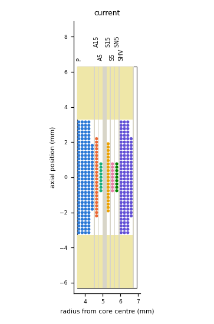

# Auxiliary flyback TR1 – cross regulation and an improved winding

Board tube_power_5_1, sheet 1: PWM2 (IW1818, primary-side regulated quasi-resonant
flyback, integrated 800 V BJT) with TR1 (EF20, 10-pin vertical bobbin). This is a design
study for the next rewind / board revision. **The schematic, symbols, footprint and board
are not changed.** Status 2026-11-16.

Net names: this document uses the KiCad names after commit 46a60f9: **15V** (Proteus `20V`)
and **15V_ISO_SEC** (Proteus `20V_ISO_SEC`); both are 15 V gate-drive rails (user). The
scripts still label them `20V` / `20V_ISO_SEC` / `S15` internally (`flyback_sim.RAILS`).

## Summary

**TODO / in progress – the study was stopped part-way (2026-11-16); see [NEXT.md](NEXT.md).**
Results so far (OpenMagnetics leakage, ngspice rail voltages; full tables in
[results.md](results.md)):

- **Current V2 build** (separate windings on top of each other, 3 mm margins): leakage
  referred to the 52 T primary is 24–52 µH from the primary to the isolated windings
  (5–11 % of Lp) and 20–43 µH between the feedback winding A5 and the isolated windings.
  The 3-turn windings, bunched in 1.7 mm of the 6.6 mm margin-limited width, couple worst.
- Over 15 load cases at 400 V the isolated 5 V / −5 V rails stay within 4.85–5.36 V and
  −80 V within 77.9–81.1 V, but **the primary-side 15V rail rises to 20.6 V when only the
  IW1818 Vcc (5 mA assumed) loads it, above the 18.7 V AUX_MEAS ADC limit**, and the 5V rail
  peak-charges to 6.1–6.5 V unloaded. **15V_ISO_SEC sits at 12.6–14.4 V** (7 T), not 15 V.
- **Triple-insulated wire on the isolated windings (no margin tape)** roughly halves the
  primary–secondary leakage and cuts A5–secondary leakage 3–10× (tiw_simple); 15V max
  drops to 17.1 V (within the limit), all isolated rails within ±0.3 V over the load cases
  except light load.
- Tapping (AC-stacking) the windings with the current build (stacked) also brings 15V
  below 18.7 V (17.95 V) but makes −5V worse at its own min load (5.59 V).
- The split-primary sandwich with a trifilar A5/S5/SN5 layer (tiw_sandwich) is only
  partly simulated (6 of 15 cases) and its A5–S5 leakage from MKF (15.8 µH) is
  suspiciously higher than tiw_simple's (11.1 µH); MKF's field-grid resolution for
  windings sharing one layer has to be checked before this option is trusted.
- **No recommendation is made yet.** Leading candidate: TIW secondaries without margins
  (tiw_simple or the sandwich once checked), isolated 15 V winding 8 T, plus preloads on
  15V / 5V if the light-load peak charging stays high (options `recommended`,
  `recommended_pre` are defined but not simulated).

## 1. The current transformer (V2, confirmed wound)

PDF sheet 1 notes: "V1 : 67/9/4/54", "V2 : 52/8/3||7/3/3/42", "V3 : 58/9/4/47",
"TR1 : core 171nh", "R64 = 39k/ v2 trans", "Vpeak = 640V with V2 design". V1 and V3 list
primary / 15 V / 5 V / 80 V turns only. The user confirmed that **V2 (52 T primary) is
wound** and that **every secondary is a separate winding** (none stacked). Mapping used
(checked against the pinout and the rail voltages):

| turns | winding | pins (start → finish) | rectifier → rail | volts at the knee (1.86 V/T) |
|---|---|---|---|---|
| 52 | primary P | 4 (DC+) → 5 (collector, IW1818 C) | – | Vor = 96.7 V |
| 8 | A15, primary-side gate | 2 (GND) → 1 | D5 → **15V** (Proteus 20V) | 14.9 V − Vf |
| 3 | A5, primary-side 5 V + feedback | 2 → 3 (= AUX_FB) | D6 → 5V | 5.58 V (regulated) |
| ‖ | isolation barrier: 4 layers of tape | | | |
| 7 | S15, isolated gate | 9 (ISO_GND) → 10 | D4 → **15V_ISO_SEC** | 13.0 V − Vf |
| 3 | S5 | 9 → 7 | D29 → 5V_ISOL | 5.58 V − Vf |
| 3 | SN5 | 8 → 9 (dot at 8) | D14 (cathode at 8) → −5V_SEC | −(5.58 V − Vf) |
| 42 | SHV | 6 → 9 (dot at 6) | D8 (cathode at 6) → −100V BIAS (−80V OUT) | −(78.1 V − Vf) |

- "||" is read as the barrier between the primary-side and the isolated windings, and the
  list as the winding order from the bobbin outwards (assumed; the order is not documented).
- 5.58 V at the aux winding knee follows from the Vsense divider (R64 39k ‖ R81 15k over
  R84 33k ‖ R85 4.7k = 0.2753) and Vsense = 1.536 V. The PDF note "Vsense @ 1.536V =
  5.8368Vaux" does not match the fitted divider (it needs a 11.5 kΩ upper leg); it probably
  predates "R64 = 39k / v2 trans".
- The isolated 15 V winding has 7 T, one less than the primary-side one, so
  **15V_ISO_SEC sits at ≈ 12.7 V, not 15 V** (simulated, nominal load).
- Build (design doc ch. 2.1, user): 3 × AWG34 in parallel on every winding, 3 mm margin
  tape on both sides (6 mm creepage), windings on top of each other, 4 layers of tape
  between primary and secondary side; one tape layer between the other windings (assumed).
- Gap: fitted so that the primary self-inductance is 171 nH × 52² = **462 µH**
  ("TR1 : core 171nh" read as the AL of the gapped core; 0.319 mm in the centre leg in
  MKF's model). The design doc's table 2.1 (Lp 614 µH, AL 175 nH, 52 T) is inconsistent
  with itself (175 nH × 52² = 473 µH); the PDF note is used.



## 2. Method

**OpenMagnetics** (PyOpenMagnetics 1.7.41 = MKF, `pip install --user PyOpenMagnetics`;
PyMKF was not needed):

- Works: the core / material / bobbin / wire databases (EF20 = "E 20/10/6", Norwe
  09987-106 bobbin whose 3.81 mm pitch and 10.16 mm row distance match the board footprint,
  AWG enamel grades, Rubadue TCA3 triple-insulated wire), the inductance matrix
  (`calculate_inductance_matrix`, energy method on the winding-window field, consistent with
  `calculate_leakage_inductance`: L′ii + L′jj − 2L′ij equals the pairwise leakage to 0.1 %),
  DC resistance per winding, winding losses (Dowell / Ferreira, from the simulated current
  waveforms), core losses (iGSE / Steinmetz / Roshen), and the insulation coordination
  (`calculate_insulation`, IEC 62368-1 / 61558-1 / 60664-1; reinforced, PD2, OVC II:
  creepage 3.2–4.4 mm, clearance 1 mm, 0.4 mm DTI or 3-layer wire, 4 kV withstand).
- Does not do (1.7.41): `wind()` ignores per-intersection tape thickness
  (`set_intersection_insulation` has no effect), splits the radial height by its
  `proportion` argument instead of by the layers needed, and cannot wind two windings in one
  layer (bifilar/trifilar). `om_model.py` therefore places sections, layers and turns itself
  in MKF's own JSON format and leaves all electromagnetics to MKF. Check against `wind()` for
  a case it can wind (52 T / 42 T, 3 mm margins): 21.9 µH vs 22.2 µH leakage (1.3 %).
  MKF's thermal model rejects the hand-placed coil (a flange check), so core losses use a
  plain one-winding coil (core losses depend only on the flux). `design_magnetics_from_converter`
  (the adviser) was not used: the turns, core and footprint are fixed here.
- Core losses are uncertain: for the same flux (Bpk 0.135 T, ΔB/2 0.093 T at 72 kHz, N87
  assumed) MKF gives 1.46 W (iGSE), 0.84 W (Steinmetz) and 0.11 W (Roshen). They are the
  same for every option (same Lp, Ipk, f) and do not decide anything here; measure the core
  temperature on the bench.

**ngspice transient** (`flyback_sim.py`): every winding (or winding section) is an L with
MKF's self-inductance and all pairs are coupled with K = M/√(LiLj) from MKF's matrix, plus
MKF's DC resistance. DC+ = 400 V (design doc), switch + 1.245 Ω sense, 30 pF collector
node (assumed), RCD snubber D7 S1M / R72 100R / R45 1M ‖ C12 470p, ES1-class rectifiers,
schematic output capacitors, 12.1k bleeders, loads as constant-current sinks, IW1818 Vcc
5 mA on 15V (assumed). The IW1818 is modelled behaviourally: the AUX_FB divider is sampled
at the knee (when the magnetising ampere-turns reach zero) and regulated to 1.536 V by a
PI controller; PWM at 72 kHz with Ipk ∝ √u above u = 0.12, PFM below (fixed 0.28 A, falling
frequency; assumed – the public product summary only says "adaptive multi-mode PWM/PFM").
Details and all assumptions: docstring of `flyback_sim.py`. Bulk capacitors are scaled down
(to 10 %, 3 % on rails loaded only by their bleeder) so each case settles in 9–12 ms; each
result carries its residual drift over the last 0.75 ms.

**Load cases** (A, on top of the bleeders; assumed from design doc table 1.1, maxima 0.2 A
on each 5 V / 15 V rail and −80 V 10 mA): *nom* = 0.1 A on each 5 V / 15 V rail and 3.4 mA
extra on −80 V (5.1 W out); *min_X* = rail X bleeder only, others nominal; *max_X* = rail X
at the table maximum; *light* = every rail bleeder only (+ Vcc); *nom325* = nominal at
DC+ = 325 V (PFC not running). All 400 V cases together are "the 15 load cases".

## 3. Results

See [results.md](results.md) (generated; tiw_sandwich only 6 of 15 cases) and
[crossreg.png](crossreg.png).


**TODO / in progress:** per-case discussion, the capacitor-scaling check (one run of
`current` nom with `cscale = 1`), losses per option (`losses.py`; done only for `current`
nom: winding losses 0.148 W, of which primary 0.091 W; primary RMS 0.089 A; core losses see
section 2).

## 4. Options

Defined in `options.py` (geometry PNGs `geometry_<option>.png`):

| option | build | status |
|---|---|---|
| current | P \| A15 \| A5 ‖ S15 \| S5 \| SN5 \| SHV, 3 × AWG34, 3 mm margins | 15/15 cases |
| stacked | same, tapped: 15V = A5 + 5 T, 15V_ISO = S5 + 4 T, −80 V = SN5 + 39 T (same pins) | 15/15 |
| tiw_simple | TIW (TCA3 30/32 AWG) isolated windings, no margins, AWG30 primary in 2 layers, spread low-turn windings, S5/SN5 bifilar | 15/15 |
| tiw_sandwich | TIW, no margins, P1 26 T \| S15 \| A5+S5+SN5 trifilar \| SHV \| A15 \| P2 26 T | 6/15 (stopped) |
| tiw_sandwich_stacked | tiw_sandwich with tapped windings | not run |
| margin_sandwich | enamel + 3 mm margins, split primary with two 4-layer barriers, spread strands | not run |
| recommended / recommended_pre | tiw_sandwich with S15 8 T; _pre adds what-if preloads 3.3 k on 15V, 1 k on 5V | not run |

**TODO / in progress:** isolation / fill / Bpk / losses / Vpeak check per option, pin
notes (all options keep the pinout; the sandwich needs the P1–P2 crossover sleeved across
the secondaries because all 10 pins are used).

## 5. Recommended design

**TODO / in progress** – not decided yet (see Summary and NEXT.md). The winding spec,
predicted leakage and cross-regulation improvement and `mas/tr1_recommended.json` will be
written once `recommended` has been simulated.

## 6. Other findings on sheet 1

- **Rectifier voltage ratings (schematic value ES1A = 50 V):** reverse voltage at
  DC+ = 420 V is Vout + Vin·Ns/Np: D6 / D29 / D14 (3 T) ≈ 29 V – OK; D5 (8 T) ≈ 80 V,
  D4 (7 T) ≈ 70 V, **D8 (42 T) ≈ 420 V** plus ringing – far above 50 V. Either the fitted
  parts differ from the schematic value or the value must change (e.g. ES1D 200 V for the
  15 V rails, ES1J / US1J 600 V for −80 V). Check the BOM / the board.
- **15V_ISO_SEC = 12.6–14.4 V** with the 7 T winding (target 15 V): check the Si8274 UVLO
  grade; an 8 T winding gives ≈ 15 V.
- **15V rail at light load exceeds the AUX_MEAS range** (current build, 20.6 V vs 18.7 V).
  AUX_MEAS divider R11/R12 (26.7 kΩ) loads the rail with only 0.56 mA (not modelled; the
  model assumes 5 mA Vcc).
- PDF note "Vsense @ 1.536V = 5.8368Vaux" does not match R64 = 39k (gives 5.58 V).
- Simulated collector peak 539–589 V (the PDF note says 640 V with V2); the 800 V BJT has margin.
- **TODO:** snubber dissipation and Vpeak per option.

## 7. Assumptions and their sources

| item | value | source |
|---|---|---|
| turns, wire, margins, barrier | 52/8/3‖7/3/3/42, 3 × AWG34, 3 mm, 4 tape layers | PDF note V2 (user: wound), design doc ch. 2.1, user |
| winding order | as listed in V2, primary innermost | assumption |
| tape | 0.055 mm per layer (25 µm film + adhesive), 1 layer between windings | assumption |
| Lp | 462 µH = 171 nH × 52² | PDF note "TR1 : core 171nh" |
| core material | N87 | assumption (not documented) |
| bobbin | Norwe 09987-106 (EE20 vertical 10-pin 3.81 mm) | MKF database; matches the footprint |
| Vsense regulation / OVP | 1.536 V / 1.838 V | PDF notes (same values in the iW1819 datasheet) |
| Ipk max | 0.803 A (1 V / R8 ‖ R9) | PDF note "Isense pk = 1V", schematic |
| f max, PWM/PFM | 72 kHz; PFM below u = 0.12 with 0.28 A | iW1818 product summary; PFM law assumed |
| DC+ | 400 V (325 V before the PFC runs) | design doc |
| Vcc load | 5 mA on 15V | assumption |
| AUX_MEAS | 0.176 × V(15V), limit 18.7 V | schematic R11/R12, user |
| loads | see section 2 | design doc table 1.1 (maxima), nominal = assumption |
| rectifiers | generic ES1-class model, breakdown not modelled | assumption |
| collector node | 30 pF | assumption |
| winding temperature | 60 °C for resistances / losses | assumption |

## 8. How to rerun

```
pip install --user PyOpenMagnetics            # 1.7.41 used
python3 simulation/flyback/om_model.py        # check of the hand layout against MKF wind()
python3 simulation/flyback/run_flyback.py --om-only            # magnetics of all options (~1 min)
python3 simulation/flyback/run_flyback.py                      # all options x 15 cases, one ngspice at a time
python3 simulation/flyback/run_flyback.py recommended --cases nom light
python3 simulation/flyback/run_flyback.py --report             # results.md, PNGs, out/report.md
python3 simulation/flyback/losses.py current recommended       # winding / core losses (needs the nom runs)
```

One ngspice run takes 35–70 s and ≈ 150 MB; a full option (16 runs) ≈ 13 min. Cached
results are in `out/results/` (git-ignored; delete a file to rerun that case).

| file | what |
|---|---|
| `om_model.py` | EF20 core, bobbin, hand-placed coil in MKF format, inductance matrix, leakage, Rdc, gap fit |
| `options.py` | the winding options (current, stacked, margin_sandwich, tiw_simple, tiw_sandwich, tiw_sandwich_stacked, recommended, recommended_pre) |
| `flyback_sim.py` | ngspice netlist (coupled inductors + IW1818 behavioural controller), run, parse |
| `run_flyback.py` | load cases, runs, cache, MAS JSON export |
| `losses.py` | winding / core losses from the simulated waveforms (MKF) |
| `report.py` | `results.md`, `crossreg.png`, `geometry_<option>.png`, `out/report.md` |
| `mas/tr1_current.json` | MAS document of the current build (inputs, magnetic with full turn geometry, inductance matrix); `mas/tr1_recommended.json`: TODO (written when `recommended` runs) |

