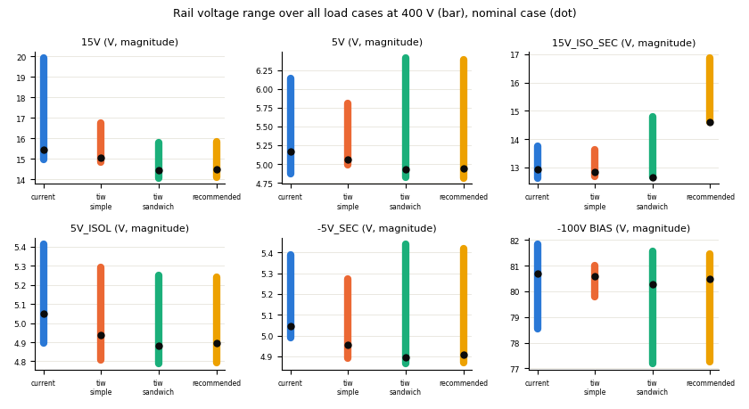

# Auxiliary flyback TR1 – cross regulation and an improved winding

Board tube_power_5_1, sheet 1: PWM2 (IW1818, primary-side regulated quasi-resonant
flyback, integrated 800 V BJT) with TR1 (EF20, 10-pin vertical bobbin). This is a design
study for the next rewind / board revision. **The schematic, symbols, footprint and board
are not changed.** Status 2026-11-16.

**2026-11-17: superseded by a new transformer on an EEL19 core – see [EEL19_DESIGN.md](EEL19_DESIGN.md).**
This EF20 study stays as reference (results reproducible).

Net names: this document uses the KiCad names after commit 46a60f9: **15V** (Proteus `20V`)
and **15V_ISO_SEC** (Proteus `20V_ISO_SEC`); both are 15 V gate-drive rails (user). The
scripts still label them `20V` / `20V_ISO_SEC` / `S15` internally (`flyback_sim.RAILS`).

## Summary

Status 2026-11-16 (session 2): model calibrated to the bench, all options simulated on the
calibrated model (15 load cases at 400 V + nominal at 325 V), recommendation made. The user has no
triple-insulated wire (TIW), so **the recommendation uses enamelled wire with 3 mm margin
tape like today's build**; the TIW options stay in the tables as reference only.

- **Calibration (2.1):** the calibrated model gives 15V = 15.95 V at board idle against the
  measured ≈ 15.5 V (+0.45 V). The first model's 20.6 V came from a different case
  (*min_15V*: isolated rails loaded, 15V nearly unloaded) and from a light-load controller
  model that limit-cycled; the AUX_MEAS divider was missing and the fixed 15V load was low.
- **Current V2 build on the calibrated model:** 15V 14.94–**19.92 V** (the 18.7 V AUX_MEAS
  limit is exceeded in *min_15V*, i.e. isolated outputs loaded while the primary gate
  drivers idle – possible, the isolated rails go off-board), 5V 4.87–6.14 V,
  **15V_ISO_SEC 12.6–13.8 V** (7 T, target 15 V), 5V_ISOL 4.89–5.41, −5V 4.99–5.39,
  −80 V 78.6–81.8 V.
- **D8 finding (section 6):** D8 sees **389–403 V reverse at DC+ = 400 V** (0.808·DC+ +
  80 V; 341 V at 325 V). A 200 V ES1D there is overstressed by 2×: fit a ≥ 600 V part
  (ES1J / US1J, same SMA footprint).
- **Recommended rewind (section 5): `margin_sandwich_8_pre`** – enamel wire, 3 mm margins,
  split primary with two 4-layer barriers: **P1 26 T ‖ S15 8 T | S5+SN5 bifilar | SHV 42 T ‖
  A5 3 T | A15 8 T | P2 26 T**, low-turn windings spread over the full 6.6 mm with parallel
  strands, plus preloads **3.3 kΩ on 15V and 1 kΩ on 5V** (accepted by the user). Same
  pinout and footprint. Predicted: 15V 14.40–15.78 V (max −4.1 V, 2.9 V below the limit),
  5V 4.85–5.22 V, **15V_ISO_SEC 14.75 V nominal** (14.75–17.07 V; the top only with the rail
  at its bleeder – an optional 3.3 kΩ preload on 15V_ISO_SEC makes it 14.78–15.87 V),
  5V_ISOL 4.88–5.36, −5V 4.97–5.53, −80 V 78.5–82.8 V. Leakage to the isolated windings
  falls from 24–52 µH to 9–10 µH; winding losses 0.139 W (0.152 W today).
- The split primary needs its P1–P2 crossover routed across both barriers in a sleeve
  (all 10 pins are used); it fits the window (2.70 of 3.40 mm radial build). If that is not
  acceptable, `stacked` (same build, tapped windings) is the no-split fallback (15V max
  17.7 V, 15V_ISO_SEC still 7 T-low).

## 1. The current transformer (V2, confirmed wound)

PDF sheet 1 notes: "V1 : 67/9/4/54", "V2 : 52/8/3||7/3/3/42", "V3 : 58/9/4/47",
"TR1 : core 171nh", "R64 = 39k/ v2 trans", "Vpeak = 640V with V2 design". V1 and V3 list
primary / 15 V / 5 V / 80 V turns only. The user confirmed that **V2 (52 T primary) is
wound** and that **every secondary is a separate winding** (none stacked). Mapping used
(checked against the pinout and the rail voltages):

| turns | winding | pins (start → finish) | rectifier → rail | volts at the knee (1.86 V/T) |
|---|---|---|---|---|
| 52 | primary P | 4 (DC+) → 5 (collector, IW1818 C) | – | Vor = 96.7 V |
| 8 | A15, primary-side gate | 2 (GND) → 1 | D5 → **15V** (Proteus 20V) | 14.9 V − Vf |
| 3 | A5, primary-side 5 V + feedback | 2 → 3 (= AUX_FB) | D6 → 5V | 5.58 V (regulated) |
| ‖ | isolation barrier: 4 layers of tape | | | |
| 7 | S15, isolated gate | 9 (ISO_GND) → 10 | D4 → **15V_ISO_SEC** | 13.0 V − Vf |
| 3 | S5 | 9 → 7 | D29 → 5V_ISOL | 5.58 V − Vf |
| 3 | SN5 | 8 → 9 (dot at 8) | D14 (cathode at 8) → −5V_SEC | −(5.58 V − Vf) |
| 42 | SHV | 6 → 9 (dot at 6) | D8 (cathode at 6) → −100V BIAS (−80V OUT) | −(78.1 V − Vf) |

- "||" is read as the barrier between the primary-side and the isolated windings, and the
  list as the winding order from the bobbin outwards (confirmed by the user 2026-11-16).
- 5.58 V at the aux winding knee follows from the Vsense divider (R64 39k ‖ R81 15k over
  R84 33k ‖ R85 4.7k = 0.2753) and Vsense = 1.536 V. The PDF note "Vsense @ 1.536V =
  5.8368Vaux" does not match the fitted divider (it needs a 11.5 kΩ upper leg); it probably
  predates "R64 = 39k / v2 trans".
- The isolated 15 V winding has 7 T, one less than the primary-side one, so
  **15V_ISO_SEC sits at ≈ 12.7 V, not 15 V** (simulated, nominal load).
- Build (design doc ch. 2.1, user): 3 × AWG34 in parallel on every winding, 3 mm margin
  tape on both sides (6 mm creepage), windings on top of each other, 4 layers of tape
  between primary and secondary side; one tape layer between the other windings (user).
- Gap: fitted so that the primary self-inductance is 171 nH × 52² = **462 µH**
  ("TR1 : core 171nh" read as the AL of the gapped core; 0.319 mm in the centre leg in
  MKF's model). The design doc's table 2.1 (Lp 614 µH, AL 175 nH, 52 T) is inconsistent
  with itself (175 nH × 52² = 473 µH); the PDF note is used.


## 2. Method

**OpenMagnetics** (PyOpenMagnetics 1.7.41 = MKF, `pip install --user PyOpenMagnetics`;
PyMKF was not needed):

- Works: the core / material / bobbin / wire databases (EF20 = "E 20/10/6", Norwe
  09987-106 bobbin whose 3.81 mm pitch and 10.16 mm row distance match the board footprint,
  AWG enamel grades, Rubadue TCA3 triple-insulated wire), the inductance matrix
  (`calculate_inductance_matrix`, energy method on the winding-window field, consistent with
  `calculate_leakage_inductance`: L′ii + L′jj − 2L′ij equals the pairwise leakage to 0.1 %),
  DC resistance per winding, winding losses (Dowell / Ferreira, from the simulated current
  waveforms), core losses (iGSE / Steinmetz / Roshen), and the insulation coordination
  (`calculate_insulation`, IEC 62368-1 / 61558-1 / 60664-1; reinforced, PD2, OVC II:
  creepage 3.2–4.4 mm, clearance 1 mm, 0.4 mm DTI or 3-layer wire, 4 kV withstand).
- Does not do (1.7.41): `wind()` ignores per-intersection tape thickness
  (`set_intersection_insulation` has no effect), splits the radial height by its
  `proportion` argument instead of by the layers needed, and cannot wind two windings in one
  layer (bifilar/trifilar). `om_model.py` therefore places sections, layers and turns itself
  in MKF's own JSON format and leaves all electromagnetics to MKF. Check against `wind()` for
  a case it can wind (52 T / 42 T, 3 mm margins): 21.9 µH vs 22.2 µH leakage (1.3 %).
  MKF's thermal model rejects the hand-placed coil (a flange check), so core losses use a
  plain one-winding coil (core losses depend only on the flux). `design_magnetics_from_converter`
  (the adviser) was not used: the turns, core and footprint are fixed here.
- Core losses are uncertain: for the same flux (Bpk 0.135 T, ΔB/2 0.093 T at 72 kHz, N87
  assumed) MKF gives 1.46 W (iGSE), 0.84 W (Steinmetz) and 0.11 W (Roshen). They are the
  same for every option (same Lp, Ipk, f) and do not decide anything here; measure the core
  temperature on the bench.

**ngspice transient** (`flyback_sim.py`): every winding (or winding section) is an L with
MKF's self-inductance and all pairs are coupled with K = M/√(LiLj) from MKF's matrix, plus
MKF's DC resistance. DC+ = 400 V (design doc), switch + 1.245 Ω sense, 30 pF collector
node (assumed), RCD snubber D7 S1M / R72 100R / R45 1M ‖ C12 470p, ES1D-class rectifiers
(200 V, user), schematic output capacitors, 12.1k bleeders, loads as constant-current sinks,
a fixed 9.5 mA on 15V (IW1818 Vcc and the Si827x supplies, see 2.1) and the AUX_MEAS
divider R11 + R12 (26.7 kΩ). The IW1818 is modelled behaviourally: the AUX_FB divider is
sampled at the knee (magnetising ampere-turns below 0.2 At, 80 ns tracking) and regulated to
1.536 V by a PI controller whose gains scale with the output power; PWM at 72 kHz with
Ipk ∝ √u above u = 0.12, then the multi-mode light-load law of the iW1819 datasheet (same
family, same 1.536 V / 1.838 V / 72 kHz): PFM (Ipk 0.28 A, f falls to 25 kHz), DPWM
(25 kHz, Ipk falls to VIPK(LOW) = 0.23 V → 0.185 A), DPFM, DDPWM (2.1 kHz floor).
Details and all assumptions: docstring of `flyback_sim.py`. Bulk capacitors are scaled down
(to 10 %, 3 % on rails loaded only by their bleeder) so each case settles in 9–40 ms; each
result carries its residual drift (difference between the two halves of the averaging
window: 1.5 ms, 5 ms for *light*, 10 ms for *idle*). The reverse voltage of every rectifier
is measured through a 50 ns RC (the model turns the switch on in ~10 ns from wherever the
DCM ring is, without valley switching or winding capacitance, so the raw peak overstates
the turn-on ringing: raw 890–940 V on D8, filtered 390–400 V).

**Load cases** (A, on top of the bleeders; assumed from design doc table 1.1, maxima 0.2 A
on each 5 V / 15 V rail and −80 V 10 mA): *nom* = 0.1 A on each 5 V / 15 V rail and 3.4 mA
extra on −80 V (5.1 W out); *min_X* = rail X bleeder only (15V: its fixed 9.5 mA + AUX_MEAS),
others nominal; *max_X* = rail X at the table maximum; *light* = every rail bleeder only;
*idle* = the board idling, the calibration point (5V 50 mA for the MCU board on J2 and the
Si827x input sides, 15V_ISO_SEC 2 mA, 5V_ISOL 5 mA, the rest bleeders; estimated);
*nom325* = nominal at DC+ = 325 V (PFC not running). All 400 V cases together are "the
15 load cases".

### 2.1 Calibration against the bench (2026-11-16)

The user measured **15V ≈ 15.5 V at light load** on the real board (V2 transformer), where
the first model had reported 20.6 V. What was wrong, in order of size:

1. **The 20.6 V was not a light-load result.** It came from *min_15V* – the 15V rail with
   only 5 mA while every other rail carries 0.1 A (Ipk 0.46 A at 72 kHz). The first model's
   *light* case was 18.0 V and had not settled (15V drifting −0.3 V per 0.75 ms).
2. **Light-load controller model.** Below u = 0.12 the first model kept Ipk at 0.28 A and
   only lowered the frequency, with a floor at 2.4 kHz (u = 0.004) and fixed PI gains. At
   light load the loop gain is ~10× higher (the rails are lightly loaded), the PI limit-cycled
   between the floor and PWM and the light case never settled. Fixed: iW1819-type multi-mode
   law (above), PI gains ∝ output power, sampling tracking 150 → 80 ns and knee threshold
   0.5 → 0.2 At (the sample had carried ~0.85 V of D6 drop at ~1 A when the 5 V rail takes
   most of a short light-load pulse).
3. **Loads on the 15V rail.** Added the AUX_MEAS divider (0.56 mA, was missing). The 5 mA
   "IW1818 Vcc" was replaced by 9.5 mA for everything the 15V rail always supplies: IW1818
   (iW1819 data: ICCQ 2.7 mA typ / 4 mA max + BJT base drive 16–50 mA during the on-time,
   ~0.5 mA average), Si8274 DRV5 VDDA (pin 16), the bootstrapped DRV5 VDDB (D19) and the
   DRV3 Si8271 output side (D11), ~1.6 mA each, IXDD609 ×3 idle ≈ 0, plus ~20 %.
4. **What sets the light-load 15V level.** The 8 T winding A15 sits between the primary
   and the 3 T feedback winding A5. During the first ~400 ns of each flyback interval, while
   the primary current transfers through the leakage to the loaded windings, A15 follows the
   primary's clamp voltage and the 5 V rectifier's drop at its peak current (5 A peak in A5
   at Ipk 0.28 A), so a 15V rail with only a few mA peak-charges to 8/3 × (5.6 V + ~0.9 V)
   + leakage spike instead of 8/3 × 5.58 V − Vf = 14.3 V. It is therefore very sensitive to
   its own load: at *idle* (5V 20 mA) the model gives 17.7 V with 6 mA, 16.1 V with 10 mA,
   15.8 V with 15 mA total on 15V (scratch runs; 5V 0.1 A instead: 16.6 V at 10 mA).
5. **ES1D rectifiers** (200 V): same forward model as before (the ES1A–D family shares it),
   breakdown not modelled by default, reverse voltage measured (D8 finding in section 6).
6. **Winding order**: confirmed by the user as modelled (primary, 8 T, 3 T, 4 tape layers,
   7 T, 3 T, 3 T, 42 T, one tape layer between windings). No change.

**Result:** the calibrated model gives **15V = 15.95 V at *idle*** (measured ≈ 15.5 V)
and 16.64 V at *light*; nominal-load results moved by < 0.1 V. The remaining
difference is within what the unknowns allow (the real idle loads on 5V and 15V, the IW1818
knee sampling, and HF damping of the leakage ringing by winding capacitance / proximity
losses, which the model does not have). **The worst case for the AUX_MEAS limit is not light
load but *min_15V* (isolated rails loaded, primary gate drivers idle): 19.92 V on the
current transformer** – possible on this board because +15V OUT / +5V OUT / −5V OUT / −80V OUT
go off-board. Measure 15V in that condition (isolated outputs loaded, DHB / PFC / heater
drivers idle) to confirm.

## 3. Results

Full tables: [results.md](results.md) (generated), per-case tables in `out/report.md`
(not committed), rail ranges in [crossreg.png](crossreg.png) (grey = TIW, not buildable).



Rail voltages, nominal and min–max over the 15 load cases at 400 V (V, magnitude):

| option | buildable | 15V (limit 18.7) | 5V | 15V_ISO_SEC (target 15) | 5V_ISOL | −5V_SEC | −80 V |
|---|---|---|---|---|---|---|---|
| current (V2) | yes | 15.44 (14.94–**19.92**) | 5.16 (4.87–6.14) | 12.94 (12.63–13.76) | 5.05 (4.89–5.41) | 5.05 (4.99–5.39) | 80.7 (78.6–81.8) |
| stacked | yes | 14.85 (14.45–17.71) | 5.08 (4.81–5.73) | 12.75 (12.39–13.61) | 5.03 (4.91–5.41) | 5.00 (4.94–5.62) | 80.1 (77.1–83.1) |
| margin_sandwich (7 T) | yes | 14.57 (14.47–16.08) | 4.94 (4.83–6.45) | 12.73 (12.73–15.06) | 4.92 (4.86–5.31) | 4.94 (4.94–5.53) | 80.9 (78.1–82.9) |
| margin_sandwich_8 | yes | 14.65 (14.48–16.16) | 4.97 (4.84–6.44) | 14.74 (14.74–17.02) | 4.95 (4.88–5.31) | 4.97 (4.97–5.50) | 81.3 (78.2–82.9) |
| **margin_sandwich_8_pre (recommended)** | yes | 14.65 (14.40–15.78) | 4.96 (4.85–5.22) | 14.75 (14.75–17.07) | 4.96 (4.88–5.36) | 4.97 (4.97–5.53) | 81.3 (78.5–82.8) |
| margin_sandwich_8_pre3 (+3.3k on 15V_ISO_SEC) | yes | 14.69 (14.49–15.80) | 4.98 (4.86–5.23) | 14.78 (14.78–15.87) | 4.97 (4.88–5.30) | 4.99 (4.97–5.49) | 81.5 (78.7–82.8) |
| margin_sandwich_8b_pre (5 V pair at the barrier) | yes | 14.70 (14.41–15.77) | 4.98 (4.85–5.22) | 14.76 (14.76–16.55) | 4.97 (4.88–5.84) | 5.00 (4.97–5.94) | 81.5 (78.5–82.5) |
| margin_order_8 (one barrier, A5 next to P) | yes | 15.22 (14.95–16.65) | 5.48 (5.16–7.32) | 14.95 (14.75–15.89) | 5.00 (4.87–5.34) | 5.01 (4.95–5.32) | 81.5 (80.3–82.0) |
| margin_order_8_pre | yes | 15.22 (14.99–16.74) | 5.47 (5.15–6.81) | 14.97 (14.74–16.05) | 5.01 (4.87–5.45) | 5.02 (4.95–5.41) | 81.6 (80.9–82.5) |
| tiw_simple | no (TIW) | 15.05 (14.84–16.72) | 5.06 (4.98–5.81) | 12.84 (12.70–13.64) | 4.94 (4.81–5.29) | 4.96 (4.89–5.27) | 80.6 (79.8–81.0) |
| tiw_sandwich | no (TIW) | 14.45 (14.06–15.79) | 4.93 (4.82–6.41) | 12.64 (12.64–14.80) | 4.88 (4.79–5.25) | 4.90 (4.86–5.44) | 80.3 (77.2–81.5) |
| tiw_sandwich_stacked | no (TIW) | 14.50 (14.13–15.48) | 4.93 (4.83–6.39) | 12.63 (12.63–14.24) | 4.88 (4.79–5.25) | 4.90 (4.88–5.39) | 80.4 (77.2–81.4) |
| tiw_recommended (S15 8 T) | no (TIW) | 14.49 (14.08–15.84) | 4.95 (4.81–6.38) | 14.61 (14.61–16.86) | 4.89 (4.79–5.24) | 4.91 (4.87–5.42) | 80.5 (77.3–81.4) |
| tiw_recommended_pre | no (TIW) | 14.50 (14.13–15.47) | 4.95 (4.85–5.16) | 14.63 (14.61–16.88) | 4.90 (4.79–5.25) | 4.92 (4.87–5.42) | 80.6 (77.7–81.4) |
| sandwich_paired_b | no (TIW) | 14.71 (14.39–14.99) | 4.96 (4.82–7.13) | 14.65 (14.62–16.28) | 4.90 (4.79–5.80) | 4.91 (4.86–6.04) | 82.3 (78.8–83.2) |
| sandwich_paired_c | no (TIW) | 14.62 (14.27–14.88) | 4.97 (4.81–6.85) | 14.57 (14.51–16.16) | 4.91 (4.80–5.50) | 4.93 (4.87–5.79) | 81.4 (77.4–82.3) |
| sandwich_paired_c_pre | no (TIW) | 14.63 (14.30–14.85) | 4.97 (4.82–5.15) | 14.59 (14.51–16.16) | 4.92 (4.80–5.36) | 4.93 (4.87–5.67) | 81.5 (77.8–82.4) |

Observations:

- **The light-load excursions are peak charging.** A lightly loaded winding charges its
  capacitor to the peak of its winding voltage during the current transfer at the start of
  the flyback interval, so the excursion follows how closely the winding sits to the
  primary versus to the loaded windings. In the current build A15 sits between P and A5
  (15V up to 19.9 V); in the sandwich designs A15 lies outside A5 next to P2 and the 15V
  rail stays within 14.4–16.2 V. The same mechanism lifts 15V_ISO_SEC (next to P1 in the
  margin sandwich) to 17.1 V when it carries only its bleeder, and the 5V rail (only the
  Vsense divider as minimum load) to 6.1–7.3 V – the 1 kΩ preload removes the latter.
- **margin_order_8** (no split primary, A5 directly on the primary) regulates the
  isolated rails well but its 5V rail runs high (5.5 V nominal): A5 couples to the primary
  much better than to the loads it should represent. Not recommended.
- **Capacitor-scaling check** (`checks.py cscale`, current nom with the real capacitors,
  30 ms): 15V 15.64 / 5V 5.24 / 15V_ISO_SEC 13.08 / 5V_ISOL 5.12 / −5V 5.08 / −80 V 81.7 V
  against 15.44 / 5.16 / 12.94 / 5.05 / 5.05 / 80.7 V with the scaled capacitors: the
  scaling biases the levels by +0.03…+0.2 V (+1 V on −80 V) in the same direction for every
  option, which does not change the comparison.
- *idle* and *light* hunt slowly between the light-load modes (±0.3–0.5 V on 15V over
  10 ms); their values are 10 ms / 5 ms averages, drift in the result JSONs.

## 4. Options

Defined in `options.py` (geometry PNGs `geometry_<option>.png`; `_pre` = same winding +
preloads 3.3 kΩ on 15V, 1 kΩ on 5V; `_pre3` also 3.3 kΩ on 15V_ISO_SEC).

| option | build | buildable |
|---|---|---|
| current | P \| A15 \| A5 ‖ S15 \| S5 \| SN5 \| SHV, 3 × AWG34, 3 mm margins, windings bunched | yes (today) |
| stacked | same, tapped: 15V = A5 + 5 T, 15V_ISO = S5 + 4 T, −80 V = SN5 + 39 T (same pins) | yes |
| margin_sandwich | P1 26 T ‖ S15 7 T \| S5+SN5 \| SHV ‖ A5 \| A15 \| P2 26 T, enamel, 3 mm margins, two 4-layer barriers, spread strands | yes (split primary) |
| margin_sandwich_8 / _pre / _pre3 | margin_sandwich with S15 8 T (3 × AWG32) | yes (split primary) |
| margin_sandwich_8b_pre | P1 ‖ S5+SN5 \| S15 8 T \| SHV ‖ A5 \| A15 \| P2 | yes (split primary) |
| margin_order_8 / _pre | P \| A5 \| A15 ‖ S15 8 T \| S5+SN5 \| SHV, one barrier, spread | yes |
| tiw_simple, tiw_sandwich, tiw_sandwich_stacked, tiw_recommended(_pre) | triple-insulated wire on the isolated windings, no margins | **no** (no TIW) |
| sandwich_paired_b / _c / _c_pre | TIW, the two 15 V windings and the three 5 V windings each in one multifilar layer | **no** (no TIW) |

Losses, flux, build, rectifier stress (nominal case unless noted; results.md has all):

| option | winding losses W | Bpk nom T | radial build mm (of 3.40) | Vcol max V | R45 W | D8 V_R max V |
|---|---|---|---|---|---|---|
| current | 0.152 | 0.136 | 3.22 | 587 | 0.011 | 402 |
| stacked | 0.154 | 0.136 | 2.49 | 577 | 0.011 | 397 |
| margin_sandwich_8_pre (rec.) | 0.139 | 0.144 | 2.70 | 556 | 0.010 | 403 |
| margin_order_8_pre | 0.231 | 0.141 | 2.89 | 595 | 0.013 | 399 |
| tiw_sandwich (ref.) | 0.136 | 0.146 | 2.93 | 546 | 0.009 | 403 |

Core losses: MKF gives 0.01–0.41 W depending on the model (iGSE / Steinmetz / Roshen) and
the option, without a consistent pattern although Lp, Ipk and f are the same – not used for
the decision; Bpk 0.14 T nominal, 0.21 T at the 1 V current limit (N87 assumed). Every
option keeps the pinout and footprint (the windings keep their pins).

**Isolation.** Margin-tape options: 3 mm margins on both sides of every section give 6 mm
creepage around each barrier edge (MKF's coordination for reinforced insulation, PD2,
OVC II, 264 V mains: 3.2–4.4 mm creepage, 1 mm clearance), 4 tape layers per barrier (3
layers of a tape that passes the electric strength test are enough for reinforced
insulation in thin layers). **The split primary needs the barrier twice**
(P1 ‖ secondaries ‖ P2) and its P1–P2 crossover passes the secondary sections: it has to
run in the margin zone inside a sleeve rated for reinforced insulation (e.g. PTFE / FEP
tubing ≥ 0.3–0.4 mm wall), entering and leaving at the primary pin side, since all 10 pins
are used. The radial build (2.70 mm of 3.40 mm) leaves room for that.

## 5. Recommended design

**`margin_sandwich_8_pre`** – buildable with enamelled wire and margin tape, same bobbin
(Norwe 09987-106 EF20 10-pin), same core and gap (AL 171 nH, Lp 462 µH; gap 0.309 mm in
MKF's model), same pinout. MAS document: [mas/tr1_recommended.json](mas/tr1_recommended.json)
(option `recommended` in options.py writes it).

Winding spec, from the bobbin outwards (all sections: 3 mm margin tape both sides, i.e.
6.6 mm winding width; tape 0.055 mm per layer; all windings same direction, start at the
pin listed first):

| # | winding | turns | wire | layers | pins | notes |
|---|---|---|---|---|---|---|
| 1 | P1 (primary half 1) | 26 | 1 × AWG32 heavy | 1 | 4 (DC+, start) → crossover | close-wound |
| – | barrier | | 4 layers tape | | | reinforced |
| 2 | S15 → 15V_ISO_SEC | **8** | 3 × AWG32 heavy in parallel | 1 | 9 → 10 | strands side by side, spread over the width |
| – | tape | | 1 layer | | | |
| 3 | S5 + SN5 (5V_ISOL, −5V_SEC) | 3 + 3 | 3 × AWG30 each, bifilar (strands alternate S5/SN5) | 1 | S5 9 → 7, SN5 8 → 9 | spread over the width |
| – | tape | | 1 layer | | | |
| 4 | SHV → −80 V | 42 | 1 × AWG34 heavy | 2 | 6 → 9 | spread |
| – | barrier | | 4 layers tape | | | reinforced |
| 5 | A5 (5V + AUX_FB) | 3 | 6 × AWG30 in parallel | 1 | 2 → 3 | spread |
| – | tape | | 1 layer | | | |
| 6 | A15 → 15V | 8 | 2 × AWG30 in parallel | 1 | 2 → 1 | spread |
| – | tape | | 1 layer | | | |
| 7 | P2 (primary half 2) | 26 | 1 × AWG32 heavy | 1 | crossover → 5 (collector) | P1 + P2 in series aiding |
| – | outer wrap | | 1 layer tape (more as needed) | | | |

Plus on the board (user accepted): **preload 3.3 kΩ on 15V** (68 mW at 15 V, 0805/1206) and
**1 kΩ on 5V** (25 mW). Optional (not yet agreed): 3.3 kΩ more on 15V_ISO_SEC (or R124
12.1 kΩ → 2.7 kΩ, 83 mW) – keeps 15V_ISO_SEC within 14.78–15.87 V instead of 14.75–17.07 V.

Predicted (MKF leakage referred to 52 T: P–isolated windings 9.3–10.4 µH, A5–S15 19 µH,
A5–S5/SN5 15 µH, A5–SHV 9.4 µH; current build 24–52 µH and 20–43 µH):

| rail | current build, nominal (range) | recommended, nominal (range) |
|---|---|---|
| 15V (limit 18.7 V) | 15.44 (14.94–19.92) | 14.65 (14.40–15.78) |
| 5V | 5.16 (4.87–6.14) | 4.96 (4.85–5.22) |
| 15V_ISO_SEC | 12.94 (12.63–13.76) | 14.75 (14.75–17.07); with the optional preload 14.78 (14.78–15.87) |
| 5V_ISOL | 5.05 (4.89–5.41) | 4.96 (4.88–5.36) |
| −5V_SEC | 5.05 (4.99–5.39) | 4.97 (4.97–5.53) |
| −80 V | 80.7 (78.6–81.8) | 81.3 (78.5–82.8) |
| collector peak | 587 V | 556 V |
| winding losses (nom) | 0.152 W | 0.139 W |

15V spread 4.98 → 1.37 V, 5V 1.27 → 0.37 V; 15V_ISO_SEC moves to its 15 V target. The
idle 15V reading should drop from ≈ 15.5 V (measured) to ≈ 14.3 V (model offset −0.45 V
applied to 14.64 V). Build notes: wind each low-turn layer with its strands side by side
across the full width (not bunched); keep the margins exactly 3 mm; the crossover sleeve
goes in the margin zone at the pin-row side of the primary.

## 6. Other findings on sheet 1

- **D8 (−100V BIAS) is overstressed – design finding.** The fitted rectifiers are the 200 V
  versions of ES1A (ES1D class, user). D8 blocks while the switch is on: the 42 T winding
  (pin 6 dot, D8 cathode at pin 6) then sits at +Vin × 42/52 against ISO_GND while the
  anode is at −80 V, so **V_R(D8) = 0.808 × DC+ + 80 V + Vf** – 403 V at DC+ = 400 V
  (simulated 389–403 V over all load cases and options, 50 ns filtered), 419 V at 420 V and
  still 341 V at 325 V before the PFC runs. A 200 V part would only be within its rating
  below DC+ ≈ 150 V. The polarity is checked against the schematic (dots at pins 2, 4, 6, 8,
  9): the −80 V rail can only be made in the flyback interval, so no winding arrangement
  avoids this reverse voltage. On top comes the ringing at switch-on (the model's hard
  turn-on gives raw spikes to ~940 V; with the IW1818's valley switching the real spike is
  smaller, but measure it). **D8 needs a ≥ 600 V part** (ES1J / US1J / RS1J, SMA, same
  footprint; 1000 V US1M / RS1M for margin against the turn-on ringing). If a 200 V ES1D is
  really fitted at D8 it is driven into reverse breakdown every cycle at ~2× its rating
  (ngspice cannot follow a 200 V breakdown there – `checks.py d8bv200` stops with "timestep
  too small"); check the part on the board. D4 / D5 (7–8 T) see 67–81 V and D6 / D14 / D29
  (3 T) 28–30 V: ES1D (200 V) is fine there.
- **15V_ISO_SEC = 12.6–13.8 V** with today's 7 T winding (target 15 V): check the Si8274
  VDDB UVLO grade; 8 T gives ≈ 14.7–14.8 V.
- **15V and the AUX_MEAS range:** the current build exceeds 18.7 V only in *min_15V*
  (19.9 V; isolated outputs loaded, primary gate drivers idle); at idle it is ≈ 16 V in the
  model, 15.5 V measured.
- **Light-load 5V regulation:** at board idle the model has the 5V rail at 4.66–4.87 V
  (the IW1818 knee sample carries some of D6's drop when the 5 V rail takes most of a short
  pulse). Measure 5V at idle to check.
- PDF note "Vsense @ 1.536V = 5.8368Vaux" does not match R64 = 39k (gives 5.58 V).
- Collector peak 546–595 V over all options and cases (PDF note: 640 V with V2), snubber
  R45 9–13 mW: the 800 V BJT and the RCD snubber have margin.

## 7. Assumptions and their sources

| item | value | source |
|---|---|---|
| turns, wire, margins, barrier | 52/8/3‖7/3/3/42, 3 × AWG34, 3 mm, 4 tape layers | PDF note V2 (user: wound), design doc ch. 2.1, user |
| winding order | P, 8 T, 3 T, 4 tape layers, 7 T, 3 T, 3 T, 42 T, 1 tape layer between windings | user (confirmed 2026-11-16) |
| tape | 0.055 mm per layer (25 µm film + adhesive), 1 layer between windings | assumption |
| Lp | 462 µH = 171 nH × 52² | PDF note "TR1 : core 171nh" |
| core material | N87 | assumption (not documented) |
| bobbin | Norwe 09987-106 (EE20 vertical 10-pin 3.81 mm) | MKF database; matches the footprint |
| Vsense regulation / OVP | 1.536 V / 1.838 V | PDF notes (same values in the iW1819 datasheet) |
| Ipk max | 0.803 A (1 V / R8 ‖ R9) | PDF note "Isense pk = 1V", schematic |
| f max, light-load modes | 72 kHz; PFM below u = 0.12 (0.28 A) → DPWM 25 kHz → Ipk min 0.185 A (VIPK(LOW) 0.23 V) → DDPWM 2.1 kHz | iW1818 summary, iW1819 datasheet (same family); u = 0.12 assumed |
| DC+ | 400 V (325 V before the PFC runs) | design doc |
| fixed 15V load | 9.5 mA (IW1818 + Si827x supplies) + AUX_MEAS 26.7 kΩ | estimate (iW1819 ICCQ 2.7 mA, base drive, Si827x ~1.6 mA each); calibrated: idle 15.95 V vs 15.5 V measured |
| AUX_MEAS | 0.176 × V(15V), limit 18.7 V | schematic R11/R12, user |
| loads | see section 2; *idle* loads estimated (5V 50 mA MCU board) | design doc table 1.1 (maxima), nominal / idle = assumption |
| rectifiers | ES1D class (200 V fitted, user); breakdown not modelled, reverse voltage measured | user, ES1A–D datasheet class |
| collector node | 30 pF | assumption |
| winding temperature | 60 °C for resistances / losses | assumption |

## 8. How to rerun

```
pip install --user PyOpenMagnetics            # 1.7.41 used
python3 simulation/flyback/om_model.py        # check of the hand layout against MKF wind()
python3 simulation/flyback/run_flyback.py --om-only            # magnetics of all options (~1 min each for the sandwiches)
python3 simulation/flyback/run_flyback.py margin_sandwich_8_pre --jobs 8   # 16 cases in a pool of 8 ngspice runs
python3 simulation/flyback/run_flyback.py margin_sandwich_8_pre --cases nom idle
python3 simulation/flyback/run_flyback.py --report current stacked margin_sandwich_8_pre ...   # results.md, PNGs, out/report.md
python3 simulation/flyback/losses.py current margin_sandwich_8_pre   # winding / core losses (needs the nom runs)
python3 simulation/flyback/checks.py cscale                     # capacitor-scaling check
```

One ngspice run takes 40–180 s (idle 10 ms window) and 40–260 MB. The pool runs up to
`--jobs` (default 8) at once within a 3 GB ngspice memory budget (measured from /proc):
96 cases (6 options) took 747 s with a peak of 2.1 GB; one option (16 cases) ≈ 4–6 min.
Cached results are in `out/results/` (git-ignored; delete a file to rerun that case).

| file | what |
|---|---|
| `om_model.py` | EF20 core, bobbin, hand-placed coil in MKF format, inductance matrix, leakage, Rdc, gap fit |
| `options.py` | the winding options (section 4); `recommended` = margin_sandwich_8_pre, writes the MAS file |
| `flyback_sim.py` | ngspice netlist (coupled inductors + IW1818 behavioural controller), run, parse |
| `run_flyback.py` | load cases, parallel runs (pool), cache, MAS JSON export |
| `losses.py` | winding / core losses from the simulated waveforms (MKF) |
| `report.py` | `results.md`, `crossreg.png`, `geometry_<option>.png`, `out/report.md` |
| `mas/tr1_current.json`, `mas/tr1_recommended.json` | MAS documents of the current build and of the recommended margin-tape design (inputs, magnetic with full turn geometry, inductance matrix); written by `run_flyback.py --om-only current recommended` |
| `checks.py` | single-run checks: capacitor scaling (`cscale`), D8 breakdown (`d8bv200`, does not converge) |

